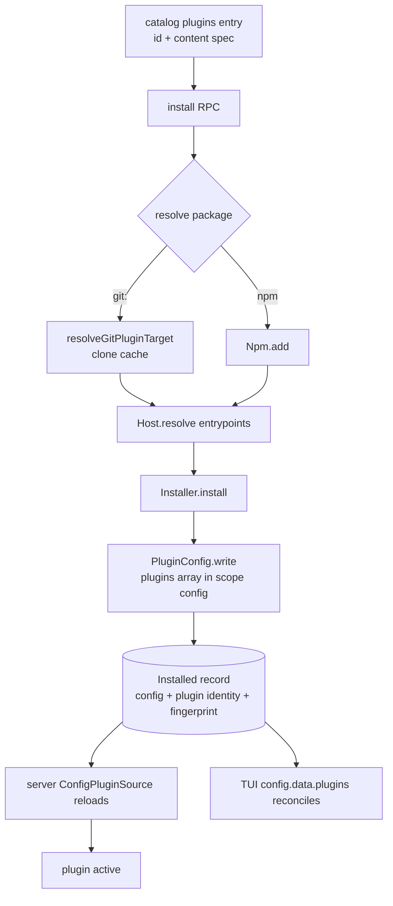

# Part 3: Marketplace plugin kind

Implementation plan for **phase 3 (PRs 7–8)** of `migration-tracking/plans/mcp-marketplace.md`, the follow-up to
PR #16027 (phase 2, `git:` plugin sources).

## Goal

The Kilo marketplace installs plugins exactly like agents, skills and MCP servers: list, install per scope,
status, uninstall, with ownership recorded in the server database. A plugin is written as one spec in the
scope's native `plugins` array and the running plugin loaders pick it up. No new RPC, no new endpoint.

Exit criteria (copied from the master plan):

1. `list({kind:"plugin"})` returns the Kilo catalog's `plugins` entries.
2. A `plugin` `Installed` record stores the owning spec, the config file and a fingerprint, so uninstall removes
   only the owned entry and refuses an entry the user edited.
3. `Installed.config` and a `{plugin}` resource describe the installation.
4. The TUI marketplace has a Plugins tab and VS Code lists plugin items with their warning.
5. Map cells close: `bun script/upstream/progress.ts --list marketplace` reports none open.

## Decisions

- **Install-time resolution (v1 parity, chosen by the user).** The install RPC resolves the package before
  writing config: `git:` specs through `PluginGitSource.resolveGitPluginTarget` (clone into the cache), npm
  specs through `Npm.add`, and both are checked with `Host.resolve` for a server or GUI entrypoint. A package
  that cannot be resolved fails the install and never reaches the config. This differs from the master plan's
  "let the loader install on reload" recommendation; record the change in that plan when updating phase 3.
- **No `id === pluginIdentity(spec)` rule.** v1 required it because installed state was keyed by the identity.
  v2 keys the durable record by catalog `(registry, kind, id, scope)` and stores the identity in the resource,
  so a catalog id that differs from the package identity stays installable and removable. `pluginIdentity` must
  still resolve, because removal finds the config entry by it.
- **Drop v1's server/TUI config split.** v2 has one native config per scope; the server reads `plugins`
  through `ConfigPluginSource` and the TUI reads the same merged config (`packages/tui/src/plugin/context.tsx`
  line 306). One entry covers both.
- **Reuse `Installed.config`.** It now means "the native config file this installation wrote", for MCP and
  plugins. Update the schema comment instead of adding a field.
- **One queue per config file.** MCP's and the new plugin writer must serialize on the same canonical file, or
  two concurrent installs can lose one writer's edit. Extract the shared file plumbing from `mcp.ts` instead of
  duplicating it.
- **No feature flag.** This is a parity port of shipped v1 behavior, opt-in per install, and it changes no
  existing kind. Say so in the PR body.
- **Placement.** Everything is Kilo-owned: `packages/kilo-plugin/src/marketplace/*`,
  `packages/schema/src/kilocode/marketplace.ts`, `packages/tui/src/kilocode/marketplace.tsx`,
  `packages/kilo-vscode/**`, plus one host registration change for the `Npm` requirement. No shared upstream
  file, no `kilocode_change` marker, no `shared-patches.json` entry.

## Data flow



## Tasks

### PR 7 — server: schema, config writer, installer, RPC

**1. Schema** — `packages/schema/src/kilocode/marketplace.ts`

- `Kind` becomes `["skill","mcp","agent","plugin"]`.
- `Item` gains `plugin: optional(Schema.Struct({ spec: Schema.String }))`.
- `Resource` union gains `Schema.Struct({ plugin: Schema.String, fingerprints: optional(Schema.Array(Schema.String)) })`.
- `Installed.config` doc: "Native config file relative to the scope root: an MCP server entry or the `plugins`
  entry this install owns. Kept scope-relative so a record survives moving the project."
- No generated client: the RPC definition is consumed directly by the TUI, VS Code and the CLI test via
  `client.rpc(...)`; `bun run generate` in `packages/client` is not needed.

**2. Shared config plumbing** — new `packages/kilo-plugin/src/marketplace/config.ts`

Move out of `mcp.ts`, unchanged in behavior:

- `resolveFile(file)` — canonical file through symlinks.
- `configFile(directory, global)` — first existing `KiloConfigFiles.writeCandidates` entry, else
  `KiloConfigFiles.newFile`; rejects a project target that resolves outside the native candidates.
- `serialized(file, task)` — the single canonical-file queue (keep MCP's existing implementation; do not add a
  second queue from `queue.ts`, whose canonicalization does not follow a symlinked file).
- `readText(file)` (`ENOENT` → `"{}"`), `parseConfig(text, file)` with a `ConfigError`, and `save(...)`.
- `fingerprintValue(value)` — canonical JSON hash; `Mcp.serverFingerprint` delegates to it.
- `ConfigError` with `reason: "invalid_params" | "conflict"`.

`mcp.ts` imports these and keeps re-exporting `configFile` and `resolveFile` so `index.ts` and existing tests
keep their imports. Replace `mcp.ts`'s private queue and `serverFingerprint` body.

**3. Identity** — new `packages/kilo-plugin/src/marketplace/plugin-spec.ts` (ports v1 `plugin-spec.ts`)

```ts
export function pluginIdentity(value: unknown): string | undefined
```

- string → `identity(spec)`; array with a string first element → identity of it (v1 tuple); object with a string
  `package` → identity of that (v2 `ConfigPlugin.Entry`).
- `identity`: trim, empty → `undefined`; `PluginGitSource.isGitPluginSpec` → `gitPluginIdentity`; `file://`,
  absolute and relative path values → the value itself (so a hand-written local plugin still de-duplicates);
  otherwise `npm-package-arg`'s `name`, falling back to the trimmed spec when npa cannot parse it (v1 parity).
- Add `npm-package-arg` `13.0.2` and `@types/npm-package-arg` `6.1.4` to
  `packages/kilo-plugin/package.json` (same versions as `packages/util`), then `bun install` to update the
  lockfile. Do not add a helper to `packages/util/src/npm.ts`.

**4. Plugin config writer** — new `packages/kilo-plugin/src/marketplace/plugin-config.ts` (ports v1
`plugin-config.ts`; v2 shape is `plugins: [string | {package, options}]`)

```ts
export class PluginConfigError extends Error { reason: "invalid_params" | "conflict" }
export function entryFingerprint(value: unknown): string // Config.fingerprintValue
export async function fingerprint(file: string, identity: string): Promise<string | undefined>
export async function preflight(input: { file: string; identity: string; fingerprints?: readonly string[] }): Promise<void>
export async function write(input: { file: string; spec: string; identity: string; replace: boolean; fingerprints?: readonly string[] }): Promise<void>
export async function remove(input: { file: string; identity: string; fingerprints?: readonly string[] }): Promise<void>
```

- Every entry runs under `Config.serialized(file)`; parse the JSONC text once and only `applyEdits` back.
- An entry matches when `pluginIdentity(entry) === identity`. `{package, options}` entries are matched the same
  way.
- Ownership: every matched entry's `entryFingerprint` must be in `accepted` (owned from the previous record plus
  the value this install writes); otherwise `PluginConfigError("conflict", "Plugin entry <id> in <file> is modified or not owned by this install")`.
- `write`: no match → append with `modify(text, ["plugins", list.length], spec, { isArrayInsertion: true })`, or
  create the `plugins` array when absent. A match with `replace: false`, or the first match already equal to
  `spec` with no extra matches → no-op. Otherwise set the first match to `spec` and delete the remaining
  matches from the highest index down. Removing individual indices, not rewriting the array, keeps comments in
  the other entries.
- `remove`: delete every match, highest index first; no match → no-op; then report the write.
- `fingerprint`: no match → `undefined`; one match → its value hash; several matches → the hash of the sorted
  match values, so duplicates never read as a single owned entry.
- Invalid JSON, or `plugins` present and not an array → `PluginConfigError("invalid_params", "<file> is not valid JSON; fix it first")`, matching MCP's message style.
- `preflight` = parse + ownership check, no write.

**5. Catalog** — `packages/kilo-plugin/src/marketplace/kilo.ts`

- `paths` gains `plugin: "plugins"`.
- `normalize`: for `kind === "plugin"` require `content` to be a non-empty string (trim it) and set
  `plugin: { spec }`; skip the entry otherwise, like a skill without an archive. `options: []`, no payloads, no
  archive.

**6. Package resolution** — new `packages/kilo-plugin/src/marketplace/plugin-package.ts`

```ts
export class PluginPackageError extends Error { reason: "invalid_params" | "fetch_failed" }
export const resolve = (input: { spec: string; npm: Npm.Interface }): Effect.Effect<{ directory: string }, PluginPackageError>
```

- `git:` spec: `PluginGitSource.parseGitPluginSpec` must accept it (`invalid_spec` → `invalid_params`), then
  `resolveGitPluginTarget(spec)`; map `invalid_spec`/`subpath_missing` to `invalid_params` and
  `clone_failed`/`not_cached` to `fetch_failed`.
- otherwise: `Npm.isInstallablePackage(spec)` false → `invalid_params` ("a plugin target must be an npm registry
  package or a Git package specifier", the wording `plugin add` uses), then `npm.add(spec)`; an
  `InstallFailedError` becomes `fetch_failed`.
- `Host.resolve` the resolved directory (with `name` for npm) and require `server` or `gui`, else
  `invalid_params` ("<spec> does not expose a server or GUI entrypoint"). The server loader (`PluginModule.load`)
  only accepts those, and v2 has one config shared by the server and the TUI, so a TUI-only spec would make every
  location report a failed plugin. v1 took `server` or `tui` because it kept a separate TUI plugin list; that is a
  deliberate v1 delta.
  Wrap the sync resolve so a malformed manifest is a `fetch_failed`/`invalid_params` error, not a defect.

**7. Installer** — `packages/kilo-plugin/src/marketplace/installer.ts`

- `Failure` gains `PluginConfigError`; `Resource` gains the plugin variant
  `{ config, plugin, target?, fingerprints? }`.
- `install`: after the agent branch, the config-shaped resource is MCP **or** plugin. For a plugin require
  `item.plugin`, derive `identity = pluginIdentity(spec)` (missing → `PluginConfigError("invalid_params", ...)`)
  and build `{ config: input.config, plugin: identity, target: await Config.resolveFile(input.config), fingerprints: [PluginConfig.entryFingerprint(spec)] }`.
  The shared prior/preflight/pending loops call `PluginConfig.preflight` for `"plugin" in resource`; the write
  phase calls `PluginConfig.write({ ..., replace: true, fingerprints: accepted(config) })`. `Written.config` is
  set for plugins, `Written.server` is not. Plugins create no rollback resources (a config write is atomic).
- `preview`: reject every non-MCP kind (`kind !== "mcp"`), not just agents.
- `key`: add `["plugin", target ?? config, plugin]` before the MCP case. `same`: compare `plugin` for the
  alias-free fallback.
- `active`: build the record-level config resource only when `record.server !== undefined`, and pass plugin
  resources through from `record.resources` (matching by `plugin`, not `server`). Without this a plugin record
  would be inspected as an MCP server named after its id.
- `resourceFingerprint` / `cleanup`: plugin → `PluginConfig.fingerprint` / `PluginConfig.remove`.
- `checkTarget`: generic message ("Config target changed since installation: <file>").

**8. RPC service** — `packages/kilo-plugin/src/marketplace/index.ts`

- Require `Npm.Service`: `define<Global.Service | Scope.Scope | Npm.Service>`, `const npm = yield* Npm.Service`.
- `store`: `"plugin" in resource → { plugin: resource.plugin, fingerprints }`.
- `restore`/`owned`: plugin branch mirroring MCP — prefer the recorded config when it holds the identity, else
  `locatePlugin(scope, identity)`, canonicalize with `Config.resolveFile`, apply the same project-outside check,
  return `{ config, plugin, target?, fingerprints }`. Add `locatePlugin` next to `locate`, iterating
  `configs(scope)` with `PluginConfig.fingerprint` and returning the first unreadable candidate as `locate` does.
- `valid`: plugin resources get the config-inside check but no `safe()` id check (identities contain `/` and
  `@` and never become paths).
- `install`: resolve the config file for plugins alongside MCP:
  `input.kind === "mcp" || input.kind === "plugin" ? await configFile(...) : ...`. After `previous` is restored
  and before `Installer.install`, for plugins run `resolve({ spec: entry.item.plugin!.spec, npm })` inside
  `Effect.tryPromise` and let `PluginPackageError` propagate.
- `reason`: map `ConfigError`, `PluginConfigError` and `PluginPackageError` by their `reason`.

**9. Host registration** — `packages/kilo-cli/src/host.ts`

Add `Npm.Service` to the plugin-requirement unions (the three type argument lists) and `Npm.node` to the host
`deps`. `packages/kilo-plugin/test/marketplace-plugin.test.ts` already gets `Npm` from `PluginTestLayer`
(`packages/core/test/plugin/fixture.ts` replaces `Npm.node` with a stub), so no test layer change is needed
for the git path.

**10. Tests**

- `packages/kilo-plugin/test/marketplace-plugin-spec.test.ts` — identity for plain/scoped npm specs with and
  without versions, npm tags, `foo@npm:bar` aliases, `git:` specs with and without refs/subpaths, `file://` and
  local paths, `{package}` entries, v1 tuple entries, and unparseable values.
- `packages/kilo-plugin/test/marketplace-plugin-config.test.ts` — append, untouched JSONC comments in sibling
  entries, create the array, replace an owned version bump, collapse duplicate identities, no-op when equal,
  refusal on an unowned same-identity entry, refusal on invalid JSON, removal leaves other entries and comments,
  removal of several matches, `fingerprint` of none/one/several, and a project config that resolves outside the
  native candidates.
- `packages/kilo-plugin/test/marketplace-plugin-package.test.ts` — fake `Npm.Interface` for the npm path
  (added with `{directory, name}`, no entrypoint → `invalid_params`, add failure → `fetch_failed`) and a real
  local git repository for the `git:` path (clone, bad repo → `fetch_failed`, no entrypoint → `invalid_params`).
- `packages/kilo-plugin/test/marketplace.test.ts` — plugin catalog normalization: spec extracted, empty/non-string
  `content` skipped, `/plugins` is the only plugin request path; keep the existing "only Kilo skills and MCP
  catalog endpoints" test extended to plugins.
- `packages/kilo-plugin/test/marketplace-plugin.test.ts` — the catalog fixture answers `/plugins` with a
  `git:<local repo>` spec. Add RPC cases: install writes `plugins: [spec]` in `<project>/kilo2.json` and a record
  with `{plugin}` + `config` reads `ready`; reinstall with a changed spec replaces the entry; uninstall removes
  only the owned entry; a hand-edited spec reads `modified` and both reinstall and uninstall fail `conflict`;
  uninstall after a project move still finds the entry.
- `packages/kilo-cli/test/marketplace.test.ts` — round-trip `list → install → installed → uninstall` for
  `kind: "plugin"` through the RPC client, asserting the config file contents and the `{plugin}` resource.
- `packages/kilo-cli/test/marketplace-plugin.test.ts` (new) — end-to-end activation: a catalog item whose spec is
  `git:<local repo>` (reuse the repository fixture from `plugin-git-source.test.ts`), install through the
  marketplace RPC, then `GET /api/plugin` eventually lists that plugin active; uninstall removes it from config
  and it disappears.

### PR 8 — clients: TUI and VS Code

**11. TUI** — `packages/tui/src/kilocode/marketplace.tsx`

- `tabs` gains `{ id: "plugins", title: "Plugins" }` after MCPs; `kinds` gains `{ kind: "plugin", title: "Plugins" }`.
  `visibleKinds` already derives `plugin` from the `plugins` tab by stripping the trailing `s`.
- Placeholder: "Search agents, skills, MCPs and plugins…".
- Item details: `Spec: <item.plugin.spec>` for plugins, next to `Kind: plugin`.
- Install confirm for `kind === "plugin"`: "Plugins run code with full permissions. They can read and change
  your files, run commands, and access your credentials and network. Only install plugins you trust." plus the
  reinstall sentence the other kinds use. No auth step; the success path is the generic toast.
- `resourceLabels`: `"plugin" in resource ? [{ kind: "Plugin", id: resource.plugin }]` before the MCP fallback.
- Update `packages/tui/test/kilocode/marketplace.test.ts`: the six "Search agents, skills and MCPs" waits, the
  two tab-order arrays (add `["MCPs","Plugins"]`), the `list` kind-order assertion to
  `["agent","skill","mcp","plugin"]`, and add a plugin item to the fixture's `list` branch so the Plugins tab has
  a row. `down()` offsets before "Demo MCP" are unaffected because plugins sort last.
- Optionally extend `packages/tui/test/kilocode/marketplace.view.test.tsx` to assert the plugin row renders and
  does not change the resize listener count.

**12. VS Code**

- `packages/kilo-vscode/webview-ui/src/v2/marketplace-data.ts`: `KINDS` gains `"plugin"` (last).
- `.../components/marketplace/MarketplaceListView.tsx`: the labels map and the available-kinds list gain
  `plugin: kindLabel(language.t, "plugin")` / `"plugin"`.
- `.../components/marketplace/utils.ts`: `kindLabel` returns `language.t("marketplace.remove.type.plugin")` for
  plugins.
- `.../components/marketplace/InstallModal.tsx`: `warnings()` adds
  `marketplace.install.plugin.warning` for `item.kind === "plugin"`. The about paragraph already resolves
  `marketplace.install.about.plugin`.
- `.../components/marketplace/marketplace.css`: port the v1 badge rule
  `.marketplace-type-plugin` / `.marketplace-badge-type.marketplace-type-plugin` using the critical tokens
  (`--text-on-critical-base`, `--border-critical-base` at 14%).
- `packages/kilo-vscode/test/marketplace-data.test.ts` already iterates `KINDS`, so the new kind is covered;
  check its assertions still hold and extend the per-kind expectations if a count or order is hard-coded.

**13. Map and docs**

- `migration-tracking/progress/dispositions.json`:
  - `module:packages/opencode/src/kilocode/marketplace/plugin-spec.ts` → `ported`, note names
    `packages/kilo-plugin/src/marketplace/plugin-spec.ts` and the deliberate differences (no `id === identity`
    rule; npm identity via `npm-package-arg`, git identity via `PluginGitSource`).
  - `module:packages/opencode/src/kilocode/marketplace/plugin-config.ts` → `ported`, note names
    `packages/kilo-plugin/src/marketplace/plugin-config.ts` and the v2 `plugins` shape, one scoped config file,
    index-level edits, the shared queue, and that the v1 server/TUI config split and `targets` are gone.
  - Add `ported` dispositions for `module:packages/opencode/src/kilocode/marketplace/installer.ts` and
    `.../schema.ts` pointing at `packages/kilo-plugin/src/marketplace/installer.ts` and
    `packages/schema/src/kilocode/marketplace.ts`, with notes that ownership now lives in the database record and
    that the plugin kind is covered.
  - Leave `detection.ts` and `relevance.ts` dropped (v2 replaces detection with the durable record and has no
    relevance scoring).
- Update phase 3 in `migration-tracking/plans/mcp-marketplace.md`: mark the install-time resolution decision, add
  a `Status: implemented in PRs #…` line, and note the `id === identity` drop.

## Failure modes and edge cases

- **Unresolvable package**: the RPC fails before config, with `invalid_params` for a malformed spec and
  `fetch_failed` for a clone/install failure. The intent write happens inside `Installer.install`, so nothing is
  recorded.
- **Resolution precedes the ownership preflight** (v1 order): a conflicting reinstall may leave a warm git clone
  or an npm install behind. Harmless and idempotent; state it in the PR body.
- **Edited entry**: fingerprint mismatch → `modified` status; reinstall and uninstall refuse with `conflict`
  ("Local changes are retained").
- **Duplicate identities** in `plugins`: an owned duplicate is collapsed on write/remove; an unowned one blocks
  with `conflict` so a retry cannot produce two loaded copies.
- **Same plugin in global and project scope** with different specs: two entries load; the plugin supervisor
  reports the duplicate id as a failed plugin. Same class of user error as two MCP servers with one name; not
  detected here.
- **Config file moves** (a higher-priority candidate appears): the write goes to the resolved file, the previous
  entry becomes a `pending` resource and is cleaned after the record save. Between the write and the cleanup the
  loader can briefly see both entries; MCP has the same transient.
- **Remote server**: install resolves and installs on the server; a TUI on another machine still installs its own
  copy when it reconciles `config.data.plugins`. No marketplace guarantee of a client-side install.
- **Older build reads a plugin record**: unknown resource kinds are dropped (existing behavior); the config entry
  is left in place and the record keeps loading.

## Validation

From the repository root unless noted:

- `packages/kilo-plugin`: `bun test` and `bun typecheck`.
- `packages/schema`: `bun test`, `bun typecheck`.
- `packages/kilo-cli`: `bun test test/marketplace.test.ts test/marketplace-plugin.test.ts`, `bun typecheck`, and
  `bun run startup` because the host deps gained `Npm.node`.
- `packages/tui`: `bun test test/kilocode/marketplace.test.ts test/kilocode/marketplace.view.test.tsx`,
  `bun typecheck`.
- `packages/kilo-vscode`: `bun test test/marketplace-data.test.ts`, `bun run typecheck`.
- Root: `bun run check`.
- Map: `bun script/upstream/progress.ts --list marketplace` shows no open cell, then regenerate if the PR
  workflow asks for it.
- Manual: `bun dev` with `KILO_V2_PROFILE=$(mktemp -d)`, open `/marketplace`, Plugins tab, install a small
  catalog plugin globally and into a project, confirm `kilo2.json` (or `.kilo2/kilo2.json`) is unchanged apart
  from the new entry, `/plugins` shows it active, then uninstall and confirm the entry and the record are gone.

## Out of scope

- Plugin parameter/option forms, versions or update management. A reinstall writes the catalog's current spec; it
  is not a version bump.
- Marketplace-driven enable/disable or activation diagnostics UI; `/plugins` remains the place for failures.
- v1 `detection.ts` and `relevance.ts` behavior.
- Any change to the npm/git loader, `git:` source parsing, or the plugin supervisor.
