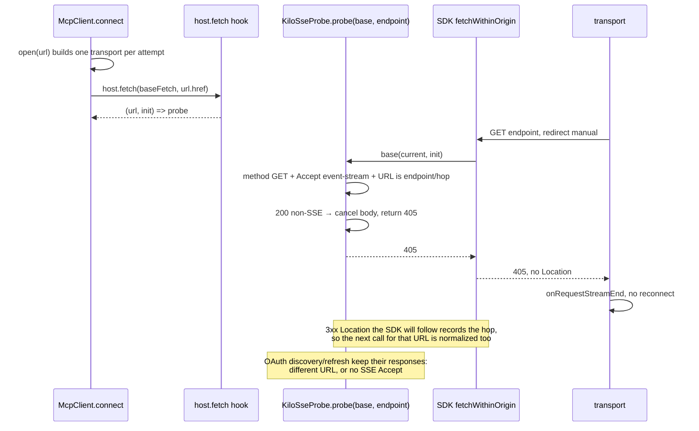

# Part 4: MCP SSE stream probe

Implementation plan for **phase 1, item 3 — PR 4 (`mcp-sse-probe`)** of
`migration-tracking/plans/mcp-marketplace.md`. It is the follow-up to PR #15986 (phase 0, MCP host
hooks) and is independent of PRs 2, 3 and 5, which are still open work.

## Goal

A remote MCP server that answers the optional `GET` stream probe with `200` and a body that is not
an event stream must be requested once, not forever. The response is normalized to `405` ("this
endpoint has no stream") before the SDK hands it to its SSE reader, which treats `405` as a clean
return.

Root cause confirmed in `@modelcontextprotocol/client@2.3.1` (`packages/core/package.json:106`):
`StreamableHTTPClientTransport._handleSseStream` parses any 2xx body as events; a body that ends
without a response calls `_scheduleReconnection(options, 0)`. Every successful `200` re-enters the
reader and reschedules at attempt 0, so `maxRetries` is never reached.

Exit criteria (copied from the master plan):

1. A `200` `GET` stream probe whose content type is not `text/event-stream` is answered as `405`
   and the transport opens the probe once.
2. Event streams, `4xx`/`5xx`, bodies without a content type, non-`GET` requests and requests
   outside the configured endpoint are untouched; OAuth discovery against the same origin keeps
   working when configured headers accept event streams.
3. The behavior is wired from the Kilo host through the existing `McpHost.Host` hook; with no host
   the upstream graph is unchanged.
4. Map: the `sse-probe` module and test cells, the `mcp` import cell and the `unattributed:mcp`
   transport cell that carry it close.

## Decisions

- **Port `probe(base, endpoint)`, not a type-only check.** v1's final shape scopes normalization to
  the configured endpoint (plus the redirect hops the SDK follows for that request) and to `GET` with an
  `Accept` that includes `text/event-stream`. That scoping is still required on v2: the transport
  also serves OAuth discovery, refresh and step-up through the same fetch
  (`_fetchWithInit = createFetchWithInit(opts.fetch, opts.requestInit)` in the SDK), and configured
  MCP headers can put `text/event-stream` in the discovery `Accept`. A wrapper without the URL check
  would rewrite discovery responses. The interactive `authorize` flow uses `loggedFetch` directly,
  but the transport's own OAuth does not.
- **Extend the hook signature: `fetch?: (fetch: FetchLike, endpoint: string) => FetchLike`.** The
  hook has no other way to learn the endpoint. This is an extension of the phase-0 seam, not a new
  mechanism; `endpoint` is a generic string with no Kilo value.
- **Apply the hook inside `open(url)`, not once per connect.** The transport dials the URL that may
  carry `?codemode=false`, and it retries at `config.url` when a server rejects the query. The probe
  must be scoped to the URL actually dialed for that attempt, so the hook runs once per transport
  attempt (also across connect retries).
- **One transport site.** v2 has no legacy SSE fallback transport; the streamable HTTP transport is
  the only remote transport. The probe is wired there once.
- **Placement.** Probe module: Kilo-owned
  `packages/core/src/kilocode/mcp/sse-probe.ts` (path matches the v1 module cell). Seam: the existing
  rung-3 lines in `packages/core/src/mcp/client.ts` and `packages/core/src/mcp/host.ts`. Host
  composition (rung 2): `packages/kilo-cli/src/host.ts`. No plugin hook reaches the MCP transport
  (recorded on those seam entries), so rung 1 cannot supply it.
- **No feature flag.** This is a defect fix that removes an unbounded request loop; it adds no
  user-visible behavior. Say so in the PR body.
- **No dispositions change.** Both cells close by file path and the two patch cells by proofs, so
  `dispositions.json` stays untouched and the generated map files are not committed.

## Data flow



## Tasks

### 1. Probe module — new `packages/core/src/kilocode/mcp/sse-probe.ts`

```ts
export * as KiloSseProbe from "./sse-probe.js"

import type { FetchLike } from "@modelcontextprotocol/client"

export const probe = (base: FetchLike, endpoint: string): FetchLike => { /* ... */ }
```

Port v1's `packages/opencode/src/kilocode/mcp/sse-probe.ts` behavior (its final state on `main`,
including the redirect and case-insensitive content-type fixes):

- Keep a `hops: Set<string>`; each call consumes `hops.delete(String(url))`.
- Run `base(url, init)` first, then pass everything through unless `String(url) === endpoint` or the
  URL is a recorded hop.
- Require `(init?.method ?? "GET").toUpperCase() === "GET"` and an `accept` value containing
  `text/event-stream` (`Headers`, header tuple array, or record; compare case-insensitively).
- On `3xx`, read `location`, resolve it against the request URL, and record it only when the SDK's
  follower would follow it (same origin, or an `http:` to `https:` upgrade on default ports); return
  the redirect untouched.
- On a non-`ok` response, return it untouched.
- On a `2xx` whose `content-type` is missing or contains `text/event-stream`, return it untouched.
- Otherwise `await response.body?.cancel()` and return `new Response(null, { status: 405 })`.

Keep v1's explanatory doc comment but describe the v2 constraint only: the SDK's stream reader
reschedules at attempt 0, the `405` the spec reserves for "no stream" returns cleanly, and the URL
check exists because the same fetch serves the transport's own OAuth requests. Do not mention v1 in
the comment.

Delta from the v1 module: `FetchLike` takes `string | URL`, never a `Request`, so drop the
`Request` header branch from `acceptsEventStream`.

### 2. Seam — `packages/core/src/mcp/host.ts` and `packages/core/src/mcp/client.ts`

- `host.ts` (Kilo-owned new file; its `// kilocode_change - new file` header covers the edit):
  change the hook to `readonly fetch?: (fetch: FetchLike, endpoint: string) => FetchLike` and update
  its doc to say it wraps the transport fetch for one attempt and that `endpoint` is the URL the
  transport dials.
- `client.ts`: remove the connect-level
  `const fetch = options.host?.fetch?.(baseFetch) ?? baseFetch` line and build the wrapper inside
  `open`:

  ```ts
  const open = Effect.fnUntraced(function* (url: URL) {
    // kilocode_change(mcp:<fetch-cell-id>) - embedding transport hook, scoped to the dialed URL
    const fetch = options.host?.fetch?.(baseFetch, url.href) ?? baseFetch
    session.transport = new StreamableHTTPClientTransport(url, { /* unchanged */ fetch })
    return yield* initialize(session.transport)
  })
  ```

  `baseFetch` stays the one `McpOAuth.loggedFetch(...)` instance, so logging still sees the server's
  real response and normalization happens outside it.
- Update the `packages/core/src/mcp/client.ts` `seam` text in `script/upstream/shared-patches.json`
  to mention the per-attempt application and the endpoint argument. Leave `rung: 3` and `host.ts`'s
  entry unchanged apart from the hook description.

### 3. Host composition — `packages/kilo-cli/src/host.ts`

- Import `KiloSseProbe` from `@opencode/core/kilocode/mcp/sse-probe`.
- Extend the existing `Mcp.configured({ ... })` `host` object:

  ```ts
  host: {
    oauth: { name: "Kilo", uri: "https://kilo.ai" },
    // A 200 that is not an event stream must not reschedule the optional GET probe forever.
    fetch: (base, endpoint) => KiloSseProbe.probe(base, endpoint), // kilo_port(mcp:<import-cell-id>)
  },
  ```

### 4. Tests — new `packages/core/test/kilocode/mcp-sse-probe.test.ts`

The file name keeps the v1 basename so the map closes the test cell by path. Port
`packages/opencode/test/kilocode/mcp-sse-probe.test.ts`, changing imports to
`@modelcontextprotocol/client` and `@opencode/core/kilocode/mcp/sse-probe`:

1. `200` `text/html` → `405`.
2. `200` `text/event-stream` passes with its header.
3. `TEXT/EVENT-STREAM; charset=utf-8` passes.
4. `POST` and a failing `GET` (`500`) pass through.
5. A `200` with no content type passes (servers that omit the header).
6. A `GET` with a non-SSE `Accept` passes.
7. A `GET` outside the endpoint passes, including with an SSE `Accept` and for a same-origin path
   such as `/oauth/metadata`.
8. With the real `StreamableHTTPClientTransport` and `reconnectionOptions` at 1 ms / `maxRetries: 2`:
   one `GET` when the probe gets a non-SSE body, and `seen` is `["/mcp", "/stream"]` and
   `["/mcp", "/hop", "/stream"]` for 307 and 307→308 chains, plus one `GET` for an `http:` endpoint
   that upgrades to `https:` on the same host.
9. `discoverOAuthProtectedResourceMetadata(endpoint, undefined, createFetchWithInit(probe(...), { headers: { Accept: "application/json, text/event-stream" } }))`
   still returns the metadata.
10. Control: the same handshake without the probe repeats the `GET` more than twice.

Replace v1's implicit-`Request` case with an explicit `string` URL input, since `FetchLike` has no
`Request` form.

Then add an end-to-end wiring test, either in the same file or
`packages/core/test/kilocode/mcp/host-hooks.test.ts` (next to the existing hook test, reusing its
`hostEnvironmentLayer` pattern):

11. `Bun.serve` on `127.0.0.1` serving POSTs through `echoMcpHandler()` (`test/fixture/mcp-echo.ts`)
    and answering the `GET` with `200 text/html`. Call `McpClient.connect` with `codemode: false`,
    `oauth: false` and
    `host: { fetch: (base, endpoint) => { seen.push(endpoint); return KiloSseProbe.probe(base, endpoint) } }`.
    Assert the connect succeeds and `seen` holds the server's `/mcp` URL. Do not assert a `GET` count
    here: the scope closes before the SDK's 1 s reconnection window, so the loop is proven by the
    1 ms cases above, not by this wiring test.

Extend the existing `host-hooks.test.ts` `fetch` case to record the `endpoint` argument and assert it
is the dialed URL.

### 5. Map and proofs

- Result of the real map: the probe is two v1 hunks of `packages/opencode/src/mcp/index.ts`.
  `patch:mcp:18028d867142` (line 36) is the `probe` import plus the cleanup import, and it is the
  cell the host wiring closes. The `fetch: probe()` hunk (line 352) is not attributed to `mcp` at all:
  the map's batched `cat-file` read loses this file's import bindings, so it sits in
  `patch:unattributed:mcp:6d0c29d2df2a`. That is the transport cell, and it is the proof the
  `client.ts` line carries.
- Both open `sse-probe` module and test cells close by path: the new
  `packages/core/src/kilocode/mcp/sse-probe.ts` and
  `packages/core/test/kilocode/mcp-sse-probe.test.ts`.
- `git add` the two new files (the map reads tracked files), then
  `bun script/upstream/progress.ts --list mcp` (23 open before, 20 after) and
  `--list unattributed:mcp` (the probe hunk must be gone). Every remaining open cell must be one of the
  MCP Apps or later-phase cells named in the master plan.
- Do not commit `migration-tracking/progress/progress.json`, `progress.svg` or `history.svg`
  (`git checkout HEAD -- $(bun script/upstream/progress.ts --outputs)`); CI regenerates them.

### 6. Master plan

In `migration-tracking/plans/mcp-marketplace.md`:

- Phase 1 item 3: add `**Status:** implemented in this worktree.` and record the deltas: the hook
  gained the endpoint argument and is applied per transport attempt, and the probe keeps the
  endpoint/`Accept` scoping because the transport's own OAuth shares the fetch in SDK 2.3.1. Note that
  v2 has one remote transport, so the v1 SSE fallback site does not exist.
- PR sequence table: put the PR number in row 4 (`mcp-sse-probe`) only if the other rows carry them;
  otherwise leave the table alone.
- Leave `dispositions.json` and the "Gap audit" table to the phase-5 closeout.

### 7. PR body

- Title: `fix(mcp): stop a non-SSE stream probe from reconnecting forever`. Branch: `mcp-sse-probe`.
- Body: what the SDK does and why `405`, the placement table

  | Change | Rung | Why not lower | Proof |
  |---|---|---|---|
  | endpoint-scoped probe wrapper | 2 (module) + 3 (seam) | no plugin hook reaches the MCP transport; `Mcp.configured` host hook is the phase-0 seam | `core/src/kilocode/mcp/sse-probe.ts`, `kilo_port(...)`/`kilocode_change(...)` |
  | host wiring | 2 | host composition supplies the hook value | `kilo-cli/src/host.ts` |

  the v1 deltas (no legacy SSE transport, no `Request` input, `oauthGuard` composition out of
  scope), the `## Progress map` section, `Flag: none`, and proof from a real run: the new test file's
  output (the regression case and the control case) plus, if available, a `bun dev` transcript of a
  remote server that answers `200 text/html` to the probe. No screenshot is needed: no UI changes.

## Failure modes and edge cases

- **Genuine empty event stream**: a server that answers `200 text/event-stream` and closes emptily
  still reconnects at attempt 0. v1 has the same gap; this PR does not widen the fix.
- **Missing content type**: left alone, as in v1, so servers that stream SSE without the header keep
  working. A `200` with no content type that is not a stream still loops; accepted trade-off.
- **Cross-origin redirect**: not recorded as a hop, so the SDK reports its existing
  "redirect not followed" error instead of the probe hiding it.
- **OAuth discovery on the same origin**: untouched because the URL differs from the endpoint; the
  regression test guards it against a future header merge.
- **Code Mode retry**: a server that rejects `?codemode=false` gets a fresh probe for the configured
  URL, because the hook runs inside `open`, so the retry is still normalized (and the first attempt's
  hops do not leak into it).
- **Connections opened by the pool/connection service**: they pass `host` through
  (`core/src/mcp/connection.ts`), so they inherit the probe without a second wiring site.
- **No host**: `options.host` unset leaves `fetch === baseFetch`; upstream tests and defaults are
  unchanged.

## Validation

From the package directories unless noted:

- `packages/core`: `bun test test/kilocode/mcp-sse-probe.test.ts test/kilocode/mcp/host-hooks.test.ts`
  and `bun typecheck`.
- `packages/kilo-cli`: `bun test test/plugin-git-source.test.ts` (host compiles and boots) and
  `bun run startup`; `bun typecheck`.
- Root: `bun run check`, `bun script/check-shared-patches.ts --worktree`,
  `bun script/check-opencode-annotations.ts --worktree`, `bun run check:architecture`.
- Map: `bun script/upstream/progress.ts --list mcp` before and after (only unrelated cells remain),
  then revert the generated outputs.
- Manual (optional but decisive): `bun dev` with `KILO_V2_PROFILE=$(mktemp -d)` against a remote
  server behind a proxy that answers the probe with an HTML page; confirm the server log shows one
  `GET`, not a repeating series, and that the server still connects and lists tools.

## Out of scope

- v1's `oauthGuard` composition and its refresh-race fixes; token refresh in v2 is native.
- The `dropped` `detection.ts`/`relevance.ts`-style marketplace items and every other MCP delta in
  the master plan.
- Any SDK patch: the normalization stays in Kilo-owned code behind the existing hook.
- MCP Apps (U-E11-05) and the `needs_auth` classification (PR 5).
