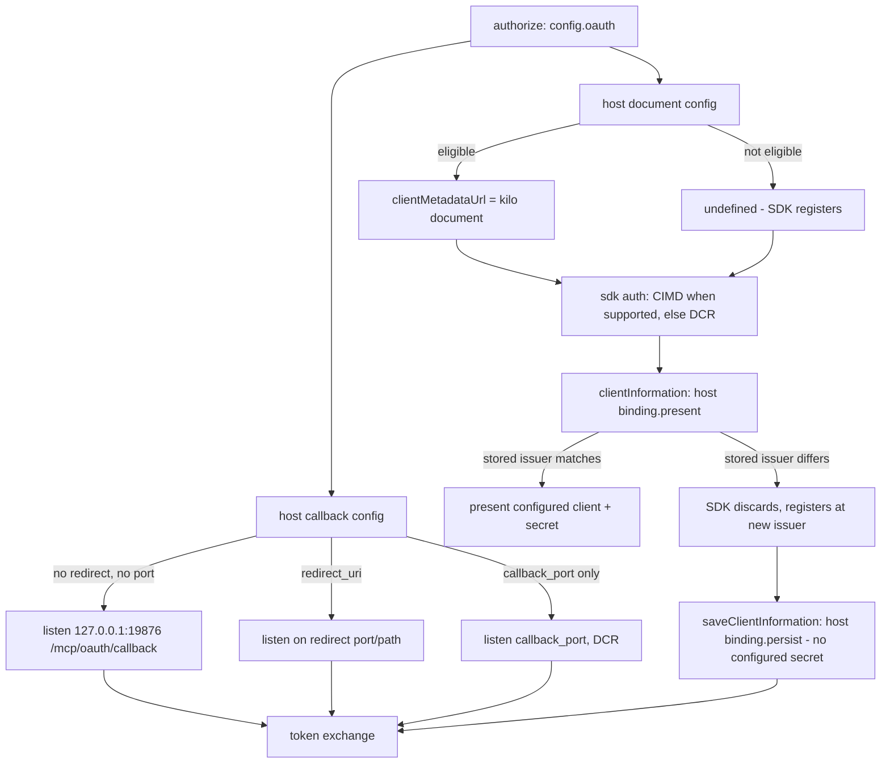

# PR 2: MCP OAuth issuer binding and CIMD

Implementation plan for **phase 1.1 (PR 2)** of `migration-tracking/plans/mcp-marketplace.md`, the follow-up to
#15986 (phase 0: the `McpHost.Host` embedding hooks). Branch `mcp-oauth-issuer`, PR title
`feat(mcp): bind OAuth clients to their issuer and present the Kilo CIMD document`.

## Goal

Two v1 behaviors return to the Kilo MCP OAuth client:

1. A pre-registered client (`oauth.client_id` / `oauth.client_secret`) is bound to the authorization server that
   first used it. When the MCP server later names a different authorization server, the SDK registers a new client
   there and the configured secret is never sent to it.
2. Kilo's own Client ID Metadata Document is the CIMD `client_id`, and the loopback callback that document lists
   (`http://127.0.0.1:19876/mcp/oauth/callback`) is the one Kilo listens on. Configurations the document cannot
   describe (a configured client, a secret, `callback_port`, a custom `redirect_uri`) never offer the document: a
   configured client presents that client with no registration, and an attempt with no configured client registers
   dynamically.

Both behaviors are supplied by the Kilo host through the hook bag from #15986, so the upstream server with no host
keeps its current behavior byte for byte.

Exit criteria:

1. A stored credential never holds the configured secret, and no request to a second authorization server carries
   it; refresh after the change goes to the new server with the client registered there.
2. An eligible attempt sends `client_id=https://kilo.ai/docs/oauth/kilo/client.json` and
   `redirect_uri=http://127.0.0.1:19876/mcp/oauth/callback` and performs no registration. An ineligible attempt
   never offers the document: a configured client registers nothing, and an attempt with no configured client
   registers dynamically.
3. `packages/core`: `bun test` and `bun typecheck` pass. Root `bun run check`, `bun run lint`,
   `bun script/check-shared-patches.ts --worktree` and `bun script/check-opencode-annotations.ts --worktree` pass.
   The upstream `packages/core/test/mcp-oauth.test.ts` suite still passes unmodified.
4. Map: `bun script/upstream/progress.ts --list mcp` drops `client-metadata.ts`, `oauth-issuer.ts`,
   `mcp-cimd.test.ts`, `mcp/oauth-issuer.test.ts` and `patch:mcp:3232794a3fe3` (23 open cells → 18).

## What v2 does today

- `packages/core/src/mcp/oauth.ts:205-211` (`provider().clientInformation` / `saveClientInformation`): a configured
  client is returned unconditionally and saved verbatim. `@modelcontextprotocol/client@2.3.1` stamps an `issuer` on
  whatever it saves and discards a credential whose stamp names another server, but the provider immediately
  re-supplies the static pair, so the configured secret is presented to every issuer. The saved credential can also
  contain the configured secret.
- `packages/core/src/mcp/oauth.ts:477-485,494`: CIMD is selected from `client_id`, `redirect_uri`, server capability
  and `none` auth only. `client_secret` without `client_id` and `callback_port` still select CIMD, and the listener
  (`:429-437`) binds an ephemeral port on `/callback`, so the authorization request can never match Kilo's hosted
  document. The offered URL is upstream's `CLIENT_METADATA_URL` (`:31`), i.e. `opencode.ai`.
- Already native, do not re-port:
  - Token binding. The SDK discards tokens stamped with another issuer, and `authorize`/`toCredential`/`toTokens`
    already persist `metadata.issuer` and re-supply it.
  - Refresh coalescing, state/PKCE per attempt and the `redirectToAuthorization` protocol check.
  - The SDK's own CIMD decision (`client_id_metadata_document_supported` + a provider `clientMetadataUrl`), visible in
    `packages/core/test/mcp-oauth.test.ts:610-676`. Kilo only has to offer the right document and redirect.
- v1 sources to port: `packages/opencode/src/kilocode/mcp/client-metadata.ts` (the document URL),
  `packages/opencode/src/kilocode/mcp/oauth-issuer.ts` (`configured`/`stored`/`retain`), and the two v1 tests named in
  the exit criteria. v1 wired them by importing into `packages/opencode/src/mcp/oauth-provider.ts` (the
  `patch:mcp:3232794a3fe3` hunk); v2 wires the same behavior through the host hook instead.

## Decisions

1. **Hooks, not a provider port.** v1's `McpOAuthProvider`/`McpOAuthPendingProvider` cannot be ported as classes: v2's
   provider is a closure over a `Store`, the credential service and the `authorize` callback flow. The shared
   `oauth.ts` only asks the host for a policy value; the policy and the v1 helpers stay in Kilo-owned files.
2. **Policy as three functions on the host hook.** `document(config)` answers "which document, if any", `callback(config)`
   answers "which loopback", `binding.present/persist` answer the credential question. Declarative values would push
   the eligibility rule (a Kilo rule) into the shared file, and the rule depends on four config fields at once.
3. **Replace PR 1's `documentUrl`.** The scalar cannot express eligibility and is only read at `oauth.ts:494`, so it is
   replaced by `document(config)` rather than extended. `McpHost.OAuthClientMetadata` is renamed to `McpHost.OAuth`
   because it now carries policy; the ripple is `core/src/mcp/host.ts`, the three option annotations in `oauth.ts`
   (`:154`, `:296`, `:368`), `kilo-cli/src/host.ts` and one type annotation in the PR 1 test. `index.ts` only passes
   `host.oauth` through, so it does not change.
4. **Kilo owns CIMD when a host is present.** Kilo eligibility is the v1 config rule only; the SDK decides CIMD versus
   DCR from the server's advertised capability. The shared code must therefore stop passing upstream's
   `CLIENT_METADATA_URL` whenever a host is present, or a Kilo user with `callback_port` would present opencode's
   document. The upstream path (`host` unset) keeps `cimd`/`CLIENT_METADATA_URL` unchanged.
5. **Fixed loopback for CIMD, matching the hosted document.** Only document-eligible attempts listen on
   `127.0.0.1:19876` with path `/mcp/oauth/callback`; every other attempt keeps upstream's chain (ephemeral port and
   `/callback`), or the port/path a configured `redirect_uri`/`callback_port` names. A configured `redirect_uri` owns
   port and path and wins over `callback_port` (v1 precedence, `parseRedirectUri`). Consequence: until PR 3 lands the
   callback takeover, a second concurrent document-eligible attempt fails with `EADDRINUSE` instead of binding an
   ephemeral port. Acceptable: the user has one login window per server.
6. **Drop `retain`.** v1 needed it because the pending provider committed what it had buffered. v2's `authorize`
   finalizes from the same in-memory store the provider wrote to, so `configured`/`stored` cover every case and a
   third helper has no caller.
7. **No feature flag.** Parity port of shipped v1 behavior plus a credential-leak fix, opt-in per MCP server config,
   and no default changes when the host is absent. State that in the PR body (the repo requires a flag decision).
8. **Placement.** New Kilo-owned files under `packages/core/src/kilocode/mcp/` (paths match the v1 module cells, so the
   progress map closes them mechanically). Host registration in `packages/kilo-cli/src/host.ts`. The only shared-file
   edits are annotated rung-3 seam lines in `packages/core/src/mcp/oauth.ts`; `script/upstream/shared-patches.json`
   text for `oauth.ts` and `host.ts` is extended, rungs stay 3. No schema, protocol or generated-client change.

## Hook surface

`packages/core/src/mcp/host.ts` (Kilo-owned new file from #15986):

```ts
import type { FetchLike, StoredOAuthClientInformation } from "@modelcontextprotocol/client"
import type { ConfigMCP } from "@opencode/schema/config/mcp"

export type OAuthConfig = typeof ConfigMCP.OAuth.Type

/** Binds a stored OAuth client to the authorization server that issued it. */
export interface OAuthBinding {
  /** Client information to present for a configured client ID, given what is stored. */
  readonly present: (input: {
    readonly id: string
    readonly secret?: string
    readonly stored?: StoredOAuthClientInformation
  }) => StoredOAuthClientInformation | undefined
  /** What to persist when the server registers or stamps a client for a configured client ID. */
  readonly persist: (input: {
    readonly id: string
    readonly info: StoredOAuthClientInformation
  }) => StoredOAuthClientInformation
}

export interface OAuth {
  /** Product name sent as `client_name` and in the initialize challenge. */
  readonly name?: string
  /** Product URI sent as `client_uri`. */
  readonly uri?: string
  /** Client ID Metadata Document for this attempt, or undefined to let the server register the client. */
  readonly document?: (config: OAuthConfig | undefined) => string | undefined
  /** Loopback callback for an attempt that configures neither `redirect_uri` nor `callback_port`. */
  readonly callback?: (config: OAuthConfig | undefined) => { readonly port: number; readonly path: string } | undefined
  /** Credential binding for a configured `client_id`. Absent keeps upstream's static client. */
  readonly binding?: OAuthBinding
}
```

`Host.oauth?: OAuth` (was `OAuthClientMetadata`). Keep `fetch` and `localCommand` untouched.

## Data flow



## Tasks

### 1. Hook surface — `packages/core/src/mcp/host.ts`

- Rename `OAuthClientMetadata` to `OAuth`; add `document`, `callback`, `binding` and the `OAuthConfig` alias as above.
- Keep the file comment explaining that an unset hook leaves upstream behavior.
- Change `Host.oauth` to the new type.

### 2. Document and callback policy — new `packages/core/src/kilocode/mcp/client-metadata.ts`

Ports v1 `client-metadata.ts` (which is the URL only) and carries the v1 eligibility rules that lived in the
`clientMetadataUrl` getter and `parseRedirectUri`:

```ts
export const clientMetadataUrl = "https://kilo.ai/docs/oauth/kilo/client.json"
export const callbackUrl = "http://127.0.0.1:19876/mcp/oauth/callback"

/** The hosted document only describes a public client with the callback above. */
export function document(config: OAuthConfig | undefined): string | undefined {
  if (config?.client_id || config?.client_secret || config?.callback_port) return undefined
  return (config.redirect_uri ?? callbackUrl) === callbackUrl ? clientMetadataUrl : undefined
}

/** The loopback the attempt must listen on; undefined keeps the caller's default chain. */
export function callback(config: OAuthConfig | undefined): { port: number; path: string } | undefined {
  if (config?.redirect_uri) {
    const url = new URL(config.redirect_uri)
    return { port: url.port ? Number(url.port) : url.protocol === "https:" ? 443 : 80, path: url.pathname || "/mcp/oauth/callback" }
  }
  if (config?.callback_port) return undefined
  return { port: 19876, path: "/mcp/oauth/callback" }
}

export const oauth = { name: "Kilo", uri: "https://kilo.ai", document, callback, binding: McpOAuthIssuer.binding }
```

- The port rule is v1 `parseRedirectUri` verbatim, including `:0` meaning ephemeral, `https` default 443, and a
  missing path falling back to the callback path.
- `document` compares the effective redirect, so the v1 "explicit default redirect overrides a custom port" case stays
  CIMD and listens on the redirect's port.
- Export one `oauth` object so `kilo-cli` wiring is a single value and the host test can import the exact production
  policy.

### 3. Issuer binding — new `packages/core/src/kilocode/mcp/oauth-issuer.ts`

Ports v1 `oauth-issuer.ts` to v2's snake_case `StoredOAuthClientInformation`:

```ts
export function configured(
  stored: StoredOAuthClientInformation | undefined,
  id: string,
  secret: string | undefined,
): StoredOAuthClientInformation | undefined

export function stored(info: StoredOAuthClientInformation, id: string): StoredOAuthClientInformation

export const binding: McpHost.OAuthBinding
```

- `configured`: the stored client is the bound configured client (`{ client_id: id, client_secret: secret, issuer }`),
  or nothing is bound yet (`{ client_id: id, client_secret: secret }`, which the SDK stamps), or a registration for
  another server is returned so the SDK discards it, or an expired registration returns `undefined` so the SDK
  registers instead of falling back to the secret.
- `stored`: `client_id === id` keeps only `client_id` and `issuer` (never the configured secret); any other client is
  kept in full, because a dynamically registered secret is needed for token requests.
- `binding = { present: ({ id, secret, stored }) => configured(stored, id, secret), persist: ({ id, info }) => stored(info, id) }`.
- No `retain` (decision 6). Add a comment saying why, so a later reader does not re-port it.
- `kilo_port(mcp:<test-id>)` markers are not needed for a new Kilo-owned file; the module cell closes by path.

### 4. Shared wiring — `packages/core/src/mcp/oauth.ts`

Five edits in `provider()`/`authorize()`, plus `connectProvider()`, all inert when `host` is unset:

1. `provider()` `clientInformation` (`:205`) — when a configured client exists and `options.clientMetadata?.binding` is
   set, read the store and return `binding.present({ id, secret, stored })` instead of the static pair. Add
   `// kilocode_change(mcp:3232794a3fe3)` as a standalone line above it, closing the v1 patch cell.
2. `provider()` `saveClientInformation` (`:211`) — route through `binding.persist({ id, info })` for a configured
   client, so the configured secret is never written.
3. `authorize()` before the listener (`:386-390`) — compute
   `const callback = input.clientMetadata?.callback?.(oauth)`, use `callback?.path` after the redirect path and put
   `callback?.port` first in the listener chain (`callback?.port ?? oauth?.callback_port ?? redirectPort ?? 0`), so a
   configured `redirect_uri` wins over `callback_port` as in v1.
4. `authorize()` provider options (`:494`) — compute
   `const document = oauth?.client_id ? undefined : input.clientMetadata?.document?.(oauth)` and pass
   `clientMetadataUrl: document ?? (input.clientMetadata ? undefined : cimd ? CLIENT_METADATA_URL : undefined)`.
   The host presence suppresses upstream's document (decision 4).
5. The `registration:` log (`:482-485`) — report `static`, `cimd` or `dcr` from the document actually offered, so a
   Kilo attempt whose server lacks CIMD logs `dcr`.

Also thread the same `document` into the connect-time provider: in `connectProvider()` (`:293`) pass
`clientMetadataUrl: input.clientMetadata?.document?.(input.config.oauth || undefined)`. Without it a silent connect
that has to acquire a client registers dynamically instead of using the document on a CIMD-capable server.

Extend the `packages/core/src/mcp/oauth.ts` seam text in `script/upstream/shared-patches.json` to mention the
document/callback selectors and the credential binding, and the `host.ts` text to list the new fields. Rung stays 3.

### 5. Host wiring — `packages/kilo-cli/src/host.ts`

Replace the inline identity at `:151-156`, importing
`import { McpClientMetadata } from "@opencode/core/kilocode/mcp/client-metadata"` (the convention the other Kilo core
imports use):

```ts
Mcp.node.replace(
  Mcp.configured({
    clientInfo: { name: "kilo", version: KiloApp.version },
    host: { oauth: McpClientMetadata.oauth },
  }),
)
```

`McpClientMetadata.oauth` carries `name`, `uri`, `document`, `callback` and `binding`, so the hosted document, the
product identity and the issuer binding cannot drift apart. `packages/core/src/mcp/index.ts:277-289,318-324` already
threads `options?.host?.oauth` and needs no edit; only the three `McpHost.OAuthClientMetadata` annotations in
`oauth.ts` rename.

### 6. Tests

`packages/core/test/kilocode/mcp/oauth-issuer.test.ts` (closes the v1 cell by relative path) — port
`packages/opencode/test/kilocode/mcp/oauth-issuer.test.ts` through v2's entry points, reusing the fake authorization
server and `memoryCredentials` helper style from `packages/core/test/mcp-oauth.test.ts`:

- Pure `configured`/`stored` cases: nothing bound, bound to this id, registration for another issuer, expired
  registration, and `stored` dropping only the configured secret.
- Configured confidential client: authorize at server A (`authorization_code` carries `client_secret`, the row keeps
  only `{ client_id, issuer }`), point the MCP resource at server B, authorize again (`/register` at B, no configured
  secret and no old refresh token in any B request), then `McpOAuth.connectProvider` + `auth()` refreshes at B with
  the registered client.
- Dynamically registered client: the same rotation without a configured secret, asserting the v1 "old refresh never
  reaches the new server" property.
- One case proving the client registers at B while the connect-time provider ends in `needs_auth` (no listener), so
  the no-secret property is covered without the interactive flow.

`packages/core/test/kilocode/mcp-cimd.test.ts` (closes the v1 cell by basename) — port the ten v1 config cases:

- Provider-level (no listener): `McpOAuth.connectProvider({ ..., clientMetadata: McpClientMetadata.oauth })` exposes
  `clientMetadataUrl` exactly for the v1 "document" rows and not for static client, configured secret with an id,
  secret without an id, custom callback port, custom redirect, or a custom redirect that is not the document.
- `authorize`-level: one full eligible round trip asserting `client_id`, `redirect_uri`, zero `/register` calls, the
  token exchange carrying the document id, and the credential client stamped with the issuer. It binds 19876, so keep
  it to one case and let the scope finalizer close the listener; the ineligible rows run with custom ports only.
- Explicit-default-redirect row (`redirect_uri` = document URL, `callback_port` = 23456): document offered and the
  listener uses the redirect's 19876 (v1 precedence).
- Assert the provider metadata the document must contain (`client_name` "Kilo", `client_uri`, redirect list, grant and
  response types, `token_endpoint_auth_method` "none") from `provider.clientMetadata`, so a change here fails locally.
  Do not fetch the hosted URL in tests; paste the verified `curl` output in the PR body instead.

`packages/core/test/kilocode/mcp/host-hooks.test.ts` — rename the type in the existing identity test. The no-host
default (upstream's document URL) stays covered by the untouched upstream registration suite.

`packages/kilo-cli/test/host.test.ts` — add a second test next to "the server gives MCP servers the Kilo client
identity" whose fake authorization server also advertises `client_id_metadata_document_supported: true` and
`token_endpoint_auth_methods_supported: ["none"]`. Keep the existing test on the DCR path, because it is what proves
`client_name`/`client_uri`. The new test starts a login and asserts the URL carries
`client_id=https://kilo.ai/docs/oauth/kilo/client.json` and
`redirect_uri=http://127.0.0.1:19876/mcp/oauth/callback` with no `/register`. This is the only test that proves the
host wiring reaches the server graph; it holds 19876 until the attempt is cancelled, so end it by cancelling the
attempt (or closing the layer) before the file finishes.

No test change in `packages/schema`, `packages/protocol` or the generated client (`bun run generate` is not needed).

### 7. Map and docs

- Creating the two Kilo-owned modules and two tests closes their cells mechanically (same feature and relative path);
  verify with `bun script/upstream/progress.ts --list mcp`.
- Add `kilocode_change(mcp:3232794a3fe3)` on the `clientInformation` seam; that closes the patch cell. The other
  in-scope patch cells belong to their own phases (the two `index.ts` host-hook hunks from PR 1 and the
  `oauth-callback.ts` hunk in PR 3) and stay open.
- No dispositions are required for behavior-identical ports; if a behavior differs from the ported file (for example
  `retain` dropped), record it in the PR body, not as a `dropped` cell.
- Update phase 1 item 1 in `migration-tracking/plans/mcp-marketplace.md` with
  `**Status:** implemented in PR #…` and the two deliberate differences from v1 (`retain` dropped; eligibility is
  config-only and the SDK picks CIMD).

## Failure modes and edge cases

- **19876 busy**: an eligible attempt fails with `EADDRINUSE` and the user sees a connect error, not a stale
  authorization. PR 3 replaces this with the named takeover error. Do not fall back to an ephemeral port: the document
  would no longer match.
- **Legacy credential rows**: an earlier v2 build could persist the configured secret in `metadata.client` next to the
  issuer stamp. The fix never reads that copy (a bound configured client presents the configured value with the stored
  issuer), so it is only stale data at rest in the local credential store; it is replaced the next time the client is
  registered or stamped. No migration is needed. State it in the PR body.
- **Stored binding without an issuer** (written by an older build): treated as unbound, so it is stamped with the
  current issuer on first use, exactly like v1. A server that moved before this fix therefore keeps the legacy
  behavior once, then binds correctly.
- **Server without CIMD support**: the document is offered but the SDK registers; the authorization request carries the
  document's callback, which the registration also lists. The log reports `dcr`.
- **`oauth: false` / no oauth config**: `authorize` is never called for the server; the hook is not consulted.
- **Custom `redirect_uri`**: the redirect owns port and path, the document is not offered, and registration uses that
  redirect. A malformed redirect still fails at `new URL` in `authorize` as today.
- **`callback_port` without a redirect**: upstream chain binds it on `/callback`; the document is not offered. Two
  `callback_port` servers in one config still collide exactly as today.
- **Client secret without a client ID**: no static client exists, so it registers and the secret is unused; no document
  (eligibility rule).
- **Authorization server metadata without `issuer`**: the SDK compares against the discovered authorization server
  URL instead (`metadata?.issuer ?? String(authorizationServerUrl)`), so `configured` returns the binding unchanged and
  the comparison still happens. No special case.
- **Two servers, same configured client, different authorization servers**: each integration has its own credential
  row, so each binds independently; no cross-server reuse.
- **Remote server**: the authorization attempt runs on the server that owns the integration; a client on another
  machine only receives the URL, so the loopback callback must be reachable from the browser there. Same constraint as
  today, and v1.

## Validation

From the repository root unless noted:

- `packages/core`: `bun test test/mcp-oauth.test.ts test/kilocode/mcp/oauth-issuer.test.ts test/kilocode/mcp-cimd.test.ts test/kilocode/mcp/host-hooks.test.ts` and `bun typecheck`.
- `packages/kilo-cli`: `bun test test/host.test.ts`, `bun typecheck`, and `bun run startup` (host composition changed).
- Root: `bun run check`, `bun run lint`, `bun script/check-shared-patches.ts --worktree`,
  `bun script/check-opencode-annotations.ts --worktree`.
- Map: `bun script/upstream/progress.ts --list mcp` shows 18 open cells; `bun script/upstream/progress.ts` regenerates
  the map (the bot PR owns the committed outputs).
- Manual, from a development worktree with `KILO_V2_PROFILE=$(mktemp -d) bun dev`: add a remote MCP server pointing at
  a local authorization server that advertises CIMD and `none` auth, start the login, and confirm the browser URL has
  `client_id=https://kilo.ai/docs/oauth/kilo/client.json` and
  `redirect_uri=http://127.0.0.1:19876/mcp/oauth/callback`; repeat with `callback_port` and confirm a registration
  instead. The same fake server from the test suite is enough.

## PR body notes

- **Flag**: none. Parity port of shipped v1 behavior, a credential-leak fix, opt-in per MCP server, no default change
  without a host.
- **Deliberate differences from v1**: `retain` dropped (no pending provider); CIMD eligibility is config-only and the
  SDK chooses CIMD vs DCR; the fixed callback applies only when the host supplies the policy, so upstream's ephemeral
  CIMD path is untouched.
- **Proof**: paste the host test transcript (login URL with both parameters, zero registrations), the
  `curl https://kilo.ai/docs/oauth/kilo/client.json` output, and the second-issuer test asserting no configured secret
  in the new server's requests.

## Out of scope

- Callback listener takeover and the named "replaced by another authorization attempt" error (PR 3).
- SSE probe (PR 4), auth-failure classification (PR 5), env sanitization, Docker `--rm`, branding regression and MCP
  Apps (phases 4-5 / U-E11-05).
- Any change to upstream's own CIMD selection, `CLIENT_METADATA_URL`, or the `authorize` flow when `host` is unset.
- `mcp-branding.test.ts` (v1) — its `clientInfo` half is covered by #15986; the CIMD half is covered here, and the
  remaining branding item is phase 4.
