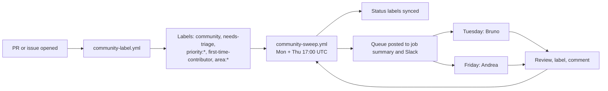
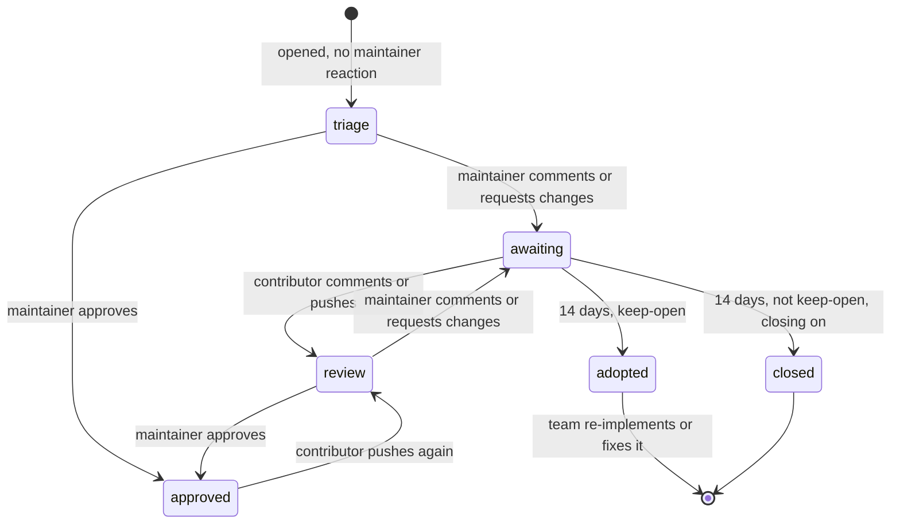

# Community triage

How we handle pull requests and issues from people outside the Kilo team.

The goal is simple. Maintainers see the community work that matters, and contributors know what happens next.

Background: [Slack discussion](https://anaconda.slack.com/archives/C0BJ2GQ40HM/p1791377022461359).

## Overview



Two workflows do the work. Both use `script/kilocode/community-triage.ts`. A third runs the tests of that script.

| Workflow | Runs | Does |
|---|---|---|
| `community-label.yml` | When a PR or issue opens or is edited | Adds `community`, `needs-triage` (new items only, not reopened ones), `first-time-contributor`, `area:*` and, for PRs, `priority:*` labels |
| `community-sweep.yml` | Monday and Thursday, 17:00 UTC, or by hand | Syncs status labels, `first-time-contributor` and `quick-win`, adds a missing priority, posts the queue |
| `community-triage-test.yml` | On PRs that change the script, its tests or the community workflows | Runs the unit tests |

The sweep runs the evening before each maintainer slot. Andrea starts Friday and Bruno starts Tuesday with a fresh queue.

## Closing

Only one workflow closes PRs: `kilo-auto-close.yml`. The sweep and the label workflow close and remove nothing. They only add and remove labels, and the sweep posts the queue.

`kilo-auto-close.yml` runs every day at 06:00 UTC and is controlled by the single variable `KILO_AUTO_CLOSE_ENABLED`:

| PR | Closed when |
|---|---|
| Has `keep-open` | Never. Issues with `keep-open` are also skipped |
| Has `awaiting-contributor` | No activity for 14 days. A reply or a push resets the clock |
| Any other PR | No activity for 30 days |

Issues with no activity for 60 days are closed too. A close comment explains the reason.

- `KILO_AUTO_CLOSE_ENABLED` must be exactly `true` to close. Any other value makes the workflow log what it would close, and do nothing else. A manual run uses its "dryRun" box instead.
- The sweep sets `awaiting-contributor`. `keep-open` is set by hand. The workflow reads both labels at run time, so a label that is a few days old does not close a PR that was active since.

### Paused: opencode v2 migration

The team is migrating to opencode v2, and community reviews are paused until further notice. A community PR must not be closed because nobody had time to answer it. So `KILO_AUTO_CLOSE_ENABLED` must be kept set to `false` while the pause lasts. If it is set to `true`, `kilo-auto-close.yml` closes PRs, and the `awaiting-contributor` rule closes them after 14 days with no warning. Any other value, including unset, closes nothing.

- Labels, priorities and the queue keep working.
- To resume, set the variable to `true` (`gh variable set KILO_AUTO_CLOSE_ENABLED --body true`) and remove this note.
- To check what would be closed first, run "kilo-auto-close" by hand with "dryRun" ticked.

## Who is a maintainer

An author or commenter is a maintainer when one of these is true:

- GitHub shows them as `OWNER`, `MEMBER` or `COLLABORATOR`.
- The secret `COMMUNITY_TRIAGE_MEMBER_TOKEN` (`read:org`) shows they are in the org.
- Their login is in `.github/community-maintainers.json`.

The default token cannot see private org members. They look like normal contributors. The member token fixes that, so it is needed. If the secret is missing or empty, the label job and the sweep fail with a clear message, so team PRs are not labeled as community. Org members are never listed in the file.

Bots are ignored.

### The list of extra maintainers

`.github/community-maintainers.json` holds logins that count as maintainers but are not in the org: bot and agent accounts, and people outside the org. It has one key, `logins`, with a list of GitHub logins. The list must be sorted, in lower case and without duplicates. A test checks this.

```json
{
  "logins": ["some-agent-account", "someone-outside-the-org"]
}
```

- Change the list with a normal PR.
- The file is public. Do not add org members. The member token finds them, and their membership may be private.
- One file serves every repo. The community dashboard reads the same file for its four repos, so the two tools agree on who is a maintainer.
- The dashboard's reviewer list is separate. It says who can be assigned reviews, not who counts as a maintainer.

## Labels

Set by the workflows:

| Label | Meaning |
|---|---|
| `community` | Author is not a maintainer |
| `area:vscode`, `area:cli`, `area:agent-manager`, `area:jetbrains`, `area:desktop`, `area:docs`, `area:gateway`, `area:sdk`, `area:ui`, `area:i18n` | Part of the repo. Comes from the title scope (`fix(vscode): ...`), a product name in the title ("Kilo Desktop", "Agent Manager" or "JetBrains"), the changed paths, or the issue "Component" dropdown |
| `first-time-contributor` | First contribution to this repo. See [First-time contributors](#first-time-contributors) |
| `quick-win` | Small, low-risk PR. See [Quick wins](#quick-wins) |
| `priority:p1`, `priority:p2`, `priority:p3` | Set from the title when a community PR opens. See [Priority](#priority) |
| `needs-triage` | A maintainer should look: a new PR, or the contributor replied or pushed |
| `awaiting-contributor` | A maintainer reacted last. After 14 days with no activity, `kilo-auto-close.yml` closes the PR, if closing is on |

Set by hand:

| Label | Meaning |
|---|---|
| `keep-open` | We want to keep this PR. It is never auto-closed. After 14 days of silence it shows in the digest under "Adopt" |
| `priority:p0` to `priority:p3` | Change the priority by hand. P0 (critical) is only ever set by hand. The sweep never changes an existing priority |

The sweep owns the status labels, `first-time-contributor` and `quick-win`. It adds and removes them on its own. Do not manage them by hand.

The sweep also removes `community`, `first-time-contributor`, `quick-win` and the status labels from open PRs whose author is a maintainer. This fixes labels set before the maintainer list was known. It only handles PRs.

`area:*` labels are only added, never removed. Fix a wrong one by hand. On every run the sweep also adds an area for a product name in the title of each open community PR.

## Whose turn is it

The sweep reads the comments, reviews, review replies, commits and reopen events of each open community PR. Drafts are skipped. A reopen by the author counts as a reply. The sweep ignores commit dates more than 5 minutes in the future.

The sweep reads only the latest events. If it finds no maintainer reaction on a PR with more events than it can read, it labels the PR `needs-triage` so a person decides.



| State | Label | Rule |
|---|---|---|
| triage | `needs-triage` | No maintainer reaction yet, and no `keep-open` label |
| review | `needs-triage` | The contributor acted after the last maintainer reaction, or a `keep-open` label exists |
| approved | none | The last maintainer reaction is an approval |
| awaiting | `awaiting-contributor` | The last maintainer reaction asked for something and the contributor has not answered |

The 14 day clock starts at the time of the last maintainer reaction.

## Priority

Every community PR gets a priority label when it opens, so the queue can be sorted at once. The label workflow sets it. The sweep adds it to PRs that have none. Other tools can read the same label.

The type of a PR decides the label:

| Type | Label |
|---|---|
| Fix | `priority:p1` |
| Feature | `priority:p2` |
| Other | `priority:p2` |
| Docs | `priority:p3` |

The first rule that fits decides the type:

1. The title starts with `fix`, `fixes`, `bugfix`, `hotfix` or `revert`: fix. Or with `docs` or `documentation`: docs. Or with `feat` or `feature`: feature.
2. The PR has the label `bug`: fix. Or `documentation` or `docs`: docs. Or `enhancement` or `feature`: feature.
3. `area:docs` is the only area label: docs.
4. The title starts with `add`, `adds`, `support` or `implement`: feature.
5. Nothing fits: other.

So a PR titled `Add docs for X` with the `documentation` label is docs, not a feature. P0 is never automatic.

To change a priority, edit the label on GitHub. The sweep never changes an existing priority, even when the title changes. Priority does not mean the PR is triaged. A PR is triaged when a maintainer reacts, or when it has `keep-open`.

## First-time contributors

A warm first reply matters most for people who are new here.

- GitHub marks an author as `FIRST_TIME_CONTRIBUTOR` or `FIRST_TIMER` until one of their PRs is merged. These PRs and issues get `first-time-contributor`.
- The label is set when the item opens or is edited. The sweep keeps it in sync on PRs, and removes it after the first merge. Issues keep the label.
- The digest adds "first-time contributor" next to these PRs, and the Slack summary shows how many there are.
- First-time contributors often need a maintainer to approve their workflow runs before CI starts. Approve the runs early. Few checks on a PR can mean this.

## Quick wins

`quick-win` marks PRs that are small and low-risk, so a maintainer can review them in minutes. It does **not** mean "merge without review". The sweep sets it when all of these are true:

- The PR is not a draft, its author is a community member, and it is not waiting for the contributor.
- The last commit has passing checks, and GitHub reports the PR as mergeable.
- No changed file is risky: `.github/`, `.kilo/`, `script/`, `patches/`, `packages/kilo-gateway/`, `package.json` or `bun.lock`.
- One of these shapes fits:

| Shape | Rule |
|---|---|
| Docs only | Every file is a `.md` or `.mdx` file, or is under `docs/` or `packages/kilo-docs/`. Files under `.kilo/` and `.changeset/` do not count as docs. At most 150 changed lines |
| Tests only | Every file is a test file. At most 150 changed lines |
| Small change | At most 50 changed lines in at most 3 files |

The sweep removes the label when a PR stops fitting, for example after a new push or when checks fail. A PR that GitHub has not yet checked for conflicts misses the label until the next sweep.

A quick win can still need a decision. A new provider docs page is small, but the team still has to keep it up to date.

The digest lists quick wins in their own section, right after "Adopt".

## The 14 day rule

When a PR has been `awaiting-contributor` for 14 days with no activity:

| PR | Result |
|---|---|
| Has `keep-open` | Stays open and shows in the digest under "Adopt". Add it to the standup doc and pick an owner |
| Anything else | Closed by `kilo-auto-close.yml` with a comment, when closing is on. See [Closing](#closing) |

The sweep itself closes nothing and posts no warning comment. The digest shows the days waiting, so a maintainer can still reply before day 14.

## The digest

Each sweep writes a queue to the job summary, and to [Slack](#slack). It lists the open community PRs in these sections. An empty section is left out. Each section shows at most 15 PRs, and a line with the number of the others.

| Section | PRs |
|---|---|
| Adopt | `keep-open` PRs with no contributor reply for 14 days. The team adopts them or lets them go |
| Quick wins | PRs with `quick-win` that are not waiting for the contributor |
| Needs triage | No maintainer has reacted yet |
| Contributor replied, needs review | The contributor answered after the last maintainer reaction |
| Approved, ready to merge | The last maintainer reaction is an approval |
| Waiting for contributor | Days waiting. Longest wait first |

A PR can be in "Quick wins" and in its state section. The digest marks first-time contributors and PRs with failing checks next to the PR. Adopt and Quick wins follow the `keep-open` and `quick-win` rules. The other sections use the same state rules as the status labels. `needs-triage` covers both "Needs triage" and "Contributor replied, needs review", because a maintainer should look in both cases.

## The maintainer routine

Open the latest "Community sweep" run. The job summary has the queue. A copy goes to [Slack](#slack) when a Slack secret is set.

1. **Adopt**: pick an owner and add the PR to the standup doc.
2. **Quick wins**: review these first. They are the fastest way to clear the queue.
3. **Needs triage**: decide. Comment on it, or add `keep-open`. Change the priority if it is wrong. Not sure? Put it in the standup doc.
4. **Needs review**: the contributor replied. Review again.
5. **Approved**: merge.
6. **Waiting for contributor**: nothing to do.

Greet first-time contributors first, and approve their workflow runs.

Friday and Tuesday are three to four days apart. This gives contributors time to reply between reviews.

Useful searches:

- All community PRs: `is:pr is:open label:community`
- Needs a maintainer: `is:pr is:open label:needs-triage`
- One area: `is:pr is:open label:community label:area:vscode`
- Quick wins: `is:pr is:open label:quick-win`
- First-time contributors: `is:pr is:open label:first-time-contributor`

## Slack

The sweep can post the queue to Slack. Slack is optional.

- **Bot token and channel set:** the channel gets one short message with the title, a count per section and a link to the run. Each section is a reply in its thread.
- **Only the webhook set:** the channel gets the whole queue as one message.
- **The bot post fails:** the sweep still finishes and logs a warning with the Slack error. If not even the summary was posted, the whole queue goes through the webhook when one is set. If only a thread reply fails, the sweep warns and keeps the rest, so the queue is not posted twice.
- **Manual runs:** the "slack" box is ticked by default. Untick it to run without posting. Scheduled runs always post.

## Issues

New issues get the `community` label, `needs-triage`, `first-time-contributor` for new authors and an `area:*` label. The area comes from the required "Component" dropdown in the bug and feature templates. If there is no answer, for example "Other / not sure" or an issue that skips the form, a product name in the title is used instead. The sweep only handles PRs, so older issues get their labels when they are edited, and `needs-triage` on an issue stays until you remove it by hand.

## Setup

| Name | Kind | Needed | Purpose |
|---|---|---|---|
| `KILO_AUTO_CLOSE_ENABLED` | Variable | No | `true` lets `kilo-auto-close.yml` close PRs and issues. Set to `false` while community reviews are paused |
| `COMMUNITY_TRIAGE_MEMBER_TOKEN` | Secret | Yes | Token with `read:org`. Finds private org members |
| `COMMUNITY_TRIAGE_SLACK_TOKEN` | Secret | No | Slack bot token (`xoxb-`, scope `chat:write`). Posts a summary and threads the lists. The bot must be in the channel |
| `COMMUNITY_TRIAGE_SLACK_CHANNEL` | Secret | No | Channel ID (`C...`) for the bot token |
| `COMMUNITY_TRIAGE_SLACK_WEBHOOK` | Secret | No | Posts the whole queue as one message. Used when there is no bot token, or when the bot post fails |

Labels are created by the workflows, and their color and description are kept in line with the list in the script. Run "Community sweep" once by hand after merge to create them and label the open PRs.

## Safety

- `community-label.yml` uses `pull_request_target`. It checks out the base branch only. It never runs PR code.
- The sweep and the label workflow close nothing. A test checks that the sweep script has no close call.
- Closed PRs can be reopened by the contributor.
