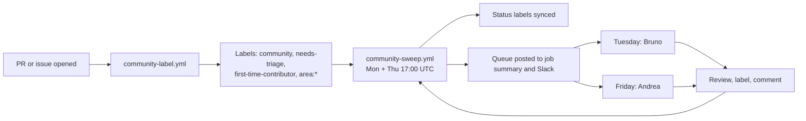
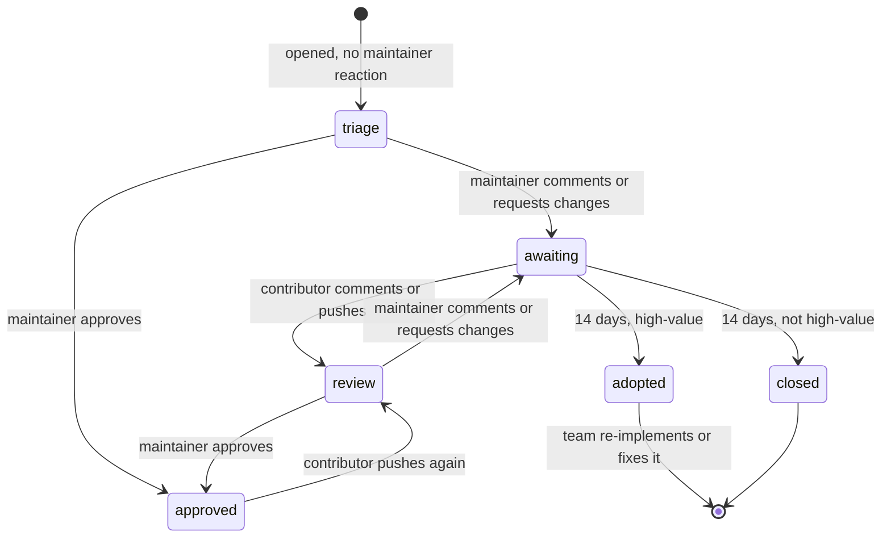

# Community triage

How we handle pull requests and issues from people outside the Kilo team.

The goal is simple. Maintainers see the community work that matters, and contributors know what happens next.

Background: [Slack discussion](https://anaconda.slack.com/archives/C0BJ2GQ40HM/p1791377022461359).

## Overview

Two workflows do the work. Both use `script/kilocode/community-triage.ts`. A third runs the tests of that script.

| Workflow | Runs | Does |
|---|---|---|
| `community-label.yml` | When a PR or issue opens or is edited | Adds `community`, `needs-triage` (new items only, not reopened ones), `first-time-contributor` and `area:*` labels |
| `community-sweep.yml` | Monday and Thursday, 17:00 UTC, or by hand | Syncs status labels, `first-time-contributor` and `quick-win`, closes stale PRs, posts the queue |
| `community-triage-test.yml` | On PRs that change the script, its tests or the community workflows | Runs the unit tests |

The sweep runs the evening before each maintainer slot. Andrea starts Friday and Bruno starts Tuesday with a fresh queue.

## Who is a maintainer

An author or commenter is a maintainer when one of these is true:

- GitHub shows them as `OWNER`, `MEMBER` or `COLLABORATOR`.
- Their login is in the repo variable `COMMUNITY_MAINTAINERS` (comma separated).
- The optional secret `COMMUNITY_TRIAGE_MEMBER_TOKEN` (`read:org`) shows they are in the org.

The default token cannot see private org members. They look like normal contributors. Set the variable or the secret so their PRs are not labeled `community`.

Bots are ignored.

## Labels

Set by the workflows:

| Label | Meaning |
|---|---|
| `community` | Author is not a maintainer |
| `area:vscode`, `area:cli`, `area:agent-manager`, `area:jetbrains`, `area:desktop`, `area:docs`, `area:gateway`, `area:sdk`, `area:ui`, `area:i18n` | Part of the repo. Comes from the title scope (`fix(vscode): ...`), a product name in the title ("Kilo Desktop", "Agent Manager" or "JetBrains"), the changed paths, or the issue "Component" dropdown |
| `first-time-contributor` | First contribution to this repo. See [First-time contributors](#first-time-contributors) |
| `quick-win` | Small, low-risk PR. See [Quick wins](#quick-wins) |
| `needs-triage` | No maintainer has reacted yet |
| `needs-review` | The contributor replied or pushed. A maintainer should look again |
| `awaiting-contributor` | A maintainer reacted last. The 14 day clock runs |
| `ci-failing` | Checks on the last commit failed |
| `needs-reimplementation` | `high-value` PR with no reply for 14 days. The team takes it over |

Set by hand:

| Label | Meaning |
|---|---|
| `high-value` | We want this change. The sweep never closes it |
| `low-value` | Triaged. Not a priority |
| `keep-open` | The sweep never closes this PR |
| `priority:p0` to `priority:p3` | Optional priority: critical, high, medium, low. A PR with one counts as triaged. Tools that read GitHub labels can use it |

The sweep owns the status labels, `first-time-contributor` and `quick-win`. It adds and removes them on its own. Do not manage them by hand.

The sweep also removes `community`, `first-time-contributor`, `quick-win` and the status labels from open PRs whose author is a maintainer. This fixes labels set before the maintainer list was known. It only handles PRs.

`area:*` labels are only added, never removed. Fix a wrong one by hand. On every run the sweep also adds an area for a product name in the title of each open community PR.

## Whose turn is it

The sweep reads the comments, reviews, review replies, commits and reopen events of each open community PR. Drafts are skipped. A reopen by the author counts as a reply. The sweep ignores commit dates more than 5 minutes in the future.

The sweep reads only the latest events. If it finds no maintainer reaction on a PR with more events than it can read, it labels the PR `needs-review` so a person decides.

| State | Label | Rule |
|---|---|---|
| triage | `needs-triage` | No maintainer reaction yet, and no `high-value`, `low-value` or `priority:*` label |
| review | `needs-review` | The contributor acted after the last maintainer reaction, or a `high-value`, `low-value` or `priority:*` label exists |
| approved | none | The last maintainer reaction is an approval |
| awaiting | `awaiting-contributor` | The last maintainer reaction asked for something and the contributor has not answered |

The 14 day clock starts at the time of the last maintainer reaction.

## First-time contributors

A warm first reply matters most for people who are new here.

- GitHub marks an author as `FIRST_TIME_CONTRIBUTOR` or `FIRST_TIMER` until one of their PRs is merged. These PRs and issues get `first-time-contributor`.
- The label is set when the item opens or is edited. The sweep keeps it in sync on PRs, and removes it after the first merge. Issues keep the label.
- The digest adds "first-time contributor" next to these PRs, and the Slack summary shows how many there are.
- First-time contributors often need a maintainer to approve their workflow runs before CI starts. Approve the runs early. Few checks on a PR can mean this.

## Quick wins

`quick-win` marks PRs that are small and low-risk, so a maintainer can review them in minutes. It does **not** mean "merge without review". The sweep sets it when all of these are true:

- The PR is not a draft, its author is a community member, and it is not waiting for the contributor.
- The last commit has passing checks, and GitHub reports the PR as mergeable.
- No changed file is risky: `.github/`, `.kilo/`, `script/`, `patches/`, `packages/kilo-gateway/`, `package.json` or `bun.lock`.
- One of these shapes fits:

| Shape | Rule |
|---|---|
| Docs only | Every file is a `.md` or `.mdx` file, or is under `docs/` or `packages/kilo-docs/`. Files under `.kilo/` and `.changeset/` do not count as docs. At most 150 changed lines |
| Tests only | Every file is a test file. At most 150 changed lines |
| Small change | At most 50 changed lines in at most 3 files |

The sweep removes the label when a PR stops fitting, for example after a new push or when checks fail. A PR that GitHub has not yet checked for conflicts misses the label until the next sweep.

A quick win can still need a decision. A new provider docs page is small, but the team still has to keep it up to date.

The digest lists quick wins in their own section, right after "Adopt".

## The 14 day rule

When a PR has been `awaiting-contributor` for 14 days:

| PR | Result |
|---|---|
| Has `high-value` | Gets `needs-reimplementation` and shows in the digest under "Adopt". Add it to the standup doc and pick an owner |
| Has `keep-open` | Nothing happens |
| Anything else | Closed with a comment |

Before the sweep closes or adopts a PR, it checks the full history for a contributor reply. This catches replies on long PRs.

Closing is **off by default**. Until it is on, the sweep only logs what it would close. To turn it on, set the repo variable `COMMUNITY_AUTO_CLOSE_ENABLED` to `true`. To try it by hand, run the sweep from the Actions tab and tick "close".

When a PR first gets `awaiting-contributor`, the sweep also posts one comment that gives the due date. That comment is also off until closing is on. The sweep posts at most 20 comments per run (`MAX_COMMENTS`).

`kilo-auto-close.yml` is separate. It does not read these labels. It still closes any PR with no activity for 30 days, including `high-value` and `keep-open` PRs.

## The maintainer routine

Open the latest "Community sweep" run. The job summary has the queue. A copy goes to [Slack](#slack) when a Slack secret is set.

1. **Adopt**: pick an owner and add the PR to the standup doc.
2. **Quick wins**: review these first. They are the fastest way to clear the queue.
3. **Needs triage**: decide. Add `high-value`, `low-value` or a `priority:*` label, or comment on it. Not sure? Put it in the standup doc.
4. **Needs review**: the contributor replied. Review again.
5. **Approved**: merge.
6. **Waiting for contributor**: nothing to do.

Greet first-time contributors first, and approve their workflow runs.

Friday and Tuesday are three to four days apart. This gives contributors time to reply between reviews.

Useful searches:

- All community PRs: `is:pr is:open label:community`
- Needs a maintainer: `is:pr is:open label:needs-triage,needs-review`
- One area: `is:pr is:open label:community label:area:vscode`
- Quick wins: `is:pr is:open label:quick-win`
- First-time contributors: `is:pr is:open label:first-time-contributor`

## Slack

The sweep can post the queue to Slack. Slack is optional.

- **Bot token and channel set:** the channel gets one short message with the title, a count per section and a link to the run. Each section is a reply in its thread.
- **Only the webhook set:** the channel gets the whole queue as one message.
- **The bot post fails:** the sweep still finishes and logs a warning with the Slack error. If not even the summary was posted, the whole queue goes through the webhook when one is set. If only a thread reply fails, the sweep warns and keeps the rest, so the queue is not posted twice.
- **Manual runs:** the "slack" box is ticked by default. Untick it to run without posting. Scheduled runs always post.

## Issues

New issues get the `community` label, `needs-triage`, `first-time-contributor` for new authors and an `area:*` label. The area comes from the required "Component" dropdown in the bug and feature templates. If there is no answer, for example "Other / not sure" or an issue that skips the form, a product name in the title is used instead. The sweep only handles PRs, so older issues get their labels when they are edited.

## Setup

| Name | Kind | Needed | Purpose |
|---|---|---|---|
| `COMMUNITY_AUTO_CLOSE_ENABLED` | Variable | No | `true` turns on closing and comments |
| `COMMUNITY_MAINTAINERS` | Variable | No | Logins treated as maintainers |
| `COMMUNITY_TRIAGE_MEMBER_TOKEN` | Secret | No | Token with `read:org`. Finds private org members |
| `COMMUNITY_TRIAGE_SLACK_TOKEN` | Secret | No | Slack bot token (`xoxb-`, scope `chat:write`). Posts a summary and threads the lists. The bot must be in the channel |
| `COMMUNITY_TRIAGE_SLACK_CHANNEL` | Secret | No | Channel ID (`C...`) for the bot token |
| `COMMUNITY_TRIAGE_SLACK_WEBHOOK` | Secret | No | Posts the whole queue as one message. Used when there is no bot token, or when the bot post fails |

Labels are created by the workflows. Run "Community sweep" once by hand after merge to create them and label the open PRs.

## Safety

- `community-label.yml` uses `pull_request_target`. It checks out the base branch only. It never runs PR code.
- The sweep never closes drafts, `high-value` PRs or `keep-open` PRs.
- Closed PRs can be reopened by the contributor.
