# Kilo v1 → v2 migration plan

Status: active. Created 2026-10-12 by the planning session. Single writer per change: the coordinator, through micro-PRs (`migration-context.md`, Working model).

This file is the living index of the migration: epics, gates and sequencing (Part A), units, dependencies, acceptance and status (Part B). It replaces the previous execution plan and progress plan. Shared facts, refs, decisions and rules live in [`migration-context.md`](migration-context.md); per-feature evidence lives in the frozen discovery report under [`../discovery/`](../discovery/). This plan links to both and does not restate them.

| Reader | Read |
|---|---|
| Leadership | Part A, then stop |
| Coordinator and implementers | Part A for context, Part B for the unit you own, the register row for its evidence |
| Anyone checking a fact (SHA, path, decision text) | Appendix A and the files it links |

---

# Part A. High level

## A1. Objective

Ship Kilo on the upstream v2 runtime, surface by surface, without breaking a v1 user. The target feature set is upstream v2 at its latest synced release (the base moves, A4) plus every Kilo v1 behavior at the pinned v1 target, minus what Decision 7 marks post-cutover or not-needed: feature parity, not code parity. The terminal product (CLI/TUI) ships first at G1; VS Code (G2) and JetBrains (G3) follow on their own go/no-go, and until then they keep running on v1 against untouched v1 data. The work ends when Kilo's integration branch, `origin/v2`, becomes `main` and v1 moves to a time-limited maintenance branch.

## A2. Why this plan replaces the previous one

The previous plan (finalized 2026-09-30, never started) was a sound plan for the situation it assumed: finish the existing `kilo-v2` port. That assumption no longer holds. The port is now frozen as donor code (Decisions 1–2), and the facts measured during discovery change what the remaining work actually is. The previous plan's facts and decisions are preserved; its structure is not.

| What the previous plan assumed or lacked | What we found | How this plan handles it |
|---|---|---|
| Work continues on the `kilo-v2` port; the first step is one large consolidation merge of upstream | The port never merged upstream and sits 1,454 upstream commits behind the new base. Upstream moves about 1,000 commits every few weeks | Start from a clean upstream base and keep it current: a dedicated lane (L1) merges every upstream release in small SHA-pinned syncs |
| The port's behavior is close enough to v1 to finish from | Port behavior is an August snapshot. Since then v1 shipped 3,107 commits touching 4,104 files. Staleness was never measured per feature | Measure staleness per unit (D4). 80 of 137 units are MATERIAL: behavior is re-derived from current v1, and the port supplies only the v2 wiring |
| Identity, Gateway, catalog, config, engines and most of the TUI were "implemented, full end-to-end pending", so they had no issues | On a clean base none of that code exists | Those areas are now explicit units (E0, E1, most of E2 and E9). This is the largest block of work and the main source of new issues |
| Its own 17 new units (consolidation, ratchet, sync, fixtures, store, handshake, scenario sets, preview train) would be created as issues first | None was created | Every one is mapped to a unit in Part B; the obsolete ones (consolidation merge, old-branch imports, progress-plan alignment) are dropped with a reason |
| Live status was split across the plan, a progress plan and a working log | The three disagreed; the progress plan said "paused", and the working log still carried a live "do not resume implementation" instruction | One file holds sequencing and unit status (D9); the old documents carry superseded banners |
| Acceptance was the existing test plans | Their expected results were quoted from the port's source, not from v1, and there were no IDE scenarios at all | Acceptance is written against v1 for every unit; G2 and G3 get their own scenario sets and acceptance runs (L4) |
| Some sharing and editor-service items were completion criteria | Team and incremental sharing, speech, image generation and KiloClaw are non-gating under Decision 7 | Non-gating scope lives in one backlog epic (E11), so gate exits are unambiguous |
| The v2 binary would ship under the customer `kilo` name; the preview identity was not for customers | The cloud owners have since proposed a `kilo2` binary on a `next` dist-tag, and v1 VS Code resolves the CLI without a version pin | The binary-and-channel decision is a named deadline before the first distributed preview, and v1-IDE isolation is a tested unit |

**What this plan does not do yet.**
- No owner is assigned, so the critical path in A7 is structural and has no dates.
- Acceptance lines were written by the planner from discovery evidence; epic owners should challenge them.
- Donor seam claims were measured against the old upstream base and are re-checked inside each unit, not up front.
- The plan is long by design: only Part A is meant to be read end to end.

## A3. Decisions in force

The ten decisions in [`migration-context.md` §Decisions](migration-context.md#decisions-authoritative) are authoritative. The plan applies them as follows; it does not change any of them.

| Decision | How this plan applies it |
|---|---|
| D1 New base, kept current | Every unit lands on Kilo's `origin/v2` by PR. The upstream base moves: the L1 lane merges every `upstream/dev` release, pinned by SHA (A4). `upstream/v2` is frozen and never merged |
| D2 Freeze | The archived port is read through its tag; nothing merges from it |
| D3 Donor rules | Each Part B row states donor reuse for mechanism only. Behavior acceptance is always written against v1 |
| D4 Staleness gate | Each Part B row carries a staleness verdict. Non-EMPTY means behavior is re-derived from v1 |
| D5 Staged cutover | Three gates, two parallel IDE tracks (A7) |
| D6 Storage | Store isolation is an E1 exit criterion; import is E3; consolidation is E8 after G3 |
| D7 Scope | Non-gating scope is isolated in E11; the hard FIM gate sits in E6 |
| D8 Gates over P-labels | Gate tags in Part B decide surface readiness; P-labels only order work inside a gate |
| D9 Plan format | This file |
| D10 Readability | Part A carries no issue IDs; facts are linked, not copied |

Items that need user sign-off are listed in A10. None of them changes a decision.

## A4. Approach

**Clean base.** Kilo's integration branch, `origin/v2`, started as pristine upstream with no Kilo package. Kilo is re-landed onto it in small units, each one a session, a branch and a PR, merged by the user. Nothing from the old port branch is merged.

**Moving upstream base.** `origin/v2` does not stay on the commit it started from. Lane L1 merges every upstream release into it (D1), so the upstream base moves forward with each sync and units always build on recent upstream code. This is the strategy, not a maintenance chore. Upstream ships about five v2 releases a week and changes hundreds of harness files between them. The archived port shows the cost of waiting: after five weeks without a merge, 16 of its 21 remaining seam patches conflicted. Small, frequent syncs keep each merge cheap, expose a broken seam while the patch is still fresh, and keep Kilo aligned with the upstream code it will ship on. In practice:
- "The base" and BASE in this plan mean the current upstream base of `origin/v2` (`migration-context.md`, pinned refs), not the initial commit. Seam claims, donor reuse and acceptance are checked against it.
- Each sync is its own PR with a merge commit. It resolves conflicts and new failures in Kilo packages before it merges.
- After a sync, open PRs merge `origin/v2` into their branch and re-run their checks and self-tests.
- Known upstream failures are in `pinned-v2-baseline.md`, which each sync re-measures and which names the release it describes. When `origin/v2` has moved past it, compare against `origin/v2` before the change.

**Re-land by unit.** Every Kilo v1 behavior and every upstream-only surface has exactly one unit (Part B). A unit is done only with code, tests, acceptance evidence recorded with a SHA, its Part B status updated, and docs. A local pass is never recorded as end to end.

**Donor = mechanism, v1 = behavior.** The archived port shows how Kilo features attach to v2: host overrides, plugin and RPC registration, schema definitions, backend adapters. Those seams barely moved upstream, so that mechanism is reusable. Its behavior is a snapshot from August and its patches on TUI, theme, system-prompt and MCP files sit on code that upstream rewrote or deleted. Behavior therefore always comes from current v1.

**Staleness gate.** Before a unit starts, its v1 files are diffed between the assessment snapshot and the v1 target. EMPTY: the donor is likely faithful. Anything else: re-derive behavior from v1 and keep only the donor's v2 mapping. Discovery has already measured this per area; 80 of 137 units are MATERIAL, so most work is re-derivation, not copying.

**Lanes keep the base honest.** Five continuous lanes run beside the epics: upstream sync (L1), v1 delta sweep (L2), shared-patch ratchet (L3), acceptance (L4) and docs (L5). They stop the two moving targets (upstream v2 and v1 `main`) from silently invalidating finished units.

**Sequencing, not dates.** No owner is assigned and no effort estimate exists. The plan orders work by dependency and external lead time. Dates attach when owners do.

## A5. Program phase map

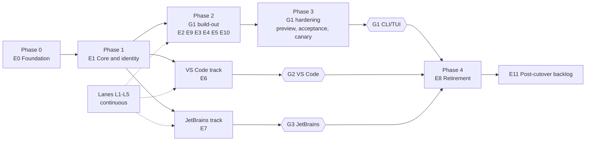

| Phase or track | Epics | Starts when | Ends when |
|---|---|---|---|
| Phase 0 Foundation | E0; lanes L1–L5 start | Now | E0 exit criteria met |
| Phase 1 Core and identity | E1 | Host and RPC scaffolding exist (E0) | E1 exit criteria met |
| Phase 2 G1 build-out | E2, E9, E3, E4, E5, E10 (G1 units) | Each unit's dependencies land; many start during Phase 1 | Every G1 unit is done |
| Phase 3 G1 hardening | Preview train, G1 acceptance run, canary | Packaging and the distribution decision are ready | G1 go/no-go |
| VS Code track | E6 plus the G2 units of E2 | RPC scaffolding and the server extension surface exist; the FIM producer starts early | G2 go/no-go |
| JetBrains track | E7 | The contract inventory can start any time; the plugin needs the build pipeline | G3 go/no-go |
| Phase 4 Retirement | E8 | G3 go | Branch flip, store consolidation, v1 end of life |
| Backlog | E11 | Any time after its gate surface ships | Every item has a recorded decision |

## A6. Epic map

Epic IDs follow discovery so register rows stay traceable; they are presented in program order. Exit criteria below are canonical from now on.

### E0 Foundation (pre-gate)

- **Outcome:** a Kilo host, a Kilo plugin/RPC pattern, a Kilo CI signal and v1 reference fixtures exist on the clean base, and no upstream workflow can publish from the fork.
- **Why:** the base has no Kilo package at all. Every other epic needs these first.
- **Exit criteria:** the host starts an isolated server through public seams only (service smoke test); one sample Kilo RPC round-trips through the generated client; a Kilo-owned workflow runs `bun run check` and package tests on PRs to `origin/v2`, compared against the pinned baseline; every upstream publish or deploy workflow is disabled or guarded; Kilo `AGENTS.md` and fork conventions name the current base and branch rules; v1 reference fixtures for offline wait, overflow, slow snapshot and snapshot retention replay on the base.
- **Gate:** blocks everything.
- **Depends on:** the admin task for Actions permissions (CI lane only).
- **Top risks:** upstream's test workflow runs on every pull request, so it will run on fork PRs before the Kilo lane exists; branch protection is convention-only until an admin acts.

### E1 Core and identity (G1; prerequisite for G2 and G3)

- **Outcome:** v2 runs as Kilo: product identity, a separate customer store, Gateway login, the Kilo catalog, prompt selectors, usage accounting, the Kilo config layer and the Kilo server extension surface.
- **Why:** every surface needs identity, auth, models and config before any feature can be accepted.
- **Exit criteria:** v1 and v2 run side by side and a v2 boot never opens a v1 file (filesystem-access test on a seeded v1 store); device login, org switch and logout pass against the deployed Gateway; Kilo models are selectable and requests carry Kilo headers; all eight prompt selectors resolve on base seams; every Kilo config key folds or is refused with a diagnostic; every shared-file patch added here is counted by L3 with its missing seam.
- **Gate:** G1, and consumed by G2 and G3.
- **Depends on:** E0.
- **Top risks:** product identity is hard-coded in upstream shared files, so shared patches grow here first; the system-prompt seam the donor used was deleted upstream; Gateway acceptance needs the deployed service.

### E2 Runtime behavior (G1; three units G2)

- **Outcome:** v1 runtime policy runs on v2 seams: session policy, agents and plan, commands and skills, Kilo tools and permissions, the memory, indexing, sandbox and telemetry engines, MCP and marketplace, agent coordination, generation endpoints.
- **Why:** this is the behavior users notice, and the IDE tracks consume it through public contracts.
- **Exit criteria:** every G1 unit passes acceptance against the E0 fixtures where one exists; every native-equivalence claim has a test covering scope, errors, cancellation, persistence and presentation; the G2 units expose public contracts that the generated client consumes; no client package imports Core or Server internals.
- **Gate:** G1 (message deletion, Agent Manager control plane and generation endpoints are G2).
- **Depends on:** E0; parts of E1 (config, catalog, identity).
- **Top risks:** nearly every area is MATERIAL or NEW, so donor reuse is low; agent coordination alone grew by about 55k lines on v1; this is the largest epic (30 units).

### E9 CLI/TUI surface (G1)

- **Outcome:** the terminal product: daemon UX, the Kilo command set, headless run, ACP, the TUI shell, slash commands, home and sidebar plugins, picker, notifications, preferences, `kilo cloud`, and a recorded disposition for each upstream-only surface.
- **Why:** G1 ships the terminal product, which needs presentation and commands, not just runtime parity.
- **Exit criteria:** every G1 CLI/TUI scenario passes on an isolated real host, recorded with SHA; `kilo --help --all` lists the v1 command set or a removal note per missing command; each upstream-only surface (desktop, web app, GUI extensions, pairing) has a recorded user decision that is implemented.
- **Gate:** G1.
- **Depends on:** E1; E2 for the behavior each screen presents.
- **Top risks:** the upstream TUI churns heavily and the donor's TUI patches sit on files that were largely rewritten; several units touch the same TUI files and must run in series.

### E3 Import and distribution (G1)

- **Outcome:** a signed v2 binary that installs beside v1, updates and rolls back, and imports v1 data opt-in and re-runnably without touching v1 files; a preview train and a canary runbook.
- **Why:** customers need a safe install and their history (D6); the first v2 release must not be G1 itself.
- **Exit criteria:** importing a fixture store from each supported v1 release leaves the original byte-for-byte and a second run imports only new sessions; signed artifacts for every v1 platform install beside v1 and update and roll back on real artifacts; a v1 IDE build cannot resolve the v2 binary through PATH, global install or dist-tag; at least one preview release has shipped; the G1 canary runbook has been exercised.
- **Gate:** G1.
- **Depends on:** E0 (CI lane), E1 (identity, store, auth, config); the binary-and-channel decision before the first distributed preview.
- **Top risks:** copy-then-migrate import is not proven lossless; signing and notarization have external lead time and need account credentials; the binary-and-channel decision is still open.

### E4 Remote sessions (G1)

- **Outcome:** `kilo remote` over the Kilo relay: wire protocol, transcript and files, suggestions, detach and heartbeat, metadata and capabilities, presence host registration, PR linking.
- **Why:** remote is a shipped v1 CLI feature.
- **Exit criteria:** local contract tests pass for every relay message; deployed relay acceptance is recorded with SHA or explicitly waived by the user; unsupported capabilities are not advertised.
- **Gate:** G1.
- **Depends on:** E1 Gateway auth; the suggest tool from E2.
- **Top risks:** deployed acceptance depends on the cloud relay; upstream's pairing and tunnel model must coexist with the Kilo relay.

### E5 Sharing (G1)

- **Outcome:** individual share, unshare and fork-from-share, a public viewer that renders v2 messages, fail-closed team upload, and scrubbed background session ingest.
- **Why:** individual sharing and the viewer are shipped v1 CLI features; team and incremental sharing are post-cutover (E11).
- **Exit criteria:** share, unshare and fork-from-share round-trip against the deployed backend, recorded with SHA; the public viewer renders self-contained v2 messages; team upload is refused with a clear message; session ingest uploads scrubbed v2 sessions and opt-out works.
- **Gate:** G1.
- **Depends on:** E1 Gateway auth; a change in the cloud repository for the viewer.
- **Top risks:** the viewer lives in another repository with another owner; the export is not redacted, so public sharing needs explicit consent.

### E10 External consumers (gate set per consumer)

- **Outcome:** each product outside this repository that consumes the Kilo CLI has a disposition, an owner, a gate and a passing validation.
- **Why:** consumers break when the CLI changes package, binary or protocol, and Decision 7 attaches them to whichever surface they consume.
- **Exit criteria:** every consumer has a recorded disposition (adapt, repackage, no change), owner and gate; every gating consumer passes validation before its gate's go/no-go; no floating `@latest` consumer breaks at the dist-tag switch.
- **Gate:** cloud agents and other CLI consumers provisionally G1 (sign-off pending); Anaconda Desktop set by its discovery.
- **Depends on:** the binary-and-channel decision; import; the Gateway provider.
- **Top risks:** floating consumers silently pick up v2 at the dist-tag switch; Anaconda Desktop's integration mode is still unknown.

### E6 VS Code track (G2)

- **Outcome:** the original Kilo VS Code extension UI, re-copied from current v1, running on the v2 backend, including FIM and next-edit.
- **Why:** VS Code stays on v1 until G2. The user decided the original UI must be preserved (working log, 2026-09-08).
- **Exit criteria:** the extension typecheck is a real check with no skip shim; every G2 scenario passes on a real VS Code host, recorded with SHA; the extension never mixes v1 and v2 routes in one session and detects the backend through the capability handshake; FIM and next-edit work end to end; rollback to the previous extension works on untouched v1 files.
- **Gate:** G2.
- **Depends on:** E0 RPC scaffolding, E1 server surface, the G2 units of E2, E3 import and build pipeline.
- **Top risks:** size (the host and webview areas together moved about 1,070 files on v1 since the snapshot); FIM is the largest single IDE gate; the timing of the branch flip constrains how v1 VS Code releases keep building.

### E7 JetBrains track (G3)

- **Outcome:** the JetBrains plugin re-landed on the clean base, talking to v2 only through a client generated from the assembled contract.
- **Why:** JetBrains pins a v1 CLI until G3; the plugin is absent from both the base and the donor.
- **Exit criteria:** the plugin builds from Kilo's `origin/v2` and uses only the generated client; every G3 scenario passes in each supported IDE, recorded with SHA; incompatible CLIs are refused with a clear message.
- **Gate:** G3.
- **Depends on:** E0 RPC scaffolding, E2 control-plane and generation contracts, E3 build pipeline.
- **Top risks:** no donor at all; Kilo plugin RPC endpoints may not appear in the OpenAPI the Kotlin client is generated from; whether FIM gates G3 is still open.

### E8 Retirement (post-G3)

- **Outcome:** Kilo's `origin/v2` is `main`, v1 lives on a maintenance branch that still builds and releases, storage paths are consolidated once, and every deployment from `main` has an owner.
- **Why:** the end state in `migration-context.md`.
- **Exit criteria:** every workflow and deployment that builds from `main` has a v2-side owner or is retired before the flip; the v1 maintenance branch builds and releases; storage consolidation runs once, with a backup, and is never repeated; the v1 end-of-life policy is published.
- **Gate:** after G3.
- **Depends on:** the G3 go/no-go and the flip-timing decision.
- **Top risks:** v1 VS Code builds its bundled CLI from the same tree, so a premature flip breaks v1 IDE releases; consolidation has no reverse migration.

### E11 Post-cutover backlog (non-gating)

- **Outcome:** every Decision 7 non-gating item (voice, image generation, team and incremental sharing, legacy TUI extras, default-off experimental features, KiloClaw) has a recorded ship, drop or re-scope decision.
- **Why:** keeping these out of gate epics keeps gate exits crisp.
- **Exit criteria:** every item has a recorded user decision; nothing here blocks a gate.
- **Gate:** none.
- **Depends on:** the surface it extends.
- **Top risks:** scope creep back into gate epics.

### L Cross-cutting lanes (continuous)

| Lane | Steady state |
|---|---|
| L1 Upstream sync | Every `upstream/dev` release merged, at least weekly, each sync pinned by SHA with a merge commit; baseline re-run, lag in releases and days recorded; no sync window missed without a note |
| L2 v1 delta sweep | Zero unclassified Kilo-owned or marked v1 files at each gate; staleness re-run for touched units |
| L3 Shared-patch ratchet | Marked shared files, client→Core/Server imports and Kilo imports of upstream internals at or below baseline; each increase states its seam |
| L4 Acceptance | Gate-tagged scenarios with v1-derived expectations; one recorded run per gate |
| L5 Docs | kilo.ai/docs describes the shipped surface at each gate |

## A7. Gate map and critical path

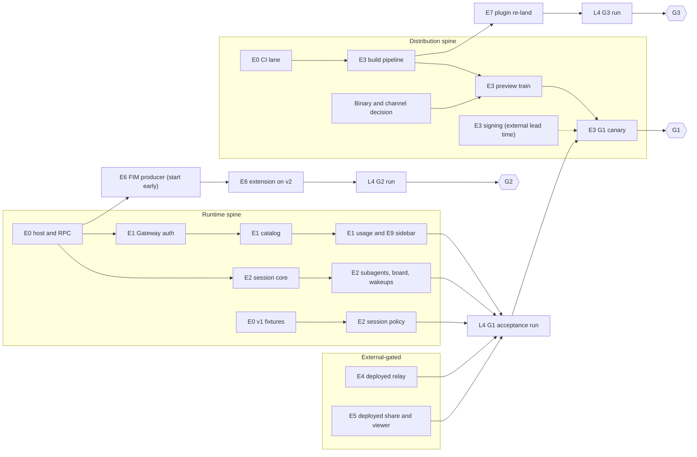

| Chain | Why it is critical | Mitigation |
|---|---|---|
| Host → Gateway auth → catalog → usage → sidebar → G1 run | Deepest dependency chain to G1; every screen needs auth and models | Start E1 auth and catalog as soon as RPC scaffolding lands; run E2 units that need only the host in parallel |
| CI lane → build pipeline → preview train → canary → G1 | Needs the binary-and-channel decision and external signing credentials | Raise the distribution decision now; start signing early |
| Deployed relay and share verification → G1 run | Depends on cloud services and another repository's owner | Book cloud-owner time at E4/E5 start; the user may waive with a recorded reason |
| FIM producer → VS Code integration → G2 | Largest single IDE gate | Start the producer during Phase 1, in parallel with G1 work |

The critical path is structural (dependency depth plus external lead time). It is UNVERIFIED against durations because no estimates exist.

What must be true at each gate:

| Condition | G1 CLI/TUI | G2 VS Code | G3 JetBrains |
|---|---|---|---|
| Units | All G1 units done (82) | All G2 units done (26), plus the shared-runtime units they consume accepted | All G3 units done (9), plus the contracts they consume |
| Acceptance | L4 G1 run passed on an isolated real host | L4 G2 run passed on a real VS Code host | L4 G3 run passed in each supported IDE |
| External | Gateway, relay and share verified with SHA, or waived by the user | Gateway login from the extension verified | As G2, from the plugin |
| Consumers | Every E10 consumer attached to G1 validated | Consumers attached to G2 validated | Consumers attached to G3 validated |
| Drift | L2 sweep run, zero unclassified files; L3 at or below baseline; upstream lag recorded | Same, re-run | Same, re-run |
| Release | At least one preview release shipped; canary runbook exercised | VSIX with the v2 binary; G2 canary and rollback runbook exercised | Plugin pinned to a v2 CLI release; G3 runbook exercised |
| Decisions | Binary and channel decided | Flip timing and handshake shape decided | FIM gate question and plugin RPC access decided |
| Rollback | v1 CLI on untouched v1 files | Previous extension on untouched v1 files | Pinned v1 CLI on untouched v1 files |
| Docs | L5 describes the CLI/TUI surface | L5 describes VS Code | L5 describes JetBrains |

G2 and G3 do not wait for the G1 go/no-go (D5). They do need the shared-runtime units they consume to be accepted.

## A8. Program risks

| Risk | Effect | Mitigation | Owner |
|---|---|---|---|
| Upstream moves about 1,000 commits every few weeks; it was already 31 commits past the base at capture | Finished units drift; large merges late in a gate | L1 merges every upstream release, at least weekly, pinned by SHA, with a baseline re-run each time (A4) | L1 |
| The moving base breaks a Kilo seam or an in-flight unit at a sync | Red `origin/v2`; rework in open PRs | Syncs stay small; the sync PR fixes what it breaks in Kilo packages; open PRs merge `origin/v2` and re-check after each sync | L1 |
| v1 `main` releases 4–5 times a week | Staleness verdicts age; behavior lands after its unit is done | L2 sweeps before each gate and on a cadence; touched units re-open | L2 |
| No owner is assigned to any epic, lane or issue | Nothing starts; no dates | Assign lane owners first (L1, L2), then E0 and E1 | User |
| Donor seam claims were measured against the old upstream base | A "reusable" seam may be gone | Every donor reuse re-checks its seam at the base inside its unit | Each unit |
| Split history: v2 CLI and v1 IDEs keep separate stores from G1 to G3 | User confusion; support load | Opt-in, re-runnable import; documented split; consolidation only after G3 | E3, L5 |
| A v1 IDE resolves the v2 binary | v1 users silently on v2 | Binary and channel decision; isolation test in E3 | E3 |
| First-release risk | G1 becomes the first real v2 release | Preview train before G1 | E3 |
| Shared-patch growth on upstream files | Expensive upstream merges | Plugin first: use the first rung that works (rung table in `v2-fork-conventions.md`); L3 ratchet; every rung 3 or 4 patch states its missing seam. Expected rung 3–4 areas are listed there | L3 |
| External services and repositories (Gateway, relay, share backend, viewer, cloud agents) | Gate acceptance blocked outside the team | Book owners at unit start; waivers only by the user, recorded | E4, E5, E10 |
| Import not proven lossless | Data loss on first import | Re-run the schema audit at the current v1 target and base; byte-identical originals test | E3 |

## A9. Metrics rollup

Counts at plan creation. Live values are tracked in Part B status cells.

| Epic | Units | Pre-gate | G1 | G2 | G3 | Other | Need a new issue |
|---|---|---|---|---|---|---|---|
| E0 Foundation | 5 | 5 | | | | | 5 |
| E1 Core and identity | 8 | | 8 | | | | 8 |
| E2 Runtime behavior | 30 | | 27 | 3 | | | 23 |
| E9 CLI/TUI surface | 15 | | 15 | | | | 11 |
| E3 Import and distribution | 13 | | 13 | | | | 5 |
| E4 Remote sessions | 8 | | 8 | | | | 1 |
| E5 Sharing | 6 | | 6 | | | | 1 |
| E10 External consumers | 3 | | 2 | | | 1 TBD | 1 |
| E6 VS Code track | 21 | | | 21 | | | 6 |
| E7 JetBrains track | 7 | | | | 7 | | 2 |
| E8 Retirement | 4 | | | | | 4 post-G3 | 4 |
| E11 Post-cutover backlog | 6 | | | | | 6 non-gating | 1 |
| L Lanes | 11 | | 3 | 2 | 2 | 4 continuous | 10 |
| **Total** | **137** | **5** | **82** | **26** | **9** | **15** | **78** |

| Staleness (D4) | Units | Donor reuse (D3) | Units |
|---|---|---|---|
| EMPTY | 8 | yes | 28 |
| SMALL | 12 | partial | 41 |
| MATERIAL (incl. MATERIAL + NEW) | 80 | no | 68 |
| NEW (post-snapshot only) | 9 | | |
| n/a (process, decision or packaging) | 28 | | |

Metrics the coordinator reports at each gate review:

| Metric | Definition | Source |
|---|---|---|
| Gate readiness | Done units / units tagged for the gate | Part B status |
| Open work per gate | Units not done, by epic | Part B status |
| Upstream lag | Releases and days behind the newest upstream release; commits on `upstream/dev` past the current base | L1 |
| Unassessed v1 changes | Kilo-owned or marked v1 files changed past the assessment cutoff without a disposition | L2 |
| Shared-file patches | Marked shared files; client→Core/Server imports; Kilo imports of upstream internals | L3 |
| Units without an issue | Part B rows marked `new` | Part B |
| Canary health | Install, update, rollback and crash signals from the preview train and canary | E3 |

## A10. Deferred decisions and sign-offs

Deferred decisions and their deadlines are canonical in [`migration-context.md` §Deferred decisions](migration-context.md#deferred-decisions); the questions with triggers are in the [register's open questions](../discovery/v2-unit-register.md#open-questions). The coordinator raises each one before its trigger unit starts.

| Decision | Deadline (trigger) | Blocks |
|---|---|---|
| Binary name, npm channel, v1-IDE isolation (Q-DIST-01) | Before the first preview distributed outside the team | Preview train, VSIX naming, floating consumers |
| Flip timing versus v1 IDE builds (Q-G2-01) | Before any change to `main`; at the latest when E6 starts | E6, E8 |
| Capability handshake shape (Q-G2-02) | VS Code connection unit | E6, E7 |
| FIM as a G3 gate (Q-G3-01) and plugin RPC access (Q-G3-02). Evidence for Q-G3-02 from #15261: plugin RPC methods are not in the generated OpenAPI or SDK; clients reach them through the generic `rpc.call` route, and per-method types come only from the TypeScript contract | JetBrains contract inventory | E7 |
| Cloud-agent gate attachment (Q-EXT-01) | Cloud-agent unit | G1 scope |
| Anaconda Desktop integration mode and gate (Q-EXT-02) | Anaconda unit | Gate scope |
| Pairing disposition (Q-PROD-01). Desktop and web app are decided: not shipped, removed 2026-10-16 (`migration-context.md`, Decision 7) | Upstream-surface disposition unit | E9 |
| Other G2 and G3 questions (Q-G2-03…08, Q-G3-03…05) | Their trigger units in the register | Their units |

Added by this plan (canonical here):

| ID | Question | Trigger | Owners |
|---|---|---|---|
| Q-HOST-01 (answered) | Host package shape on the base: a Kilo entry package that composes upstream packages through public seams (donor shape), or a thin wrapper over `@opencode/cli`. The donor chose its own package because upstream `packages/cli` exported no wrap surface; re-check at the base | U-E0-01 | Core owner |
| Q-TEL-01 | Telemetry consent on v2: v1 ships PostHog on by default; the donor chose an opt-in, allowlisted OTLP exporter as a privacy decision (`technical-notes/baseline/telemetry-v2-overlap.md`). Which default ships at G1? | U-E2-21 | Product owner, privacy |
| D-1 | Package names on `origin/v2`. Proposal: keep upstream's internal `@opencode/*` names; rename only published packages, the binary and user-visible strings (v1 renamed on every merge, a large share of its conflicts). The sync tooling keeps the package-name transform off until this is decided | Before the first rename transform is turned on (U-E1-01, rebranding) | Core owner, release owner |
| D-3 | Owners of U-L1-01, U-L3-01 and U-E0-01 | Now | User |
| D-4 (answered) | Identity and branding split, and the v2 app directory name | U-E1-01 | User, rebranding owner |

**Answered — Q-HOST-01 (host package shape).** Answer: A, a Kilo host entry package that composes upstream packages through their public seams. It runs upstream's CLI and server rather than reimplementing them, and registers Kilo plugins through `SdkPlugins.register`.

- It is the only option that lets Kilo own its identity, config, paths and plugins today. A thin wrapper over upstream's CLI cannot supply those without patching upstream code.
- It keeps our options open: because the host owns the wiring, a component can be replaced one at a time later. Wrapping would lock us to upstream's composition and force a top-level fork exactly when we would want to stop forking.
- It is the direction the `kilo-v2` iteration already took: its own entry package, composing upstream packages the same way.
- Revisit if upstream's entry points gain an options/override seam (that would make the wrapper small and capable), or if the L3 import metrics start rising toward a fork.
- Keep the host thin: U-E0-01 starts an isolated server through public seams, it does not reimplement the CLI.

**Answered — D-4 (identity split and app directory), 2026-10-19.** U-E1-01 has two parts. Part 1: the v2 app directories (config, data, cache, state) are named `kilo2`, set by the Kilo host. Part 2 (rebranding, Fabio): binary, user agent, theme, logo and user-visible strings, after D-1 and Q-DIST-01. The fail-closed store guard and its filesystem-access test stay in U-E1-02. `kilo2` holds until storage consolidation (U-E8-02, after G3, D6); the `kilo` command and paths can move to v2 at the branch flip and consolidation.

Options considered for v1 and v2 side by side; `kilo2` is the only one that is both cheap and safe:

| Option | Why not |
|---|---|
| Upstream's `opencode` directories (state before part 1) | Shares config, auth and database with real opencode installs |
| v1's `kilo` directories, same files | The databases are different formats; a shared global config means v2 writes keys v1 does not know into v1 files (D6) |
| A subdirectory of v1's tree (`~/.config/kilo/v2/`) | v1 owns the tree: it loads agents, commands and skills from it, and its cleanup or uninstall can remove it; the U-E1-02 guard gets harder |
| Renamed files in v1's directories (`kilo2.db`, ...) | Too many shared names (auth, logs, state, cache, `bin`, locks); one miss shares a file |
| Profile only through an environment variable | Useful for power users, but the default still needs a name |

**Upstream's strategy: in-place upgrade, no coexistence.** v2 takes over v1's data on first boot:

- Same `opencode` directories and, on release channels, the same `opencode.db` (`packages/cli/src/database-path.ts`; other channels get `opencode-<channel>.db`).
- `V1Migration` (`packages/core/src/database/v1-migration.bun.ts`) converts the v1 tables in that database once, resumably, with a completion marker, and imports the earlier v2 preview store `opencode-next.db` read-only.
- v1 config keys are read in place through compatibility parsers (`packages/core/src/v1/config/`, `ConfigMigrateV1`).

It works for upstream because it ships one product, the CLI, that each user upgrades once and does not run beside v1.

**Why Kilo cannot use it until the end of the migration.** Kilo ships v1 on three surfaces and cuts them over one at a time (D5): the CLI at G1, VS Code at G2, JetBrains at G3. Until G3, the v1 IDEs keep running on the v1 store (VS Code bundles the CLI built from `main`, JetBrains pins a v1 CLI). An in-place upgrade would convert or write the store those IDEs still use. Decision D6 forbids that while any v1 surface ships, and the split history between G1 and G3 is bridged by opt-in, re-runnable import (U-E3-01 to U-E3-03) instead. The in-place strategy becomes usable once every surface is on v2: storage consolidation (U-E8-02, after G3) is that step, and it should reuse upstream's pattern (one run, resumable, completion marker, backup first).

Reusable before then: the v1 config compatibility parsers for U-E1-07 and U-E3-03. `V1Migration` must never read a Kilo v1 store (U-E1-02). The archived port also used `kilo2` (`packages/kilo-cli/src/paths.ts` on the tag), as a preview identity with a `preview/` subdirectory and a `kilo2` binary.

D-1, D-3 and D-4 keep the IDs from the 2026-10-13 plan delta, which the sync tooling cites. Its D-2 (sync cadence) is decided: D1.

Sign-offs this plan asks for: the unit splits listed in Part B §B15 (no epic added or removed), the provisional G1 attachment of cloud agents and other CLI consumers, and Q-TEL-01.

---

# Part B. Low level

## B0. How to read Part B

Each epic section has workstream tables, one row per unit, and one dependency diagram. The **Deps** column is the compact table that goes with each diagram. Feature IDs, donor paths and staleness evidence stay in the [unit register](../discovery/v2-unit-register.md) (frozen discovery evidence); this plan is the living source for gate, dependencies, acceptance and status.

| Column | Meaning |
|---|---|
| Unit | `U-<epic>-<nn>`. One unit = one session, one branch, one PR. Units added by this plan are numbered after discovery's |
| Issue | Existing GitHub issue, or `new` (the user creates it) |
| Gate | pre-gate, G1, G2, G3, post-G3, non-gating, continuous, TBD |
| Deps | Units (or decisions) that must be done first |
| Delta | needs-port, native, partial, decision, not-needed, post-cutover |
| Stale | D4 verdict, snapshot → v1 target: EMPTY, SMALL, MATERIAL (M), NEW, n/a. Non-EMPTY: re-derive behavior from v1 |
| Donor | Mechanism reuse from the archived tag: yes / partial / no, with confidence H/M/L. Re-check the seam at the base before reuse |
| Mechanism | Plugin-first rung: 1 plugin on the public plugin API, 2 Kilo host composition, 3 seam patch in a shared file, 4 feature patch in a shared file, 5 branding via the rename script. Rungs 3 and 4 carry `kilocode_change` and state the missing seam; `n/a` means not a plugin concern |
| Acceptance | What must be shown, against v1 behavior, with evidence recorded with SHA |
| Status | `todo`, `active`, `review`, `done`, `blocked`, `dropped` |

**Tracking rules.** The GitHub issue is the public entry point for a unit; this file holds the versioned plan. The coordinator updates a unit's Status cell by micro-PR (`coord-status-<unit>`) with the PR link and acceptance evidence. Completing a unit changes only its own row; it never implies an adjacent row is done. Units copied from the donor apply the `@opencode/*` scope at copy time. Every unit follows the Definition of done in `migration-context.md`.

**Mechanism.** Each unit picks its mechanism plugin-first: rung 1 plugin, then rung 2 host composition, then rung 3 seam patch, then rung 4 feature patch, then rung 5 branding script. Rungs 3 and 4 must state the missing seam. Prefer rungs 1–2 even when the donor has a working non-plugin solution. The rung table and the rule are in `../technical-notes/v2-fork-conventions.md` and `.kilo/skills/v2-migration/SKILL.md`. Since U-E0-01 a Kilo server plugin goes into `KiloPlugins` (`packages/kilo-plugin/src/index.ts`) and the host (`packages/kilo-cli`) registers it through `SdkPlugins.register`, never in `packages/core/src/plugin/internal.ts` or `provider.ts`. A TUI plugin keeps one marked line in `packages/tui/src/plugin/builtins.ts`.

## B1. E0 Foundation

| Unit | Title | Issue | Gate | Deps | Delta | Stale | Donor | Mechanism | Acceptance | Status |
|---|---|---|---|---|---|---|---|---|---|---|
| U-E0-01 | Kilo host and composition package (server overrides, Location service replacements, builtin plugin list) | #15172 | pre-gate | Q-HOST-01 | needs-port | n/a | yes H | 2 host | **Next foundation unit.** `bun dev` starts the Kilo host entry, and the host entry runs the upstream CLI and server; Kilo plugins register through `SdkPlugins.register`, not `internal.ts` or `provider.ts`; donor `packages/kilo-cli/src/host.ts` is the mechanism reference (plan delta §4, #15021); pieces, seams and wrinkles measured at `v2.0.30` in `v2-host-strategy.md` §4. Host builds and starts an isolated server through public seams only; `service-smoke` passes with isolated HOME/XDG; Q-HOST-01 answer recorded | done: #15232 merged (`c546d4e3d7`, 2026-10-19), stacked on #15228. Evidence at `322a4c10`: `bun dev` runs `packages/kilo-cli`; the TUI, the standalone server and the background service run the host entry; `kilocode.gateway` lists with source `sdk`; a Kilo Gateway model (DeepSeek V4.1 Flash) answered in the TUI; the host service smoke and upstream `service-smoke.ts` pass with isolated HOME/XDG; shared patches 14 files, 48 marked, 18 unmarked before, 15, 45, 18 after; TUI built-in list keeps its marked line (recorded in `v2-host-strategy.md` section 4) |
| U-E0-02 | Kilo RPC and plugin scaffolding (`packages/schema/src/kilocode`, plugin `define`, generated client) | #15173 | pre-gate | U-E0-01 | native mechanism | n/a | yes H | 1 plugin | One sample Kilo RPC registered as a plugin round-trips through the generated client; `bun run generate` leaves no drift | done: #15261 merged (`68536a63da`, 2026-10-19). The Gateway RPC contract is in `packages/schema/src/kilocode/gateway.ts` and the adapter in `packages/kilo-plugin/src/gateway/`; `packages/kilo-cli/test/rpc.test.ts` calls it through the generated promise client against a host-booted server; `bun run generate` leaves no drift; shared patches 30 files, 305 marked, 51 unmarked before, 29, 304, 50 after |
| U-E0-03 | Re-land Kilo `AGENTS.md`; rewrite `v2-fork-conventions.md` and `script/v2-baseline.ts` (README, banners and drops done by this plan, Appendix D) | #15175 | pre-gate | — | needs-port | n/a | no | n/a | `AGENTS.md` names the integration branch `origin/v2`, BASE and branch rules; conventions carry the base pin, no-prefix branches, `services/www`; `v2-baseline.ts` runs at BASE (pin-is-ancestor assertion, mirrors `check.yml`/`test.yml`); fork conventions carry the plugin-first rung table (landed with this change) | done: #15259 merged (`d011f04bdf`, 2026-10-20). Root `AGENTS.md` carries one marked Kilo block (rung 4, `shared-patches.json` entry) naming `origin/v2`, BASE through `pinned()` and the branch rules; `v2-fork-conventions.md` rewritten without the stale banner; `v2-baseline.ts` takes the pin from `pinned()`, asserts ancestry and mirrors CI |
| U-E0-04 | Kilo CI lane on Kilo's `origin/v2`; neutralize upstream publish/deploy workflows, `sdks/vscode` publishing, hosted web properties, CI images | #15176 | pre-gate | admin: Actions permissions | needs-port | n/a | no | n/a | Kilo workflow runs `bun run check` and package tests on PRs to `origin/v2`, compared with `pinned-v2-baseline.md`; each upstream publish/deploy workflow disabled or repository-guarded, verified by reading triggers | done (evidence, 2026-10-20): only `check.yml`, `test.yml` and `kilo-v2.yml` remain. All three run on every pull request and on pushes to `v2`; `check.yml` runs `bun run check`, `test.yml` and `kilo-v2.yml` run the package tests. The 28 upstream workflows are deleted (#14996 via #15016), and `script/check-workflows.ts` fails CI on a new one. No remaining workflow publishes or deploys: `kilo-v2.yml` builds artifacts only (#14997), `test.yml` runs `publish.ts --dry-run`, and the e2e job is disabled (`if: false`). All three are green on the last two pushes to `v2` (`68536a63da`, `d011f04bdf`). Known failures are compared through `pinned-v2-baseline.md` and `v2-baseline.ts`, which mirrors CI (#15259). The comparison is a manual procedure by design, not a CI step: a failing check is compared with the baseline and with `origin/v2` before it is attributed to a change. Evidence: [#15176 comment](https://github.com/Kilo-Org/kilocode/issues/15176#issuecomment-6281565888) |
| U-E0-05 | v1 reference fixtures: offline wait, overflow, slow snapshot, snapshot retention (data at v1 target, harness on BASE) | #15177 | pre-gate | U-E0-01 | needs-port | M | partial M | n/a | Fixtures generated through v1 writer methods at `fb7e96ed`, each isolating HOME/XDG itself; harness on BASE replays them | todo |

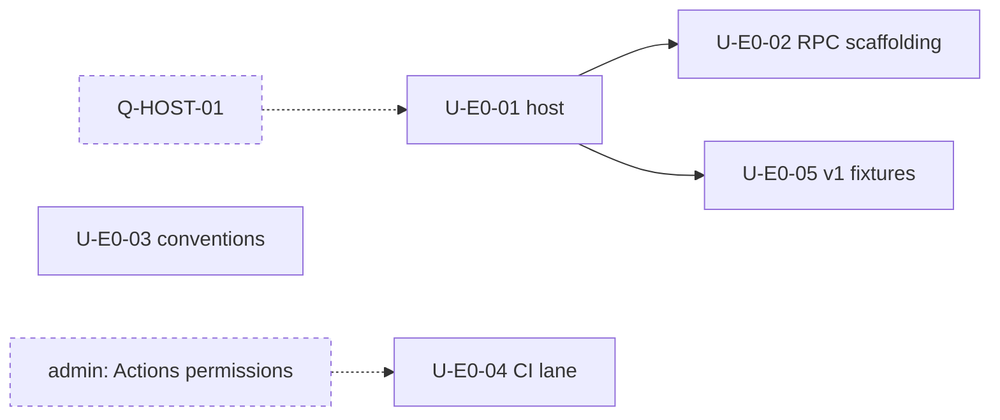

## B2. E1 Core and identity

| Unit | Title | Issue | Gate | Deps | Delta | Stale | Donor | Acceptance | Status |
|---|---|---|---|---|---|---|---|---|---|
| U-E1-01 | Product identity and branding: app dir, binary, env prefix, UA, default theme and logo (two parts, D-4) | #15267 (part 1) | G1 | U-E0-01 | partial | SMALL | yes H paths / L theme | Part 1: the host gives the runtime the `kilo2` config, data, cache and state directories (D-4); a v2 boot outside `bun dev` creates nothing under the `opencode` or `kilo` directories. Part 2: binary, UA and user-visible strings are Kilo; Kilo theme and logo render. Each shared patch counted by L3 with its seam (donor theme files are deleted at BASE). Config filenames are U-E1-07 (#15018) | active: part 1 done, #15270 merged (`9e0656d6c4`, 2026-10-20). Every process the host starts keeps config, data, cache and state under `<XDG base>/kilo2` and tmp under `<TMPDIR>/kilo2`; a boot test with a temporary HOME and no XDG variables finds nothing under `opencode` or `kilo`. One rung-3 seam, `OPENCODE_APP_DIR_NAME` in `packages/util/src/global.ts`, set by the host's `env.ts`, because `Global.Path` and the lock directory are computed at import. Part 2 (binary, UA, strings, theme, logo) todo. App name and 17 `KILO_*` env names landed with the host (#15232) |
| U-E1-02 | Customer v2 store and paths (D6): distinct dirs, fail-closed on v1/opencode stores, DB preflight, SQLite errors, log correlation | new | G1 | U-E1-01 | partial | SMALL | yes H | Filesystem-access test: a v2 boot never opens a seeded v1 store; boot fails closed on v1/opencode stores; upstream `V1Migration` is a no-op on an empty store; v1 WAL-recovery and interrupted-first-access behavior reproduced | todo |
| U-E1-03 | Gateway auth, profile, orgs, teams, Pass, error codes, tRPC client on the integration/credential framework | #14991 | G1 | U-E0-02 | partial | M | yes M | Device login, org switch, logout, Pass and balance pass against the deployed Gateway (SHA recorded); errors actionable; org default model and credential precedence match v1 | active: #15111 (login, teams), #15072 (account RPCs), #15237 (Gateway residue, progress-map proofs) merged; acceptance not recorded |
| U-E1-04 | Gateway provider, catalog merge/refresh/recovery, Kilo Auto and routed model, provider options, Codex/cloud auth | #14991 | G1 | U-E1-03 | partial | M | yes L-M | Request-capture test shows Kilo headers; Kilo models selectable; catalog recovery and malformed-entry tolerance match v1; signed-out Gateway disables the provider when the catalog is empty | active: #15111 (with #15065 catalog, #15067 headers and errors), #15116 (variants), #15237 (embedding catalog, non-retryable errors), #15248 (stored catalog at startup) merged; acceptance not recorded |
| U-E1-05 | System-prompt selectors (8), memory guidance, editor `<env>` context on BASE seams | #15108 (aliased models) | G1 | U-E1-04 | partial | M | partial L | Wire test: all eight selectors resolve per model family; memory guidance and editor context present (donor seam deleted at BASE, re-seat) | todo |
| U-E1-06 | Model usage, cost, throughput, provider usage and quotas (`/usage`) | new | G1 | U-E1-04 | needs-port | M | partial M | Session-family cost and throughput match v1 on fixture sessions incl. subagent propagation; Kilo, Codex and MiniMax provider usage shown | todo |
| U-E1-07 | Kilo config layer: keys, config filenames and `kilo.json`/`.kilo` discovery, overlay/sources/writer, references, managed policy | new | G1 | U-E1-01 | partial | M | partial M | Per-key test from `config-mapping-v2-gap.md`: each key folds or is refused with a diagnostic; writer keeps 0600 and revision checks; v1-era new keys (`memory_model`, swarm, PTC, cleanup) handled; project files (`kilo.json`, `.kilo/`) are shared with v1 whatever the app directory (D-4), so v2 never writes a key into them that v1 rejects | active: part 1 #15018 merged (`kilo.json`/`.kilo`/`.kilocode` discovery and v1 file order); follow-ups listed in #15018 (managed config, key mapping, overlay writer, legacy global `config.json`). Placement follow-up, delegated to the #15018 author: its lines in shared files import a Kilo module and hold Kilo values, so they are rung-4 patches by `v2-host-strategy.md` §5 but registered as rung 3; move them behind a generic seam set by the host, or relabel them, before the `.kilo` themes and TUI plugins follow-up lands |
| U-E1-08 | Kilo server extension surface: route groups as plugin RPC, parent watchdog, reload, watcher policy, capability/version handshake (server side) | new | G1 | U-E0-02 | partial | M | yes M | Kilo groups served as plugin RPC; server exits when its parent dies (test); `/reload` reloads the project; minimal handshake reports Kilo version and capabilities (shape per Q-G2-02) | todo |

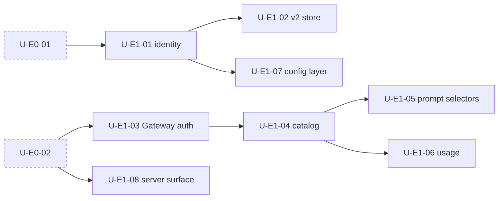

## B3. E2 Runtime behavior

Every E2 unit except U-E2-18, -21, -28 (SMALL) and U-E2-29 (EMPTY) re-derives behavior from v1.

### Workstream: session policy

| Unit | Title | Issue | Gate | Deps | Delta | Stale | Donor | Acceptance | Status |
|---|---|---|---|---|---|---|---|---|---|
| U-E2-01 | Offline network wait and reconnect | #14371 | G1 | U-E0-05 | needs-port | M | no | Fixture: waits past the native ~84 s retry bound and resumes; connection-reset retry (v1 #14893) | todo |
| U-E2-02 | Overflow accounting, `threshold_percent`, chunked compaction, payload recovery | #14372 | G1 | U-E0-05 | partial | M | no | Fixture: compaction triggers at v1 thresholds; chunked compaction and payload recovery match v1 | todo |
| U-E2-03 | Slow-snapshot interaction policy and UI | #14373 | G1 | U-E0-05 | partial | M | no | Fixture: question after the v1 timeout; persisted disable honored | todo |
| U-E2-04 | Snapshot seed/materialize, locking, cleanup, retention, restore/diff | #14374 | G1 | U-E0-05 | partial | M | no | Fixture: seed, lock, cleanup and retention match v1; restore and diff correct | todo |
| U-E2-05 | Message deletion runtime operation, Kilo revert, stable ordering | #14380 | G2 | U-E0-02, Q-G2-05 | needs-port | M | no | Public delete operation (semantics per Q-G2-05) in the generated client; ordering stable after delete and revert | todo |
| U-E2-06 | Session core verification: drain/control, prompt queue and steer, title, processing hardening | new | G1 | U-E0-01 | partial | M + NEW | no | Native-equivalence tests (scope, errors, cancellation, persistence, presentation) for drain, stop/resume, queue dismissal, steer labels, bounded title, processing fixes | todo |
| U-E2-07 | Subagent resume, background subagents (default on), steering | new | G1 | U-E2-06 | partial | M | no | Background subagents on by default with kill switch, survive stop; resume hint; steering into subagents | todo |
| U-E2-08 | Wakeups and cron (persisted, re-armed) | new | G1 | U-E2-06 | needs-port | NEW | no | Wakeups and cron persist and re-arm after a server restart (test) | todo |
| U-E2-09 | Goal mode | new | G1 | U-E2-08 | needs-port | NEW | no | `/goal`, `goal` and `goal_report` behave as v1 | todo |
| U-E2-10 | Backend-owned session retention | new | G1 | U-E1-07 | needs-port | NEW | no | Retention prunes per config on the backend; clients see a consistent list | todo |
| U-E2-11 | Session transcript recall search | new | G1 | U-E0-02 | needs-port | M | partial M | Recall returns v1-equivalent results on fixture transcripts | todo |

### Workstream: agents, commands and skills

| Unit | Title | Issue | Gate | Deps | Delta | Stale | Donor | Acceptance | Status |
|---|---|---|---|---|---|---|---|---|---|
| U-E2-12 | Kilo agents (code, ask, debug, orchestrator, plan), mode reminders, agent builder | new | G1 | U-E0-02 | partial | M | yes M | Agents and permissions as v1 (`build` shown as Code, Ask read-only, user IDs win); mode reminders; agent builder | active: agents and permissions through the host #15238 merged (supersedes #14999); mode reminders and agent builder not verified |
| U-E2-13 | Plan workflow and Plan-to-Code handoff | #14382 | G1 | U-E2-12 | needs-port | M | yes M | Plans saved in the Kilo location, not `~/.opencode/plan`; `plan_exit` requires a saved plan; follow-up offers new session, continue, refine; new-session handoff keeps Plan and opens Code | todo |
| U-E2-14 | Kilo review policy over native `/review` | new | G1 | U-E2-12 | partial | M | yes M | `/review` over working tree and worktree diff matches v1 | todo |
| U-E2-15 | Commands and workflows, skills (trust, builtin, remove), rules and primary-worktree discovery | new | G1 | U-E1-07 | partial | M | yes M | Command list/remove, reserved names, workflow variants, timeout; skill trust only for global/builtin; builtin `kilo-config`; rules from `.kilo`/`.kilocode` mirrored from the primary worktree | todo |

### Workstream: tools and permissions

| Unit | Title | Issue | Gate | Deps | Delta | Stale | Donor | Acceptance | Status |
|---|---|---|---|---|---|---|---|---|---|
| U-E2-16 | Tool registry and client gating, question tool, `suggest`, todo transitions | new | G1 | U-E0-02 | partial | M + NEW | partial L-M | `KILO_CLIENT` gating per client; headless question handling; suggest lifecycle; todo transitions as v1 | todo |
| U-E2-30 | Content and code tools: TS check after edits, rich document read, repo overview, encoding-preserving I/O, model search/selection tools | new | G1 | U-E2-16 | partial | M + NEW | partial L-M | TS check runs after edits; docx/xlsx/ods/pdf read; repo overview; encodings and BOM preserved; task model selection as v1 | todo |
| U-E2-17 | Permission customizations and bash hierarchy | new | G1 | U-E2-16 | partial | M | partial M | `/approve-all`, headless policy, config-path protection, provenance; bash hierarchy, heredoc, PowerShell; Explore read-only bash counts (28 + 20) verified | todo |

### Workstream: engines

| Unit | Title | Issue | Gate | Deps | Delta | Stale | Donor | Acceptance | Status |
|---|---|---|---|---|---|---|---|---|---|
| U-E2-18 | Memory engine, tools and RPC | new | G1 | U-E0-02 | needs-port | SMALL | yes H | Recall/save tools, `/memory`, `memory_model` fallback, save pulse; durable injection indicator or a recorded missing seam | todo |
| U-E2-19 | Codebase indexing engine, worker, `semantic_search` | new | G1 | U-E0-02 | needs-port | M | yes M-H | Worker isolated; embedders and stores as v1; consent off means no init; root/home safeguards; CLI and cloud paths covered | todo |
| U-E2-20 | Sandbox: shell/MCP/PTY confinement, network relay, git classifier, per-session lifecycle on the workspace/environment driver seam | new | G1 | U-E0-01 | needs-port | M | yes M | Confinement on macOS and Linux (bwrap) incl. MCP and PTY; prompt before sandboxed git writes; opt-in default off; v1 policy variants; release validation per platform | todo |
| U-E2-21 | Telemetry with consent and privacy policy, coexisting with OTLP | new | G1 | U-E1-01, Q-TEL-01 | needs-port | SMALL | partial M | Default per Q-TEL-01; events only with consent; OTLP observability unaffected | todo |

### Workstream: MCP and marketplace

| Unit | Title | Issue | Gate | Deps | Delta | Stale | Donor | Acceptance | Status |
|---|---|---|---|---|---|---|---|---|---|
| U-E2-22 | MCP deltas (OAuth callback handoff, issuer discovery, auth-failure surfacing, SSE probe, jsonc writes) and `git:` plugin sources | new | G1 | U-E0-02 | partial | NEW | partial L | Each delta tested against BASE MCP (gap narrowed upstream; port only what is missing); `git:` sources install | todo |
| U-E2-23 | Marketplace (MCP servers, skills, modes, plugins) | new | G1 | U-E2-22 | needs-port | NEW | no | Marketplace lists and installs each item type through the CLI API | todo |

### Workstream: agent coordination

| Unit | Title | Issue | Gate | Deps | Delta | Stale | Donor | Acceptance | Status |
|---|---|---|---|---|---|---|---|---|---|
| U-E2-24 | Shared agent board / swarm (default on) | new | G1 | U-E2-07 | needs-port | NEW | partial M | Board keyed by root session; recipients as v1; default on with kill switch | todo |
| U-E2-25 | Background processes tool, sidebar data, `/process`, on persistent PTY | new | G1 | U-E0-02 | needs-port | M | partial M | Tool and `/process` as v1; a stale `running` row shows no PID after restart | todo |
| U-E2-26 | Worktree runtime: family detection, teardown, Kilo layout, VCS | new | G1 | U-E0-01 | partial | M | no | Family detection and teardown as v1; `.kilo/worktrees` layout | todo |
| U-E2-27 | Agent Manager host contract and control plane (ask/reply/reject, protection) | #14391 | G2 | U-E2-26, Q-G2-06 | needs-port | M | partial L | Public control-plane contract (per Q-G2-06) in the generated client, incl. multi-project routing | todo |

### Workstream: generation and providers

| Unit | Title | Issue | Gate | Deps | Delta | Stale | Donor | Acceptance | Status |
|---|---|---|---|---|---|---|---|---|---|
| U-E2-28 | Generation endpoints: enhance prompt, commit message, branch name | new | G2 | U-E0-02 | partial | SMALL | yes M | Endpoints in the generated client; output and errors match v1; editor-context prefix; equivalence with the BASE `generate` group decided | todo |
| U-E2-29 | Atomic Chat local provider plugin | new | G1 | U-E1-04 | needs-port | EMPTY | no | Provider discovered and usable | todo |

```mermaid
flowchart TD
  E0_01["U-E0-01"]:::ext
  E0_02["U-E0-02"]:::ext
  E0_05["U-E0-05"]:::ext
  E1_01["U-E1-01"]:::ext
  E1_04["U-E1-04"]:::ext
  E1_07["U-E1-07"]:::ext
  subgraph SP["Session policy"]
    E2_01["01 offline wait"]
    E2_02["02 overflow"]
    E2_03["03 slow snapshot"]
    E2_04["04 snapshots"]
    E2_05["05 message deletion G2"]:::g2
    E2_06["06 session core"]
    E2_07["07 subagents"]
    E2_08["08 wakeups"]
    E2_09["09 goals"]
    E2_10["10 retention"]
    E2_11["11 recall"]
  end
  subgraph AG["Agents and skills"]
    E2_12["12 agents"]
    E2_13["13 plan"]
    E2_14["14 review"]
    E2_15["15 commands, skills, rules"]
  end
  subgraph TL["Tools"]
    E2_16["16 registry, question, suggest"]
    E2_30["30 content tools"]
    E2_17["17 permissions"]
  end
  subgraph EN["Engines"]
    E2_18["18 memory"]
    E2_19["19 indexing"]
    E2_20["20 sandbox"]
    E2_21["21 telemetry"]
  end
  subgraph MC["MCP"]
    E2_22["22 MCP deltas"]
    E2_23["23 marketplace"]
  end
  subgraph CO["Coordination"]
    E2_24["24 board"]
    E2_25["25 processes"]
    E2_26["26 worktrees"]
    E2_27["27 Agent Manager G2"]:::g2
  end
  subgraph GP["Generation"]
    E2_28["28 generation G2"]:::g2
    E2_29["29 Atomic Chat"]
  end
  E0_05 --> E2_01 & E2_02 & E2_03 & E2_04
  E0_01 --> E2_06 & E2_20 & E2_26
  E0_02 --> E2_05 & E2_11 & E2_12 & E2_16 & E2_18 & E2_19 & E2_22 & E2_25 & E2_28
  E2_06 --> E2_07 & E2_08
  E2_08 --> E2_09
  E1_07 --> E2_10 & E2_15
  E2_12 --> E2_13 & E2_14
  E2_16 --> E2_17 & E2_30
  E1_01 --> E2_21
  E2_22 --> E2_23
  E2_07 --> E2_24
  E2_26 --> E2_27
  E1_04 --> E2_29
  classDef ext stroke-dasharray: 4 4
  classDef g2 stroke-width:3px
```

## B4. E9 CLI/TUI surface

U-E9-05, -09, -10, -11 and -12 touch the same TUI files: run them in series.

| Unit | Title | Issue | Gate | Deps | Delta | Stale | Donor | Acceptance | Status |
|---|---|---|---|---|---|---|---|---|---|
| U-E9-01 | Service/daemon UX: `kilo daemon` over the native service, startup performance, port warning | new | G1 | U-E1-08 | native | M | yes M | `kilo daemon status/stop/restart` map to the native service; port warning; startup time recorded against the baseline | todo (startup ratchet for Kilo plugin activation #15246 and Gateway stored-catalog startup #15248 merged, #15244) |
| U-E9-02 | Kilo command set, help, generated CLI docs, roll-call, `kilo worktree`, inherited commands | new | G1 | U-E0-01 | partial | M | yes M | `kilo --help --all` lists the v1 set or a removal note per missing command; CLI docs generate; roll-call and `kilo worktree` as v1 | todo |
| U-E9-03 | `kilo run` and headless behavior (variant, auto, drain, stdin, questions) | new | G1 | U-E2-06 | partial | M | yes M | Each flag and headless question path matches v1; `run` waits for drain | todo |
| U-E9-04 | ACP host with Kilo permission mapping | new | G1 | U-E2-17 | partial | M | yes M | ACP permission mapping matches v1 | todo |
| U-E9-05 | TUI shell: title/activity, caffeinate, TUI config hot reload, worker transport check, inherited TUI | new | G1 | U-E1-01 | partial | M | partial L-M | OSC title and activity, `/caffeinate`, hot reload as v1; worker handshake defect reproduced or recorded not-needed | todo |
| U-E9-06 | Kilo slash-command registry and dialogs; Gateway notifications and news; provider/integration dialog guidance | new | G1 | U-E1-03 | partial | M | partial M | Registry in place, each command registered by its feature unit; news and notifications on home; provider dialogs show v1 guidance and failure detail | todo |
| U-E9-07 | Home and sidebar plugins; model picker, info panel, free/training disclosure; status/footer onboarding | new | G1 | U-E1-06 | partial | M | yes M | Sidebar order pr 50, footer 99, usage 150, indexing 225, processes 250, memory 1000; picker groups, `BYOK`/`May train` labels; model info panel rules as v1 | todo |
| U-E9-08 | Per-session soft maximum-cost alert | new | G1 | U-E1-06 | needs-port | M | no | Alert fires at the configured threshold as v1 | todo |
| U-E9-09 | Completion/abort/timeout notifications and attention policy | #14375 | G1 | U-E9-05 | partial | M | partial L | Notifications follow v1 attention policy on top of native notifications | todo |
| U-E9-10 | Session scope switching, list actions, clickable links, @session mentions, double-press guards, keybinds | #14377 | G1 | U-E9-05 | needs-port | M | no | Each interaction as v1 | todo |
| U-E9-11 | Location/session projection and foreign-project event filtering | #14379 | G1 | U-E9-05 | partial | M | no | Test proves foreign-project events are filtered; port only if BASE lacks it | todo |
| U-E9-12 | Multiline alerts and default sound; display preferences; privacy mode and PII redaction | #14378 (part) | G1 | U-E9-05 | partial | M | partial L | Alerts and sound as v1; tool/reasoning collapse; privacy redaction | todo |
| U-E9-13 | `kilo cloud` Cloud Agent CLI | new | G1 | U-E1-03 | needs-port | SMALL | yes H-M | `start/send/status/result` and stdin prompts against the deployed service (SHA recorded) | todo |
| U-E9-14 | Embedded web UI decision: `kilo-web-ui` vs upstream `packages/app` | new | G1 | U-E9-15 | decision | M | no | Decision recorded and implemented | todo |
| U-E9-15 | Disposition of upstream-only surfaces: desktop, web app, GUI extensions | new | G1 | Q-PROD-01 | decision | n/a | no | User decision per surface recorded and implemented (ship, hide or defer). Desktop, web app and GUI extensions: not shipped, removed (#15151); the TUI `/pair` command still links to the removed web UI and must be hidden | active: removal #15151; `/pair` open |

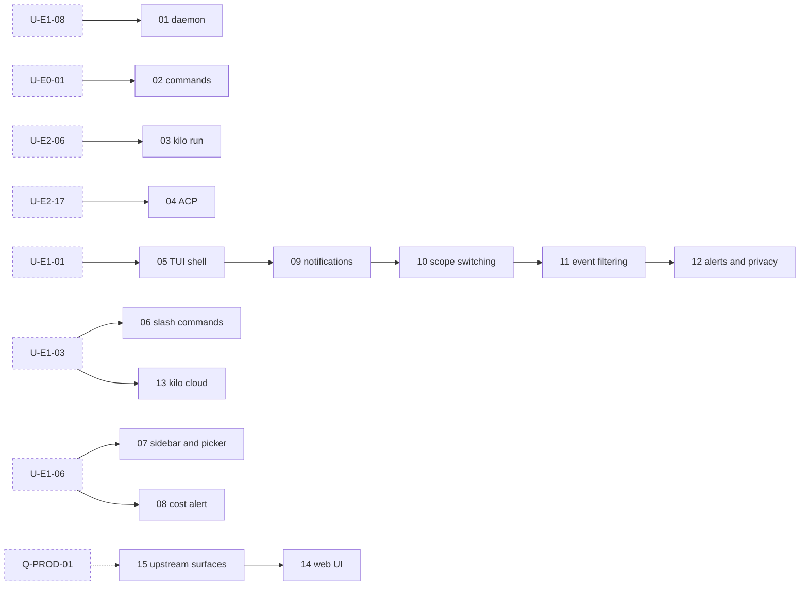

The chain 09 → 12 is the serialization rule for shared TUI files, not a functional dependency.

## B5. E3 Import and distribution

| Unit | Title | Issue | Gate | Deps | Delta | Stale | Donor | Acceptance | Status |
|---|---|---|---|---|---|---|---|---|---|
| U-E3-01 | Opt-in, re-runnable v1 session/data import into the v2 store (read `kilo.db` read-only; upstream pure transforms; legacy JSON storage) | #14413 | G1 | U-E1-02 | needs-port | M | partial M | Fixture stores from each supported v1 release incl. `fb7e96ed`: originals byte-identical, v1 binary still opens them; second run imports only new sessions; schema audit re-run against v1 target and BASE | todo |
| U-E3-02 | Credential import (host-local only) | #14413 (part) | G1 | U-E1-03 | partial | M | yes M | Host-local import only; no credential writer over HTTP/RPC; OAuth account maps to the selected org | todo |
| U-E3-03 | Config key mapping, legacy Kilo Code migrators, TUI config migration | #14413 (part) | G1 | U-E1-07 | needs-port | M | partial M | Per-key mapping test; modes, rules, workflows, MCP and ignore migrators as v1 | todo |
| U-E3-04 | External transcript resume (Claude Code, Codex), migrate API, cloud session import and `--cloud-fork` | new | G1 | U-E3-01 | needs-port | M + NEW | partial L | Each import path as v1, incl. ambient discovery and the picker | todo |
| U-E3-05 | Fork, move and portability diff verification | new | G1 | U-E2-06 | native/partial | M | no | Native-equivalence tests; cumulative diff and restore on move as v1 | todo |
| U-E3-06 | Updater and installation detection under Kilo identity | #14410 | G1 | U-E1-01 | partial | M | yes M | Update and rollback on real artifacts; install method detected; overlap with BASE `services/update` decided | todo |
| U-E3-07 | Build and release pipeline: platforms, npm/GHCR/AUR/Homebrew/nix/install script, SBOM, PTY smoke, payload format, clean install | #14409, #14412 | G1 | U-E0-04 | partial | M | partial M | Artifacts for every v1 platform; each channel dry-runs; SBOM; PTY smoke; clean install beside v1; removal of the kept upstream release paths (`services/`, `nix/`, `install`, `github/`) decided (U-E3-06 for `services/update`) | todo |
| U-E3-13 | Signing and notarization (start early) | #14411 | G1 | U-E0-04, admin: signing credentials | partial | M | no | Signed and notarized macOS and Windows artifacts verify on clean hosts | todo |
| U-E3-08 | CI and repository guards (forbidden strings, generated artifacts, markers, md tables, CodeQL, sharding, bots) | #14408 | G1 | U-E0-04 | partial | M | no | Each v1 guard ported or recorded not-needed; guards run on PRs to `origin/v2` | todo |
| U-E3-09 | Publish `@kilocode/sdk` and `@kilocode/plugin` from BASE packages | new | G1 | U-E3-07 | partial | SMALL | no | Publish dry run passes `verify:package`; names and versions decided | todo |
| U-E3-10 | v2 preview release train | new | G1 | U-E3-06, U-E3-07, U-E3-08, U-E3-12 | needs-port | n/a | no | At least one preview shipped to the team under the Q-DIST-01 identity; findings filed against units | todo |
| U-E3-11 | Canary and cutover/rollback runbook, G1 | #14414 | G1 | U-E3-10, U-L4-05 | needs-port | n/a | no | Runbook written and exercised once on the G1 candidate; rollback to v1 CLI on untouched v1 files | todo |
| U-E3-12 | Binary and channel naming; v1-IDE isolation from the v2 binary | new | G1 | U-E1-01, Q-DIST-01 | needs-port | n/a | no | Name and channel implemented; test: a v1 IDE build cannot resolve the v2 binary via PATH, global install or dist-tag | todo |

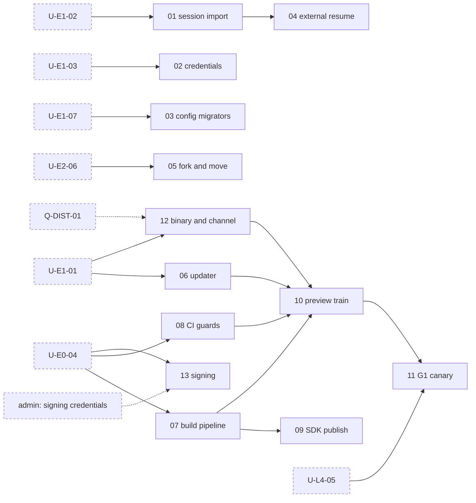

## B6. E4 Remote sessions

| Unit | Title | Issue | Gate | Deps | Delta | Stale | Donor | Acceptance | Status |
|---|---|---|---|---|---|---|---|---|---|
| U-E4-01 | Relay wire protocol and command dispatcher | #14402 | G1 | U-E1-03 | needs-port | M | yes M | Local contract test for every `CLIOutboundMessageSchema` message | todo |
| U-E4-02 | Streamed transcript, attachments, `notify_user`/`send_file`, reconnect without duplication | #14403 | G1 | U-E4-01 | needs-port | M | yes M | Reconnect replays without duplicates; attachments and files delivered | todo |
| U-E4-03 | Remote suggestion lifecycle and subscribed-session ownership | #14404 | G1 | U-E4-01, U-E2-16 | needs-port | M | yes M | Suggestions accept/dismiss remotely; ownership as v1 | todo |
| U-E4-04 | Detach/exit, interruption, heartbeat fencing | #14405 | G1 | U-E4-01 | needs-port | M | yes M | Each lifecycle path as v1; stale heartbeats fenced | todo |
| U-E4-05 | Metadata, capability advertisement, instance identity, directory listing, headless link dialog, coexistence with upstream pairing/OpenTunnel | #14406 | G1 | U-E4-01, Q-PROD-01 | needs-port | M | partial M | Unsupported capabilities not advertised; identity fields as v1; pairing coexistence decision implemented | todo |
| U-E4-06 | Presence host registration | #14395 (part) | G1 | U-E4-01 | needs-port | M | yes M | Host registers and deregisters with the event service | todo |
| U-E4-07 | PR linking (GitHub, GitLab, Bitbucket), poller, sidebar row | new | G1 | U-E4-01 | needs-port | NEW | no | Each forge links; `gh` lookup chain as v1 | todo |
| U-E4-08 | Deployed relay and consumer verification (external-gated) | #14407 | G1 | U-E4-01…07 | needs-port | n/a | no | Deployed acceptance recorded with SHA, or a user waiver recorded | todo |

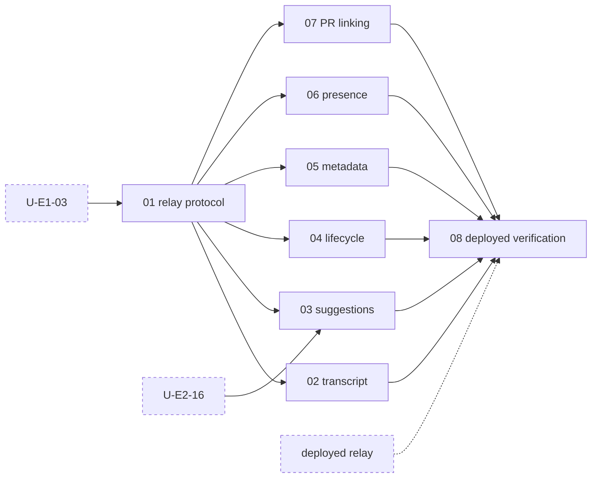

## B7. E5 Sharing

| Unit | Title | Issue | Gate | Deps | Delta | Stale | Donor | Acceptance | Status |
|---|---|---|---|---|---|---|---|---|---|
| U-E5-01 | Share transport normalization; share/unshare/fork client operations | #14396 | G1 | U-E1-03 | needs-port | EMPTY | partial M-H | Operations target the JWT `share_token` contract (`session-sharing.md`) | todo |
| U-E5-02 | v2 share payload contract (self-contained messages, metadata-first upload) | #14397 | G1 | U-E5-01 | needs-port | EMPTY | partial M | Payload of self-contained v2 messages; explicit consent before a public share | todo |
| U-E5-03 | Public viewer for v2 messages (cloud repository) | #14398 | G1 | U-E5-02 | needs-port | EMPTY | no | Viewer renders v2 messages; change merged by the cloud owner | todo |
| U-E5-04 | Team upload stays refused (fail-closed) | #14399 (part) | G1 | U-E5-01 | needs-port | EMPTY | partial M | Team upload refused with a clear message | todo |
| U-E5-05 | Deployed share contract verification (external-gated) | #14401 | G1 | U-E5-01…04 | needs-port | n/a | no | Share, unshare, fork-from-share round-trip against the deployed backend, SHA recorded | todo |
| U-E5-06 | Background session export/ingest to Kilo cloud (scrubbed), opt-out | new | G1 | U-E1-03 | needs-port | EMPTY (feature) | no | Scrubbed upload of v2 sessions; opt-out honored | todo |

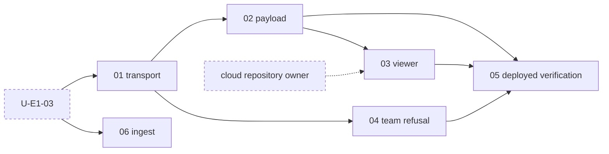

## B8. E10 External consumers

| Unit | Title | Issue | Gate | Deps | Delta | Stale | Donor | Acceptance | Status |
|---|---|---|---|---|---|---|---|---|---|
| U-E10-01 | Cloud agent consumers: adapt confirmed gaps through public interfaces and validate | #14427, #14428 | G1 (provisional, Q-EXT-01) | U-E3-12, U-E3-01 | needs-port | n/a | no | Disposition, owner and gate recorded; each contract gap (renamed CA-1…CA-11 to avoid the gate-name collision) adapted or waived; validation with cloud owners | todo |
| U-E10-02 | Anaconda Desktop: integration mode, compatibility, adaptation, validation; v1 `anaconda-desktop` provider | #14429, #14430, #14431, #14432 | TBD (Q-EXT-02) | U-E1-04 | needs-port | EMPTY | no | Integration mode and gate recorded; provider ported; validation passes on the attached gate | todo |
| U-E10-03 | Other CLI consumers: Zed extension, GitHub Action, floating `@latest` users | new | G1 | U-E3-12 | needs-port | n/a | no | Each consumer pinned or adapted before the dist-tag switch | todo |

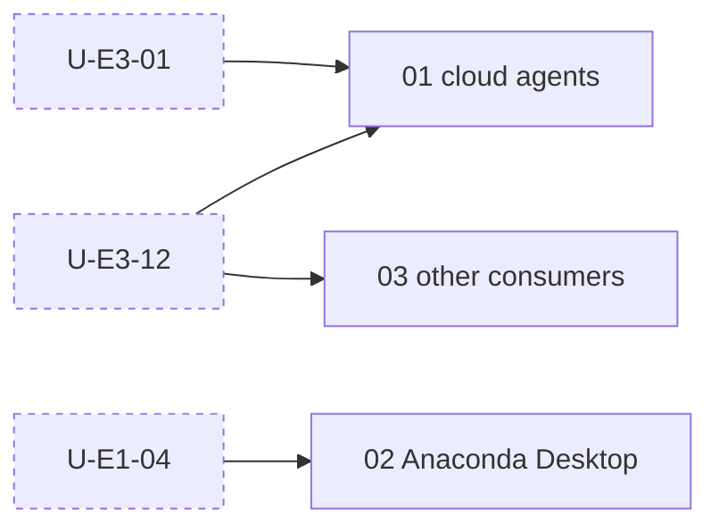

## B9. E6 VS Code track (G2)

Every unit is MATERIAL except U-E6-07, -08, -20 (SMALL), U-E6-18 (NEW) and U-E6-21 (n/a). Re-copy the extension and webview from v1 `fb7e96ed`; keep only the donor's backend-adapter pattern (`kv/backend/*`, `connection.ts`, `local-server.ts`). The `virtua` patch caveat in the old fork conventions applies once the webview lands. Start U-E6-08 during Phase 1.

| Unit | Title | Issue | Gate | Deps | Delta | Stale | Donor | Acceptance | Status |
|---|---|---|---|---|---|---|---|---|---|
| U-E6-01 | Re-land v1 extension host, webview, `kilo-ui`, `kilo-i18n` behind v2 adapters; real typecheck | #14383 | G2 | U-E0-02, Q-G2-01 | needs-port | M | partial L | `typecheck` is real with no skip shim; `bun run extension` builds | todo |
| U-E6-02 | Connection: server manager for the v2 binary, handshake (client), v2 store, opt-in first-launch import | #14387 | G2 | U-E6-01, U-E1-08, U-E3-01, Q-G2-02, Q-G2-03 | needs-port | M | partial M | Bundled v2 binary starts; handshake detects v2; never mixes v1 and v2 routes; opt-in import; `globalState` and secrets mapped | todo |
| U-E6-03 | Sidebar chat lifecycle: streaming, Stop, reconnect, Restricted Mode conflict, message-deletion caller | #14384 | G2 | U-E6-02, U-E2-05, Q-G2-04 | needs-port | M | partial L | Stop verified on desktop; Restricted Mode no longer needed; delete message works | todo |
| U-E6-04 | Editor tabs: streaming, restore, independent routing | #14385 | G2 | U-E6-03 | needs-port | M | partial L | Tabs stream, restore after reload and route independently | todo |
| U-E6-05 | Settings webview controls and persistence (max cost, display, language, CA certs) | #14386 | G2 | U-E6-01, U-E1-07 | needs-port | M | partial M | Each v1 setting persists through the config overlay | todo |
| U-E6-06 | Models, accounts, auth and provider OAuth variants, org switch, provider usage | #14388 | G2 | U-E6-02, U-E1-03 | needs-port | M | partial M | Each auth path and org switch as v1 | todo |
| U-E6-07 | Generation consumers (SCM commit message, enhance prompt, branch naming); code and terminal actions | #14389, #14417 | G2 | U-E2-28 | needs-port | SMALL | partial M | Each action works in the real UI as v1 | todo |
| U-E6-08 | FIM and next-edit producer: Gateway endpoints and service contract (shared runtime) | #14416 (part) | G2 | U-E1-03 | needs-port | SMALL | no | `/kilo/fim` and `/kilo/edit` reachable through a public contract from the generated client; shared FIM model selection as v1 | todo |
| U-E6-20 | FIM and next-edit in VS Code: inline completion, next-edit, chat autocomplete, `autocomplete.*` settings | #14416 (part) | G2 | U-E6-08, U-E6-01 | needs-port | SMALL | no | Inline completion and next-edit work end to end on a real host (hard gate) | todo |
| U-E6-09 | Terminal integration and ticket lifecycle | #14390 | G2 | U-E6-02 | needs-port | M | partial M | Terminals and PTY tickets as v1 | todo |
| U-E6-10 | Agent Manager UI on the v2 control plane | #14391 (consumer) | G2 | U-E2-27, U-E6-09 | needs-port | M | partial L | Worktrees, sessions, tabs, terminals, PR, diff, previews as v1 | todo |
| U-E6-11 | VS Code-only tools and panels: browser tab/open, chart, image preview, document viewer, sub-agent viewer, diff provider | new | G2 | U-E6-01, U-E2-16 | needs-port | M + NEW | partial L | Each tool and panel as v1 | todo |
| U-E6-12 | Notifications and suggestions lifecycle | #14392 | G2 | U-E2-16, U-E9-06 | needs-port | M | no | List, accept, dismiss as v1 | todo |
| U-E6-13 | Marketplace panel; agent, skill and MCP removal; MCP OAuth sign-in | #14393 | G2 | U-E2-15, U-E2-22, U-E2-23 | needs-port | M + NEW | partial L | Each action as v1 | todo |
| U-E6-14 | Task timeline, diff viewer projection, token throughput | #14394 | G2 | U-E6-03 | needs-port | M | partial L | Timeline and diff render v2 messages as v1 | todo |
| U-E6-15 | Remote status and presence visibility reporting | #14395 (part) | G2 | U-E4-06 | needs-port | M | partial M | Status and visibility as v1 | todo |
| U-E6-16 | Engine and policy controls: memory, indexing consent and write controls, sandbox, network ask, caffeination, attention, telemetry proxy | new | G2 | U-E2-18, U-E2-19, U-E2-20, U-E2-21 | needs-port | M | partial M | Each control as v1 | todo |
| U-E6-17 | Kilo-classic session migration and Roo import | new | G2 | U-E3-01 | needs-port | M | partial L | Sessions migrate (scope reduced by v1's server-side move) | todo |
| U-E6-18 | Session extras: board, background jobs, wakeups, retention, model usage, snapshots, move, cloud import | new | G2 | U-E2-08, U-E2-10, U-E2-24, U-E3-04 | needs-port | NEW | no | Each extra as v1 | todo |
| U-E6-19 | VSIX packaging and publishing with the v2 binary | new | G2 | U-E6-02, U-E3-07, Q-G2-08 | needs-port | M | partial M | VSIX builds with `vsce package --no-dependencies`; name and channel per Q-G2-08 | todo |
| U-E6-21 | G2 canary and rollback runbook | new (child of #14414) | G2 | U-E6-19, U-L4-06 | needs-port | n/a | no | Runbook exercised; previous extension works on untouched v1 files | todo |

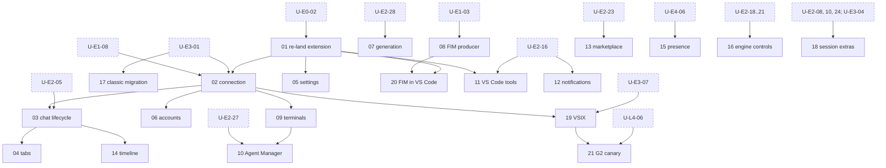

Secondary dependencies not drawn: U-E6-05 on U-E1-07, U-E6-06 on U-E1-03, U-E6-12 on U-E9-06, U-E6-13 on U-E2-15 and U-E2-22 (see the table).

## B10. E7 JetBrains track (G3)

No donor exists; behavior comes entirely from v1 (`packages/kilo-jetbrains` at `fb7e96ed`).

| Unit | Title | Issue | Gate | Deps | Delta | Stale | Donor | Acceptance | Status |
|---|---|---|---|---|---|---|---|---|---|
| U-E7-01 | Inventory plugin contracts and map each to a public v2 interface | #14420 | G3 | U-E0-02 | needs-port | M | no | Every route, event and terminal contract mapped; Q-G3-01 and Q-G3-02 answered | todo |
| U-E7-02 | Re-land the plugin: Gradle build, CLI pin to a v2 release, client generated from the assembled contract, startup, discovery, auth, version checks | #14421 | G3 | U-E7-01, U-E3-07, Q-G3-03 | needs-port | M | no | Builds from Kilo's `origin/v2`; only the generated client is used; incompatible CLIs refused with a clear message | todo |
| U-E7-03 | Sessions, streaming, permissions, history, config, board, subagents, prompt completion, settings, MCP OAuth, telemetry | #14422 | G3 | U-E7-02 | needs-port | M | no | Each area as v1 | todo |
| U-E7-04 | Terminal, diff/VFS, editor-service consumers (enhance prompt, branch name; FIM only if Q-G3-01 keeps the gate) | #14423 | G3 | U-E7-02, U-E2-28 (U-E6-08 if FIM gates) | needs-port | M | no | Each consumer as v1 | todo |
| U-E7-05 | Agent Manager, worktrees, marketplace, legacy v5 migration | new | G3 | U-E2-27, U-E7-03, Q-G3-05 | needs-port | M | no | Each area as v1; v5 migration per Q-G3-05 | todo |
| U-E7-06 | Validate in supported IDEs: reconnect, restart, version mismatch | #14424 | G3 | U-E7-02…05, Q-G3-04 | needs-port | n/a | no | Validation recorded per supported IDE | todo |
| U-E7-07 | G3 canary and rollback runbook | new (child of #14414) | G3 | U-E7-06, U-L4-07 | needs-port | n/a | no | Runbook exercised; pinned v1 CLI works on untouched v1 files | todo |

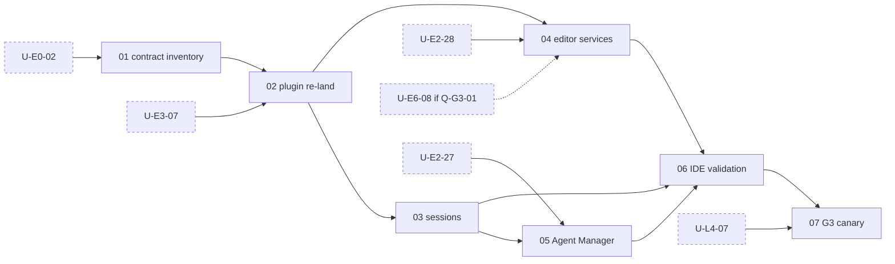

## B11. E8 Retirement (post-G3)

| Unit | Title | Issue | Gate | Deps | Delta | Stale | Donor | Acceptance | Status |
|---|---|---|---|---|---|---|---|---|---|
| U-E8-01 | Branch flip (`main`→`v1`, Kilo's `origin/v2`→`main`), timed against v1 IDE builds | new | post-G3 | G3 go, Q-G2-01 | needs-port | n/a | no | Flip done; the `v1` branch builds and releases CLI and IDEs | todo |
| U-E8-02 | Storage path consolidation (D6), once, with backup | new | post-G3 | U-E8-01 | needs-port | n/a | no | Runs once with backup; a second run is a no-op | todo |
| U-E8-03 | Packages that deploy from `main`: keep docs site, retire `kilo-console`, re-home workflows | new | post-G3 | U-L5-01 | partial / not-needed | M | no | Every workflow and deployment from `main` has a v2 owner or is retired before the flip | todo |
| U-E8-04 | v1 end-of-life policy and maintenance window | new | post-G3 | U-E8-01 | needs-port | n/a | no | Policy published with a date | todo |

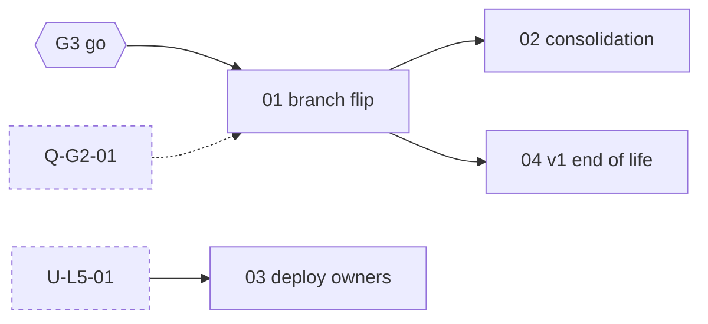

## B12. E11 Post-cutover backlog (non-gating)

Acceptance for every row is a recorded user decision (ship, drop or re-scope); shipping becomes a new unit.

| Unit | Title | Issue | Gate | Deps | Delta | Stale | Donor | Acceptance | Status |
|---|---|---|---|---|---|---|---|---|---|
| U-E11-01 | Speech-to-text (Gateway endpoints and VS Code capture) | #14418 | non-gating | — | post-cutover | SMALL | no | Decision recorded | todo |
| U-E11-02 | Image generation (tool and VS Code consumer) | #14419 (image part) | non-gating | — | post-cutover | SMALL | no | Decision recorded | todo |
| U-E11-03 | Team sharing ownership; incremental sharing with deletion/revert semantics | #14399 (ownership), #14400 | non-gating | U-E5-02 | post-cutover | EMPTY | no | Decision recorded | todo |
| U-E11-04 | Legacy TUI extras: kilo-v1/colorblind themes, legacy bindings, fixed-width tables, vim mode | #14376, #14378 (part) | non-gating | U-E9-05 | post-cutover | M | partial L | Decision recorded | todo |
| U-E11-05 | Default-off experimental features (Exa, context tools, code mode/PTC, MCP Apps, session switcher, notebook tools, Claude migration, scout, LSP tool, VS Code browser automation and prompt history) | new | non-gating | Q-G2-07 | post-cutover | NEW | no | Decision recorded per feature | todo |
| U-E11-06 | KiloClaw: not needed (removed on v1); no donor remnants copied | #14419 (Claw part) | non-gating | — | not-needed | n/a | no | Grep shows no Claw paths on Kilo's `origin/v2` | todo |

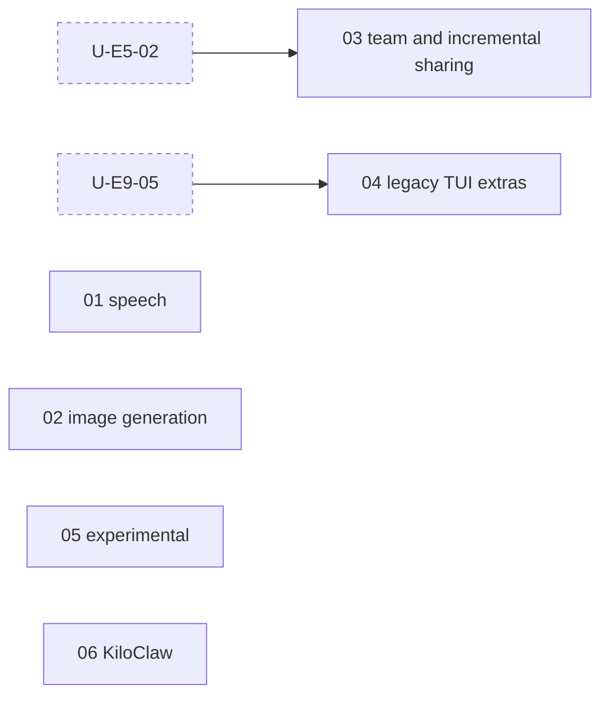

## B13. L Cross-cutting lanes

| Unit | Title | Issue | Gate | Deps | Delta | Stale | Donor | Acceptance | Status |
|---|---|---|---|---|---|---|---|---|---|
| U-L1-01 | Upstream sync: merge every `upstream/dev` release commit pinned by SHA; dry-run workflow; merge tooling (one child per merge) | #15020 | continuous | U-E0-04 (dry-run workflow only) | needs-port | M | no | Each sync pinned by SHA and merged with a merge commit; failures diffed against `origin/v2` before the sync; lag in releases and days recorded | active: tooling #15026; syncs `v2.0.27` #15029, `v2.0.30` #15136 |
| U-L2-01 | v1 delta sweep: advance the cutoff, refresh the experimental-flag list, re-run staleness (one child per sweep) | new | continuous | — | needs-port | n/a | no | First sweep starts at `d99662338`; zero unclassified Kilo-owned or marked files in range; touched units re-opened | todo |
| U-L3-01 | Shared-patch ratchet and marker disposition sweep | #14381 | continuous | U-E0-01 | needs-port | n/a | no | Script counts shared files (each with its rung and missing seam in `script/upstream/shared-patches.json`), marked lines and unmarked exceptions, plus the other two L3 metrics (client→Core/Server imports, Kilo imports of upstream internals); CI fails an increase without a stated seam | active: shared-file counter #15026; Kilo imports of upstream internals counted by `script/upstream/placement.ts --imports` (#15232) and the progress-map ratchets (#15231); client→Core/Server imports not counted yet |
| U-L4-01 | Rewrite test plans with gate tags and v1-derived expectations (G1 scenario set) | new | G1 | — | needs-port | n/a | no | Each scenario tagged G1/G2/G3; expectations quoted from v1; RT and UI IDs kept | todo |
| U-L4-02 | Acceptance harness: simulation/http-recorder, isolated real-host runner | new | G1 | U-E0-01 | needs-port | n/a | no | Harness runs scenarios on BASE; every fixture isolates HOME/XDG itself | todo |
| U-L4-03 | G2 scenario set (VS Code) | new | G2 | — | needs-port | n/a | no | Scenarios cover sidebar, tabs, Agent Manager, settings, terminals, reconnect, import, handshake, rollback | todo |
| U-L4-04 | G3 scenario set (JetBrains) | new | G3 | — | needs-port | n/a | no | Scenarios cover startup, auth, sessions, permissions, history, terminal, editor services, reconnect, restart, version mismatch | todo |
| U-L4-05 | G1 acceptance run | new | G1 | All G1 units except U-E3-11; U-L4-01, U-L4-02 | needs-port | n/a | no | Every G1 scenario run on an isolated real host, recorded with SHA | todo |
| U-L4-06 | G2 acceptance run | new | G2 | All G2 units except U-E6-21; U-L4-03 | needs-port | n/a | no | Every G2 scenario run on a real VS Code host, recorded with SHA | todo |
| U-L4-07 | G3 acceptance run | new | G3 | All G3 units except U-E7-07; U-L4-04 | needs-port | n/a | no | Every G3 scenario run in each supported IDE, recorded with SHA | todo |
| U-L5-01 | Docs: kilo.ai/docs content for v2 at each gate | new | continuous | — | partial | M | no | Docs describe the shipped surface at each gate | todo |

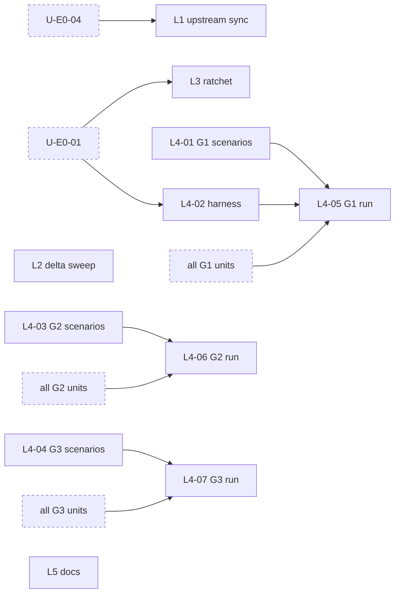

## B14. Reconciliation mapping

### Issues in the #13750 tree

| Issue | New home | Note |
|---|---|---|
| #13750 | Plan root | Published body still points at `kilo-v2`; needs a user update to link this plan |
| #14016 | Tracker → E6 | |
| #14017 | Tracker → E2, E9 | |
| #14018 | Tracker → E5 (+ E11) | Team ownership and incremental sync are now non-gating |
| #14019 | Tracker → E4 | |
| #14020 | Tracker → E3 | |
| #14021 | Tracker → U-E2-28, U-E6-07, U-E6-08, U-E6-20 | Speech, image and Claw items move to E11 |
| #14022 | Tracker → E7 | |
| #14023 | Tracker → U-E10-01 | |
| #14024 | Tracker → U-E10-02 | |
| #14371 | U-E2-01 | |
| #14372 | U-E2-02 | |
| #14373 | U-E2-03 | |
| #14374 | U-E2-04 | |
| #14375 | U-E9-09 | |
| #14376 | U-E11-04 | |
| #14377 | U-E9-10 | |
| #14378 | U-E9-12 (alerts, sound) + U-E11-04 (tables, bindings) | Split |
| #14379 | U-E9-11 | |
| #14380 | U-E2-05 (+ caller in U-E6-03) | |
| #14381 | U-L3-01 | |
| #14382 | U-E2-13 | |
| #14383 | U-E6-01 | |
| #14384 | U-E6-03 | |
| #14385 | U-E6-04 | |
| #14386 | U-E6-05 | |
| #14387 | U-E6-02 | |
| #14388 | U-E6-06 | |
| #14389 | U-E6-07 | |
| #14390 | U-E6-09 | |
| #14391 | U-E2-27 (runtime) + U-E6-10 (consumer) | Split |
| #14392 | U-E6-12 | |
| #14393 | U-E6-13 | |
| #14394 | U-E6-14 | |
| #14395 | U-E4-06 (host) + U-E6-15 (VS Code) | Split |
| #14396 | U-E5-01 | |
| #14397 | U-E5-02 | |
| #14398 | U-E5-03 | |
| #14399 | U-E5-04 (fail-closed) + U-E11-03 (ownership) | Split |
| #14400 | U-E11-03 | |
| #14401 | U-E5-05 | |
| #14402 | U-E4-01 | |
| #14403 | U-E4-02 | |
| #14404 | U-E4-03 | |
| #14405 | U-E4-04 | |
| #14406 | U-E4-05 | |
| #14407 | U-E4-08 | |
| #14408 | U-E3-08 | The fork-safety part of its scope is U-E0-04 |
| #14409 | U-E3-07 | |
| #14410 | U-E3-06 | |
| #14411 | U-E3-13 | Split out of the build pipeline to start early |
| #14412 | U-E3-07 | |
| #14413 | U-E3-01 + U-E3-02 + U-E3-03 | Split |
| #14414 | U-E3-11 (G1) + U-E6-21 (G2 child, new) + U-E7-07 (G3 child, new) | |
| #14415 | Evidence for U-E6-08 (`editor-services-inventory.md`) | Done; close candidate for the user |
| #14416 | U-E6-08 (producer) + U-E6-20 (VS Code) (+ U-E7-04 if Q-G3-01 keeps the gate) | Split |
| #14417 | U-E6-07 | |
| #14418 | U-E11-01 | |
| #14419 | U-E11-02 (image) + U-E11-06 (Claw) | Split |
| #14420 | U-E7-01 | |
| #14421 | U-E7-02 | |
| #14422 | U-E7-03 | |
| #14423 | U-E7-04 | |
| #14424 | U-E7-06 | |
| #14425 | Evidence for U-E10-01 (`cloud-agent-consumers.md`) | Done; close candidate |
| #14426 | Evidence for U-E10-01 (`cloud-agent-contracts.md`) | Done; close candidate |
| #14427 | U-E10-01 | |
| #14428 | U-E10-01 | |
| #14429 | U-E10-02 (discovery first) | |
| #14430 | U-E10-02 | |
| #14431 | U-E10-02 | |
| #14432 | U-E10-02 | |
| #14991 | Tracker → U-E1-03, U-E1-04 (+ server contracts for U-E1-08, U-E6-08) | Gateway epic; design in `kilo-gateway-v2-plan.md` |
| #15020 | U-L1-01 (+ the shared-file counter of U-L3-01, the marker guard of U-E3-08) | |
| #15108 | U-E1-05 | Aliased-model prompt overrides only |
| #15171 | Tracker → E0 | Foundation epic |
| #15172 | U-E0-01 | |
| #15173 | U-E0-02 | |
| #15175 | U-E0-03 | |
| #15176 | U-E0-04 | |
| #15177 | U-E0-05 | |
| #15229 | U-E0-01 + placement automation (`v2-host-strategy.md` §9 step 2) | Work merged in #15232 |
| #15230 | Progress map adopts the host strategy (`v2-host-strategy.md` §9 step 2b; feeds U-L3-01) | Work merged in #15231 |
| #15244 | E0 foundation: Kilo plugin startup ratchet and Gateway startup (startup part of U-E9-01) | Work merged in #15246, #15248 |
| #15059 | Proposed: U-E1-08 (reload, watcher policy) + U-E9-05 (TUI config hot reload) | Evaluation issue; mapping to confirm with the user |

Issues that map to more than one unit (#14378, #14391, #14395, #14399, #14413, #14414, #14416, #14419) either become umbrellas with one child per unit, or are narrowed; that choice is the user's.

### Old-plan units

| Old unit | New home |
|---|---|
| Phase 0 P1–P4 (create and link issues) | User checklist: the `new` rows below |
| N1 consolidation merge and scope rename | Not needed: the base is a clean upstream commit. Scope rename happens at copy time in each unit (B0) |
| N2 ratchet | U-L3-01 |
| N3 sync automation and e2e lane | U-L1-01 + U-E0-04 |
| N4 delta sweep | U-L2-01 |
| N5 v1 reference fixtures | U-E0-05 |
| N6a package assessment | U-E9-14 (`kilo-web-ui`), U-E8-03 (`kilo-console` retired, docs deploy), U-L5-01 (docs content) |
| N6b package imports onto the old branch | Not needed as a unit: `kilo-jetbrains` lands in U-E7-02, `kilo-docs` in U-E8-03 |
| N7 progress-plan and issue alignment | Not needed: this plan replaces the progress plan; issue-body updates are a user follow-up |
| N8 customer v2 store identity | U-E1-02 (+ v1-IDE isolation in U-E3-12) |
| N9 handshake and extension switch | U-E1-08 (server) + U-E6-02 (client) |
| N10 v1 retirement | U-E8-01, U-E8-02, U-E8-04 (backlog → E11) |
| N11 gate acceptance runs | U-L4-05, U-L4-06, U-L4-07 |
| N12 TUI picker, dialogs, status/footer (progress-plan rows without issues) | U-E9-06 (dialogs, provider guidance), U-E9-07 (picker, status/footer) |
| N13 runtime integration remainder (progress-plan rows without issues) | U-E2-18 (memory indicators), U-E2-19 (indexing CLI/cloud paths), U-E2-20 (sandbox validation and policy variants) |
| N14 original-extension consumers (progress-plan rows without issues) | U-E6-16 |
| N15 VS Code scenario set | U-L4-03 |
| N16 JetBrains scenario set | U-L4-04 |
| N17 preview release train | U-E3-10 |

### Units that need a new issue (70)

| Epic | Units |
|---|---|
| E1 | U-E1-01, -02, -05 (beyond #15108), -06, -07, -08 |
| E2 | U-E2-06 … -12, -14, -15, -16, -17 … -26, -28, -29, -30 (all except -01 … -05, -13, -27) |
| E9 | U-E9-01 … -08, -13, -14, -15 |
| E3 | U-E3-04, -05, -09, -10, -12 |
| E4 | U-E4-07 |
| E5 | U-E5-06 |
| E10 | U-E10-03 |
| E6 | U-E6-11, -16, -17, -18, -19, -21 (child of #14414) |
| E7 | U-E7-05, -07 (child of #14414) |
| E8 | U-E8-01 … -04 |
| E11 | U-E11-05 |
| L | U-L2-01, U-L4-01 … -07, U-L5-01 |

## B15. Divergences from discovery

| Change | Reason |
|---|---|
| Epic IDs kept (E9, E10, E11 not renumbered); presented in program order | Keeps register rows traceable; renumbering would add a mapping table and no information |
| U-E2-16 split into U-E2-16 (registry, question, suggest, todo) and U-E2-30 (content and code tools) | MATERIAL + NEW (+2,205 lines in `tool/`) is too large for one PR; U-E4-03 needs only the suggest tool |
| U-E3-07 split; signing becomes U-E3-13 | External lead time and account credentials (old plan line 194; admin task); it should start before the pipeline is complete |
| U-E6-08 split into the producer (U-E6-08, shared runtime) and the VS Code integration (U-E6-20) | The producer is the largest IDE gate and also the possible JetBrains dependency; it can start in Phase 1 independently of the extension re-land |
| New U-E6-21 and U-E7-07 (G2 and G3 canary children) | Discovery left them "later"; the gate map needs them as units |
| U-L4-01 split into U-L4-01 … -07 | Scenario sets for G2/G3 can start now and belong to the IDE tracks; one run per gate keeps one unit = one PR and makes gate conditions countable |
| U-E3-10 gains explicit deps on U-E3-08 and U-E3-12; U-E3-11 on U-L4-05 | The old plan required CI guards before the preview; the distribution decision must precede it; the canary is exercised on the accepted candidate |
| U-E0-03 narrowed | README rewrite, superseded banners and the doc drops were done in this planning commit (Appendix D) |
| Q-HOST-01 and Q-TEL-01 added | Open question from the old issue body (host package shape) and an undecided privacy default (telemetry) |
| Status column added; the register is frozen | D9 one file: Part B is the living unit index |
| Serialization chain U-E9-09 → -12 made explicit | Same-file TUI work (old plan line 112) |

No discovery epic or unit was dropped. Every discovery unit keeps its ID.

---

# Appendices

## Appendix A. Pinned refs and current-state facts

| Fact | Canonical place |
|---|---|
| Integration branch, upstream base, release marker, archived donor tag, v1 target, assessment snapshot and the `d99662338` note | [`migration-context.md` §Branches and pinned refs](migration-context.md#branches-and-pinned-refs) |
| Ancestry, toolchain, validation commands, current reds | [`pinned-v2-baseline.md`](../technical-notes/baseline/pinned-v2-baseline.md) |
| v1 line facts (version, cadence, channels) and upstream v2 facts | [`v2-feature-inventory.md`](../discovery/v2-feature-inventory.md) |
| Donor facts and staleness per area | [`v2-unit-register.md`](../discovery/v2-unit-register.md) |
| Facts preserved from the old plans | [`doc-inventory.md` §7](../discovery/doc-inventory.md) |
| Working model, conventions, Definition of done, admin tasks | [`migration-context.md`](migration-context.md) |

## Appendix B. Glossary

| Term | Meaning |
|---|---|
| v1 | Kilo on `main`, built on opencode v1. The behavioral reference at the pinned v1 target |
| v2 | Kilo running on the opencode v2 runtime (the product line this migration builds) |
| `origin/v2` | Kilo's integration branch on Kilo-Org/kilocode. Every unit merges here; it becomes `main` at cutover |
| `upstream/dev` | opencode's v2 line on anomalyco/opencode since 2026-10-10. Kilo merges its release commits in, pinned by SHA (L1) |
| `upstream/v2` | opencode's former v2 branch, frozen since 2026-10-10 (tip `4617210822b`). The initial base is on it. Never merged |
| BASE | The upstream release commit `origin/v2` is currently synced to. It moves with every L1 sync. The initial base was `5e73d5cb` (`v2.0.26`) |
| Sync | An L1 PR that merges an `upstream/dev` release commit into `origin/v2` with a merge commit |
| Donor | The archived old port (tag), used for mechanism only |
| Snapshot / cutoff | The v1 commit up to which every Kilo change has a disposition. L2 advances it |
| Staleness | v1 change to a unit's files between snapshot and v1 target (D4) |
| Unit | One session, one branch, one PR, one Part B row |
| Gate | A surface go/no-go: G1 CLI/TUI, G2 VS Code, G3 JetBrains |
| Surface | Where a unit ships: shared runtime, gateway/cloud, CLI/TUI, packaging, import, VS Code, JetBrains, external consumer, repo |
| Lane | Continuous work with a steady state instead of an exit (L1–L5) |
| External-gated | Acceptance that needs a deployed service or another team |

## Appendix C. Technical notes

| Epic | Notes under `technical-notes/baseline/` unless stated |
|---|---|
| E0 | `pinned-v2-baseline.md`, `v1-fixture-generation.md`, `cli-fixture-storage-incident.md`, `../v2-fork-conventions.md`, `../script/v2-baseline.ts` |
| E1 | `model-prompt-policy-v2-parity.md`, `model-prompt-v2-audit.md`, `settings-v2-parity.md`, `startup-loading-v2.md`, `reliability-checkpoint-2026-09-07.md` |
| E2 | `agent-policy-v2-parity.md`, `explore-policy-v2-parity.md`, `plan-v2-parity.md`, `skills-v2-parity.md`, `skill-shell-parity.md`, `memory-v2-parity.md`, `memory-activity-next-slice.md`, `indexing-v2-parity.md`, `sandbox-linux-validation.md`, `sandbox-spawn-next-slice.md`, `telemetry-v2-overlap.md`, `swarm-v2-parity.md`, `v2-v1-session-diffs.md` |
| E9 | `cli-tui-closure-verification.md`, `model-loading-v2-parity.md`, `model-info-bench-seam.md`, `model-sidebar-v2-parity.md`, `sidebar-*-v2-parity.md`, `memory-sidebar-v2-parity.md`, `memory-ui-v2-parity.md`, `cloud-cli-v2-parity.md` |
| E3 | `v1-session-schema-audit.md`, `credential-import-v2-parity.md`, `config-mapping-v2-gap.md`, `external-resume-parity.md`, `updater-local-parity.md`, `packaging-correction-plan.md`, `auto-packaging-v2-probe.md` |
| E4 | `remote-v2-parity.md`, `remote-share-next-contracts.md` |
| E5 | `../session-sharing.md`, `remote-share-next-contracts.md` |
| E10 | `cloud-agent-consumers.md`, `cloud-agent-contracts.md` |
| E6 | `existing-vscode-port.md`, `extension-surface-inventory.md`, `editor-services-inventory.md`, `vscode-packaging.md`, `v2-v1-schema-diffs.md` |
| E7 | `editor-services-inventory.md` (JetBrains consumers) |
| L | `../../marker-audit/` (assessment, shared-change inventory) |

Notes measured against the donor's upstream base are evidence: re-check their seam claims at BASE before reuse.

## Appendix D. Document moves

Applied by this plan:

| File | Action |
|---|---|
| `plans/kilo-opencode-v2-execution-plan.md`, `plans/kilo-opencode-v2-plan-progress.md` | Superseded banner |
| `plans/kilo-opencode-v2-working-log.md` | Banner: frozen evidence; its pause instruction no longer applies |
| `README.md` | Rewritten as the living index |
| `github-drafts/issue-13750/progress-comment.md`, `shared-source-footprint.md`, `tracking-policy.md` | Dropped (tracking rules now in B0) |
| `test-plans/*.md`, `technical-notes/v2-fork-conventions.md` | Stale banner pending rewrite |

Recorded as units: Kilo `AGENTS.md`, `v2-fork-conventions.md` and `v2-baseline.ts` rewrites (U-E0-03); test-plan rewrite (U-L4-01). `.DS_Store` files are untracked and already ignored; nothing to do.
