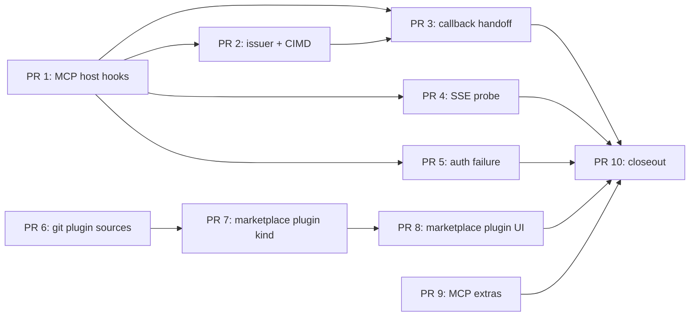

# MCP and marketplace: closing #15307 on v2

Status of this plan: implementation plan for [Kilo-Org/kilocode#15307](https://github.com/Kilo-Org/kilocode/issues/15307).
The issue covers two units from the v1 migration plan:

- **U-E2-22**: each Kilo MCP delta over BASE MCP is tested against the base, and `git:` plugin sources install.
- **U-E2-23**: the marketplace lists and installs each item type through the CLI/RPC API.

MCP Apps is **U-E11-05**, not part of #15307. Product branding is #15298; only the MCP OAuth client
identity is touched here.

## Verdict

#15307 is not complete on v2.

The native MCP base and the skill/MCP/agent marketplace are in place. The Kilo MCP deltas and the
plugin marketplace kind are not. The progress map at the time of writing:

```text
bun script/upstream/progress.ts --list mcp          # 23 open cells
bun script/upstream/progress.ts --list marketplace  # 2 open cells (installer.ts, schema.ts)
bun script/upstream/progress.ts --list plugin | grep -i git
# module:.../plugin/git-source.ts
# module:.../test/kilocode/plugin-git-source.test.ts
```

## Gap audit

| Area | v2 today | Gap |
|---|---|---|
| OAuth callback handoff | `core/src/mcp/oauth.ts` starts one HTTP server per authorization attempt; the default port is ephemeral (`0`); there is no takeover request; `Integration.oauth.connect` does not supersede an existing attempt | A configured `callback_port`/`redirect_uri` already held by another attempt returns `EADDRINUSE`; the older browser tab is not named or replaced. Default ephemeral flows work |
| Issuer discovery | `auth_server_metadata_url` and SDK discovery work; `issuer` is stored in credential metadata | Configured `client_id`/`client_secret` returns the static client unconditionally (`provider.clientInformation`), so a changed issuer can receive the configured secret. The v1 `oauth-issuer.ts` binding is missing |
| CIMD | `cimd` selects `CLIENT_METADATA_URL = https://opencode.ai/oauth/opencode/client.json` whenever no `client_id`/`redirect_uri` | Custom `callback_port` and `client_secret` without `client_id` still select CIMD; v1 required DCR. The upstream document lists the loopback redirect but v2 uses an ephemeral port, so CIMD can mismatch. No Kilo document |
| Auth-failure surfacing | Only `UnauthorizedError` becomes `NeedsAuthError`; `needs_auth` carries the error text | Plain 403 and OAuth-looking non-401 errors become `ConnectError` -> `failed`, so the UI shows "failed" instead of "sign in". The v1 `authFailure` classification is missing |
| SSE probe | The transport uses `fetch: loggedFetch`; there is no probe wrapper | `@modelcontextprotocol/client@2.3.1` still schedules a reconnect at attempt 0 when a 200 GET body is not `text/event-stream`, so a non-SSE endpoint can loop. The v1 `probe()` normalization to 405 is missing |
| jsonc writes | `kilo-plugin/src/marketplace/mcp.ts` preserves comments and symlinks; tests cover it | None |
| `git:` plugin sources | `core/src/plugin/module.ts` treats any non-absolute target as npm (`Npm.add`) | No `git:` parser/resolver/cache; the v1 `git-source.ts` behavior is absent |
| Marketplace kinds | `Kind = ["skill", "mcp", "agent"]`; installer, TUI and VS Code handle those. Modes are agents | `plugin` is absent end-to-end: schema, catalog item, installer/config write, ownership, UI, tests |
| Additional open MCP cells | cleanup, windows hide, sandbox MCP network, token-refresh coalescing, OAuth state/PKCE, remove, cancel/external auth and `needs_auth` error are native or already ported | Env sanitization is missing: local MCP inherits the full host env (`extendEnv: true`), so backend credentials leak. Docker `--rm` is missing. Client identity: upstream still defaults to `opencode`; PR 1 overrides `clientInfo` and the OAuth name/URI in the Kilo host, and the Kilo CIMD document URL remains for Phase 1. MCP Apps is absent but belongs to U-E11-05 |

### Already covered, do not re-port

- JSONC config writes for MCP marketplace installs.
- Process-group cleanup and `windowsHide` in the spawner.
- Sandbox MCP network delegation (`kilo-plugin/src/sandbox/network.ts`).
- Token-refresh race coalescing (`refreshes` in `core/src/mcp/oauth.ts`).
- OAuth state/PKCE per attempt (no shared `mcp-auth.json` race).
- MCP remove, external auth, cancel and the `needs_auth` error text.
- Marketplace skill, MCP and agent/mode install/remove in TUI and VS Code.

## Plan

### Rules

- Keep upstream defaults unchanged. Add generic embedding hooks to shared MCP files, set Kilo values
  from the host, and keep behavior in Kilo-owned code.
- MCP helpers go in `packages/core/src/kilocode/mcp/` so the v1 module cells match by path.
- Plugin resolver and marketplace plugin code go in `packages/kilo-plugin/`.
- Each PR carries the v1 proof ID (`kilo_port(...)` or `kilocode_change(...:<id>)`) and updates the
  map only after a behavior-by-behavior comparison.

### Phase 0: MCP host hooks (PR 1)

**Goal:** a generic embedding surface on `Mcp.Options`, wired from the Kilo host, with no changed
upstream behavior when the host is absent.

PR 1 delivers the hooks the first MCP deltas need:

- `McpHost.Host` in `packages/core/src/mcp/host.ts`: `fetch` (transport fetch wrapper) and
  `localCommand` (local command rewriter), plus `oauth` client identity (`name`, `uri`,
  `documentUrl`).
- Thread the host through `core/src/mcp/index.ts`, `client.ts` and `oauth.ts`.
- Wire the host in `packages/kilo-cli/src/host.ts`:
  `Mcp.node.replace(Mcp.configured({ clientInfo: { name: "kilo", version: KiloApp.version }, host: { oauth: { name: "Kilo", uri: "https://kilo.ai" } } }))`.
- Test the plumbing in `packages/core/test/kilocode/mcp/host-hooks.test.ts`:
  local command rewrite, transport fetch wrapper, and OAuth client metadata.
- Mark the shared additions as rung-3 seams and add the files to
  `script/upstream/shared-patches.json`; prove the existing upstream MCP tests still pass.

**Status:** implemented in this worktree. The hook bag is intentionally limited to the hooks the next
deltas use; later phases extend it rather than replacing it.

Later phases extend the same host interface; they do not rework the hook mechanism.

### Phase 1: MCP OAuth and failure parity

1. **Issuer binding and CIMD**
   - Port `client-metadata.ts` and `oauth-issuer.ts` to `packages/core/src/kilocode/mcp/`.
   - Extend `McpHost.Host.oauth` with the client-information policy hooks. When a configured
     `client_id` is present, return the stored client with its issuer, strip the configured secret,
     and let the SDK discard it on an issuer change.
   - CIMD eligibility: no `client_id`, no `client_secret`, no `callback_port`, and a redirect equal
     to the documented default (`http://127.0.0.1:19876/mcp/oauth/callback`). Otherwise DCR.
   - Use the default `19876`/`/mcp/oauth/callback` when CIMD is selected; keep ephemeral ports for DCR.
     v2 today always listens on an ephemeral port and uses `/callback`, so the eligibility rule and the
     listener have to change together or the authorization server rejects the document mismatch.
   - The Kilo CIMD document is hosted and verified (2026-11-10) at
     `https://kilo.ai/docs/oauth/kilo/client.json`: `client_id` is that URL, `client_name` "Kilo",
     `client_uri` `https://kilo.ai`, `redirect_uris`
     `["http://127.0.0.1:19876/mcp/oauth/callback"]`, `grant_types` authorization code + refresh,
     `response_types` code, and `token_endpoint_auth_method` `none`. Default the host document URL to it
     instead of the OpenCode URL `https://opencode.ai/oauth/opencode/client.json`; the authorization server
     reads the hosted document, so the local `clientMetadata` only has to agree for DCR. The URL is the
     client identity and must stay stable.
   - Tests: port `mcp-cimd.test.ts` and `mcp/oauth-issuer.test.ts`. Required cases: a configured
     secret is never sent to a second issuer; refresh against the new issuer; custom callback
     port/redirect/secret use DCR; explicit default redirect uses CIMD.

2. **Callback handoff**
   - Port `mcp-oauth-callback.ts` to `packages/core/src/kilocode/mcp/`.
   - Extend the OAuth host hook with the callback listener factory/takeover. The takeover must fail
     the old attempt's `Deferred` and close its listener.
   - Preserve the v1 security checks: takeover header, loopback `Host` validation, DNS-rebinding
     rejection, and the named "replaced by another authorization attempt" error.
   - Tests: port `mcp-oauth-callback.test.ts` (occupied port, takeover, missing header, rebound host).

3. **SSE probe**
   - Port `sse-probe.ts` to `packages/core/src/kilocode/mcp/`.
   - The host sets `host.fetch` to the probe. Apply it only to the MCP transport fetch, not OAuth
     discovery fetches.
   - Normalize a 200 GET whose content type is not `text/event-stream` to 405; leave event-stream and
     4xx/5xx unchanged.
   - Tests: port `mcp-sse-probe.test.ts`; add the non-SSE 200 case that currently loops.
   - **Status:** implemented in this worktree (PR branch `mcp-sse-probe`). Deltas from the text above:
     v2 has one remote transport, so there is a single site; the hook is applied per transport
     attempt and now receives the endpoint URL (the Code Mode query and the retry at the configured
     URL both change the dialed URL, so the probe cannot be scoped from the connect-level URL); and
     the probe keeps the endpoint plus `Accept` scoping even though the hook only wraps the transport
     fetch, because `@modelcontextprotocol/client@2.3.1` serves the transport's own OAuth discovery,
     refresh and step-up requests through that same fetch. Covered by the ported transport tests
     (probe once, same-origin redirect, redirect chain, http to https upgrade on default ports, OAuth
     discovery with an SSE `Accept`) and an end-to-end `McpClient.connect` test against a server that
     answers the probe with `200` `text/html`.

4. **Auth-failure surfacing**
   - Port `auth-failure.ts` to `packages/core/src/kilocode/mcp/`.
   - Extend the host hook with `authFailure` and use it in `startServer`. For remote servers with
     `oauth !== false`, classify a `ConnectError` as `needs_auth` and preserve the original error
     text; otherwise keep `failed`.
   - Tests: port `mcp/auth-failure.test.ts` and `mcp/auth-classification.test.ts` (plain 403 ->
     `needs_auth`; `oauth: false` -> `failed`; 404/500 -> `failed`).

### Phase 2: `git:` plugin sources

- Port `git-source.ts` to `packages/kilo-plugin/src/plugin/git-source.ts` (path matches the v1
  module cell).
- Add a generic `Plugin.Options.pluginSource` resolver seam in `core/src/plugin.ts` /
  `plugin/module.ts`; the host overrides `Plugin.node` with the Kilo resolver.
- Resolve `git:` specs to a cached local directory before `Npm.add`; keep npm and local-path behavior
  unchanged.
- Port the v1 security rules: no credentials in URLs, no option injection, path traversal rejection,
  ref/subpath handling, immutable cache keys, clone failure errors.
- Tests: `packages/kilo-plugin/test/plugin-git-source.test.ts` (port the v1 cases), plus a host test
  with a local git repo: config `plugins: ["git:..."]` loads the plugin.
- Add the v1 test disposition `ported` with the v2 path; mark the `plugin:25cfde80052f` patch cell on
  the resolver seam.

**Status:** implemented in this worktree.

- `packages/kilo-plugin/src/plugin/git-source.ts` exports the spec parser, the `git/...` identity,
  the cache/clone resolver, and `pluginSource`, the loader hook. `resolveGitPluginTarget` returns an
  absolute cache path instead of v1's `file://` URL, because the v2 loader decides local versus npm
  from `path.isAbsolute`; the cache root stays `Global.Path.cache/packages/git`, as in v1.
- The seam is `PluginModule.Options.pluginSource`, provided through the `PluginModule.OptionsService`
  context tag. `Plugin.configured(options)` decorates the existing registry node with that service
  through `mapLayer`, so one declaration owns the node's service, layer and dependencies and the
  plugin supervisor (a dependent of `Plugin.node`) sees the options; the loader reads them with
  `Effect.serviceOption`, so upstream's graph, with no host, keeps its behavior byte for byte.
- The resolver runs before the local/npm split in `PluginModule.load`. It returns the directory to
  load plus the `plugin.use` resources the resolution stands for (the `git/...` identity, and the
  canonical path, real path and configured spelling of a local repo), and the loader blocks the
  plugin when any of them is denied, so a deny-list cannot be bypassed by a second spelling of the
  same plugin. The identity is canonical: a URL folds its scheme, host case and default port, a local
  path becomes absolute, and the subpath is POSIX-normalized, with `..` rejected, so one repository
  has one identity and one deny resource. A target the host cannot read yet reports `pending` with
  those resources, so the clone happens in the installing pass and not in the fast pass that
  activates everything else first, like the npm branch's `resolve`; the loader reads the resources
  from that pass before it resolves, so a denied plugin never reaches the network. `source()` still
  reports the configured `git:` spec, so a git plugin lists as a package target.
- `git://host/repo` stays an npm Git dependency: `isGitPluginSpec` excludes the npm protocol form, so
  it reaches npm exactly as before.
- `packages/kilo-cli/src/plugin-npm.ts` wraps the npm service (rung 2, service replacement, in the CLI
  runtime and the server graph) so a `git:` spec is resolved from the same cache in the places that
  ask npm directly: the TUI's own plugin loader resolves configured package targets through
  `packages.prepare`, and the plugin update check would otherwise report the target as not installed.
  Every non-`git:` spec and every other method reaches the native service unchanged; a git plugin
  update forces a clone refresh and its update check reports no registry change. `resolve` is the
  non-installing read path: it reads the cache and reports the expected directory when nothing is
  cached, like `Npm.resolve` for an uninstalled package, instead of cloning or failing as a defect.
- The cache keeps the npm cache's hygiene: a resolve sweeps at most once an hour, removing
  interrupted staging clones from the cache's own `.staging` directory after an hour and clones
  nothing resolved for a week. One clone is kept per repository and ref, and a subpath is resolved
  inside it, so several plugins from one repository share a clone. The marker keeps the clone time
  and the last-use stamp apart: only the last-use stamp moves on a hit, so a frequently resolved
  mutable ref is still re-checked after the TTL, and a sweep holds the entry's lock and ages an
  unreadable marker by the directory instead of deleting it outright.
- `PluginSupervisor` needed no change: the options travel through the registry node the supervisor
  already depends on. Only `packages/core/src/plugin.ts` and `plugin/module.ts` carry the rung-3 seam
  (`script/upstream/shared-patches.json`, both rung 3).
- `packages/kilo-cli/src/host.ts` replaces `Plugin.node` with
  `Plugin.configured({ pluginSource: PluginGitSource.pluginSource })` and the npm node with the
  wrapper.
- Tests: 25 cases in `packages/kilo-plugin/test/plugin-git-source.test.ts` (the v1 parsing, identity,
  ref, cache-key, symlink-escape, staging-cleanup and `~` cases, plus the npm-protocol exclusion, the
  canonical identity and subpath, the shared clone per repository, the refresh stamps, the forced
  refresh, the sweep and the loader hook's pending/resources contract), the seam test
  `packages/core/test/kilocode/plugin-source-seam.test.ts` (resolved target, deferred pass, policy
  resources and the unchanged upstream path), the npm wrapper test
  `packages/kilo-cli/test/plugin-npm.test.ts`, and the host test
  `packages/kilo-cli/test/plugin-git-source.test.ts` (a `git:` entry in `kilo2.json` clones and
  activates). The v1 install/detect/remove case stays with the marketplace plugin kind in Phase 3.

### Phase 3: Marketplace plugin kind

Status: implemented (schema/registry/installer/RPC in one PR, clients in the next).

1. **Schema and registry**
   - `packages/schema/src/kilocode/marketplace.ts`: add `"plugin"` to `Kind`; add
     `plugin?: { spec: string }` to `Item`; add `{ plugin: string, fingerprints? }` to `Resource`.
   - Registry (`kilo.ts`): read the catalog `plugins` path and normalize `content` into
     `plugin.spec`, skipping an entry without one. Clients show the spec and a "runs arbitrary code"
     warning; `preview` rejects plugins like agents (no configuration to fill).

2. **Installer and config**
   - Extend `Installer.install`/cleanup with a `{ config, plugin, target?, fingerprints? }` resource
     instead of parallel install/remove functions, so plugins share the ownership, conflict and
     rollback path.
   - Port `plugin-spec.ts` (identity parsing for npm and `git:` specs) and `plugin-config.ts`
     (append/replace/remove in the `plugins` array), preserving JSONC comments and atomic writes.
   - Persist ownership in the existing durable `Installed` record. Remove only the owned spec; refuse
     if the entry was modified. A plugin record written by a newer build is skipped by older builds
     (the stored `kind` stays closed), the config entry stays active, and older builds can disable it
     from `/plugins`.
   - Resolve the package during the install RPC through the same npm/git machinery the loader uses
     (`Npm.add` or a `git:` clone plus a `Host.resolve` entrypoint check) and only then write the
     config, as v1 did. A package that cannot resolve fails before config exists. Recorded decision
     (2026-11-10): fail fast, accepting that the RPC blocks on the network and installs server-side.
   - Deliberate difference from v1: the catalog `id` no longer has to equal `pluginIdentity(spec)`,
     because v2 keys the durable record by catalog id and stores the identity in the resource.
   - Deliberate difference from v1: a TUI-only package is refused. v1 kept a separate TUI plugin list, so
     the server never saw such a package; v2 has one native config shared by the server and the TUI, and
     the server loader requires a server or GUI entrypoint, so writing a TUI-only spec there would make
     every location report a failed plugin.
   - Tests: installer unit tests for append/replace/remove, identity replacement, JSONC preservation,
     modified-entry refusal and git specs.

3. **Clients**
   - TUI: add a Plugins tab, install/remove actions, warning and installed state
     (`packages/tui/src/kilocode/marketplace.tsx`).
   - VS Code: add `"plugin"` to `KINDS` and the corresponding tab/actions
     (`packages/kilo-vscode/webview-ui/src/v2/marketplace-data.ts` and the marketplace UI).
   - Add a CLI/RPC round trip for `list -> install -> installed -> uninstall` in
     `packages/kilo-cli/test/marketplace-plugin.test.ts`, including activation through `/api/plugin`.
     Plugins have no configuration preview, so `preview` rejects them like agents.

4. **Map**
   - After plugin support lands, update the dropped dispositions for `plugin-spec.ts` and
     `plugin-config.ts` to `ported`; keep `detection.ts` dropped (durable ownership records replace
     runtime detection) and `relevance.ts` dropped.
   - Mark `installer.ts` and `schema.ts` as `ported` with the v2 paths. Marketplace becomes 13/13
     (verified: `bun script/upstream/progress.ts --list marketplace` reports 0 open cells).

### Phase 4: Remaining MCP deltas (decide scope)

- **Env sanitization:** local MCP currently inherits the full host environment. Either add an
  environment hook that strips `KILO_*` backend credentials and pass `extendEnv: false` with the
  filtered env, or record a deliberate decision to inherit. This is a security item; recommend
  porting.
- **Docker `--rm`:** port `ensureDockerRm` and wire it through `host.localCommand`; port the v1 unit
  test.
- **Client branding:** `clientInfo.name = "kilo"` via the host (PR 1); OAuth `client_name`/`client_uri`
  via the OAuth host hook (PR 1); Kilo CIMD document (Phase 1). Add a regression test.
- **Interrupted state:** port the v1 test. If v2's Effect-scoped startup already passes, mark it
  `native`; otherwise fix the scope leak.
- **MCP Apps:** leave open under U-E11-05. If the epic owner wants it in #15307, add a separate
  workstream for the two HTTP endpoints, tool `_meta` metadata and client rendering.

### Phase 5: Closeout

- Port remaining tests with `kilo_port(mcp:<test-id>)`.
- Add `kilocode_change(mcp:<patch-id>)` to the corresponding v2 seam/helper lines for the four
  in-scope patch cells; leave the three MCP Apps patch cells open and reference U-E11-05.
- Mark cleanup, windows hide, sandbox network, token refresh and OAuth state as `native` with v2
  pointers.
- Run:
  - `bun test` from `packages/core` and `packages/kilo-plugin`
  - `bun typecheck` in the affected packages
  - `bun run check` at the root
  - `bun script/check-shared-patches.ts --worktree`
  - `bun script/check-opencode-annotations.ts --worktree`
  - `bun script/upstream/progress.ts` and `--list mcp|marketplace|plugin`
- Self-test with `bun dev` using `KILO_V2_PROFILE=$(mktemp -d)` for the TUI marketplace/OAuth, and
  the VS Code e2e path for the plugin tab.
- Update the epic with the PR list and the remaining out-of-scope cells.

## PR sequence

| PR | Content | Depends on |
|---|---|---|
| 1 | `mcp-host-hooks`: host interface, transport/OAuth hooks, host wiring, tests | none |
| 2 | `mcp-oauth-issuer-cimd`: issuer binding, CIMD eligibility/document, tests | 1 |
| 3 | `mcp-callback-handoff`: listener takeover, tests | 1, 2 |
| 4 | `mcp-sse-probe`: probe helper and host hook, tests | 1 |
| 5 | `mcp-auth-failure`: predicate and status classification, tests | 1 |
| 6 | `plugin-git-sources`: resolver, loader seam, tests | none |
| 7 | `marketplace-plugin-kind`: schema, installer, config, RPC tests | 6 |
| 8 | `marketplace-plugin-ui`: TUI and VS Code | 7 |
| 9 | `mcp-extras`: env sanitization, Docker `--rm`, branding regression, interrupted state | 1 |
| 10 | `migration-closeout`: proofs, dispositions, map, epic update | 2-9 |



## Exit criteria

- U-E2-22: all named deltas have a v2 test ported with proof and passing; `git:` sources install
  through config and marketplace; upstream MCP tests still pass without the host.
- U-E2-23: `list`, `preview`, `install` and `uninstall` work for `mcp`, `skill`, `agent` and `plugin`
  through the RPC client; TUI and VS Code expose all four; plugin install/remove preserves JSONC and
  ownership.
- `mcp` map: 19/23 cells closed; the remaining four are MCP Apps under U-E11-05 (or 23/23 if that
  unit is pulled in).
- `marketplace` map: 13/13 after restoring `plugin-spec.ts` and `plugin-config.ts`.
- `plugin` map: `git-source` module/test/patch closed.
- `bun run check`, shared-patch checks and annotation checks pass.

## Decisions needed before implementation

1. **CIMD hosting:** resolved 2026-11-10. `https://kilo.ai/docs/oauth/kilo/client.json` exists and
   serves the Kilo client document (see Phase 1). CIMD stays enabled; DCR remains the fallback for custom
   redirects, callback ports and secrets, and for servers without the capability.
2. **MCP Apps:** confirm it stays in U-E11-05 rather than #15307.
3. **Env sanitization:** confirm v1's credential stripping is still required on v2; if yes, it is a
   security fix, not a nice-to-have.
4. **Plugin marketplace install model:** resolved 2026-11-10: stage at install time (resolve the
   package, then write the spec), matching v1 and failing fast on a package the loader could not
   activate.
5. **Client branding scope:** confirm `clientInfo.name` and OAuth `client_name` belong to this epic or
   to #15298.
