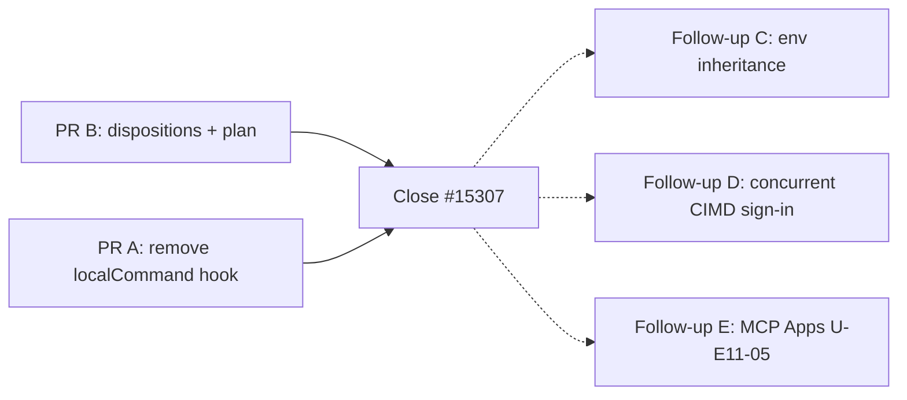

# MCP and marketplace: closing #15307 on v2

Plan for [Kilo-Org/kilocode#15307](https://github.com/Kilo-Org/kilocode/issues/15307). The issue
covers two units of the v1 migration plan:

- **U-E2-22**: each Kilo MCP delta over the upstream MCP base is either carried with a v2 test or
  recorded as not needed, and `git:` plugin sources install.
- **U-E2-23**: the marketplace lists, installs and uninstalls every item type (`skill`, `mcp`,
  `agent`, `plugin`) through the RPC, the TUI and VS Code.

Out of scope: MCP Apps (**U-E11-05**) and product branding (#15298; only the MCP client identity is
handled here).

Rule for this plan: a v1 delta is carried only when a v2 feature needs it. Matching v1 is not a
reason on its own.

## Status

Both units are functionally complete on `v2`. What is left is two small, independent PRs (map
closeout and removing one unused hook); no feature code remains for #15307.

| Map | State after the PRs below |
|---|---|
| `mcp` | 15/19 closed, 4 dropped; the 4 open cells are MCP Apps (`apps.ts` and patch cells `4979dbaffa6b`, `758f5318267c`, `ff97ca38233d`) |
| `marketplace` | 14/14 |
| `plugin` | `git-source` module, test and `plugin:25cfde80052f` closed (other `plugin` cells are not #15307) |

Check with `bun script/upstream/progress.ts --list mcp|marketplace|plugin`.

## 1. Done

All of these are merged on `v2`. Per-PR design notes live in `.kilo/plans/` (named below).

| PR | What it delivers | Main files | Tests |
|---|---|---|---|
| #15522, #15817, #15979 | Marketplace for `skill`, `mcp`, `agent`: registry, installer with durable ownership and JSONC writes, RPC, TUI and VS Code panels | `packages/kilo-plugin/src/marketplace/`, `packages/schema/src/kilocode/marketplace.ts`, `packages/tui/src/kilocode/marketplace.tsx`, `packages/kilo-vscode/webview-ui/src/components/marketplace/` | `packages/kilo-plugin/test/marketplace*.test.ts`, `packages/tui/test/kilocode/marketplace*.test.ts`, `packages/kilo-vscode/test/marketplace-*.test.ts` |
| #15986 | MCP host embedding hooks: `McpHost.Host` (`fetch`, `oauth`, later `authFailure`), threaded through `index.ts`, `client.ts`, `connection.ts`, `pool.ts`, `oauth.ts`; Kilo host sets `clientInfo.name = "kilo"` and OAuth `client_name`/`client_uri` | `packages/core/src/mcp/host.ts`, `packages/kilo-cli/src/host.ts` | `packages/core/test/kilocode/mcp/host-hooks.test.ts`, `packages/kilo-cli/test/host.test.ts` |
| #16077 | OAuth issuer binding (a configured secret never follows a changed issuer) and the Kilo CIMD document `https://kilo.ai/docs/oauth/kilo/client.json` with its fixed loopback `127.0.0.1:19876/mcp/oauth/callback`; DCR for custom redirect, callback port or secret | `packages/core/src/kilocode/mcp/{oauth-issuer,client-metadata}.ts` | `packages/core/test/kilocode/mcp-cimd.test.ts`, `mcp/oauth-issuer.test.ts` (`.kilo/plans/1794398478268-mcp-oauth-issuer-cimd.md`) |
| #16073 | SSE probe: a 200 GET that is not `text/event-stream` becomes 405, so the SDK stops reconnecting forever | `packages/core/src/kilocode/mcp/sse-probe.ts` | `packages/core/test/kilocode/mcp-sse-probe.test.ts` (`.kilo/plans/1794398075352-mcp-sse-probe.md`) |
| #16078 | Auth-failure classification: a remote server that may sign in reports `needs_auth` (Sign in) instead of `failed` for 401/403/OAuth errors | `packages/core/src/kilocode/mcp/auth-failure.ts`, seam in `packages/core/src/mcp/connection.ts` | `packages/core/test/kilocode/mcp/{auth-failure,auth-classification}.test.ts` (`.kilo/plans/1794398085399-mcp-auth-failure.md`) |
| #16027 | `git:` plugin sources: parser, canonical identity, cached clone, deny-list resources, loader seam `PluginModule.Options.pluginSource`, npm wrapper for the TUI loader | `packages/kilo-plugin/src/plugin/git-source.ts`, `packages/kilo-cli/src/plugin-npm.ts` | `packages/kilo-plugin/test/plugin-git-source.test.ts`, `packages/core/test/kilocode/plugin-source-seam.test.ts`, `packages/kilo-cli/test/{plugin-git-source,plugin-npm}.test.ts` |
| #16029 | Marketplace `plugin` kind end to end: schema, registry `plugins` path, installer resource, `plugin-spec`/`plugin-config`/`plugin-package`, RPC, TUI Plugins tab, VS Code tab | `packages/kilo-plugin/src/marketplace/{plugin-spec,plugin-config,plugin-package,installer}.ts` | `packages/kilo-plugin/test/marketplace-plugin-*.test.ts`, `packages/kilo-cli/test/marketplace-plugin.test.ts` (`.kilo/plans/1794339914958-marketplace-plugin-kind.md`) |

Deliberate differences from v1, all recorded in the PRs above:

- `needs_client_registration` is not carried; v2 reports `needs_auth` or `failed` with the original
  message.
- `retain` (issuer plan) is not carried: v2 has no pending provider.
- `callback_port` keeps upstream's `/callback` path; only the CIMD default uses
  `/mcp/oauth/callback`.
- A marketplace catalog `id` need not equal the plugin identity, and TUI-only plugin packages are
  refused because v2 has one config for server and TUI.

Already native in v2: process-group cleanup and `windowsHide` (the scoped spawn in
`packages/core/src/mcp/stdio.ts`; `cross-spawn-spawner.test.ts` covers the scope kill), sandbox MCP
network delegation, token-refresh coalescing, per-attempt OAuth state/PKCE, MCP
remove/cancel/external auth, and the `needs_auth` copy ("Sign in from /mcps"). The v1 local
interrupted-startup end-to-end fixture has no direct v2 test; that is a test gap, not a behavior gap.

## 2. What needs to be implemented

### For #15307

No feature code. Only PR B below (record the decisions in the map) is required to close the issue.

### Decided not to implement (the feature works without it)

| v1 delta | Why v2 does not need it | Map |
|---|---|---|
| OAuth callback takeover (`mcp-oauth-callback.ts`, shared `oauth-callback.ts` hunks) | v1 needed a machine-wide listener because `kilo mcp auth` ran in separate processes. v2 owns each attempt in the integration service: own listener and scope, `oauth.cancel`/`oauth.status`, 10-minute expiry, Cancel in TUI and VS Code. The only gap: two CIMD attempts at once collide on port 19876; the second fails at bind with a port error, nothing is corrupted. | module, test and `patch:mcp:78080472f471` `dropped` |
| Docker `--rm` injection (`ensureDockerRm`) | Container hygiene only; catalog entries and users pass `--rm`. | test `dropped` (the code hunk is unattributed) |
| Env sanitization (`modelEnv`) | Not a functional break: local MCP servers inherit the host env, as upstream does by design. It is a security-hardening question, moved to follow-up C. | no feature cell (unattributed) |
| v1 `cleanup.ts`, interrupted-state and branding tests | The behavior is native: `packages/core/src/mcp/stdio.ts` spawns in the caller's scope, `cross-spawn-spawner.test.ts` covers the scope kill, and the remote interruption cases cover caller interrupts. The exact local end-to-end fixture is a test gap. Branding identity is covered by the host tests. | `native` (local end-to-end gap noted) |
| MCP Apps | U-E11-05. | 4 cells stay open |

### Follow-ups outside #15307 (optional, each its own issue)

- **C. MCP env inheritance (security).** Decide whether local MCP servers should stop inheriting
  Kilo secrets: `OPENCODE_SERVER_PASSWORD`/`OPENCODE_SERVER_USERNAME` (when the user exported them),
  `OPENCODE_CONFIG*`, `KILO2_CONFIG*`/`KILO2_DB`, and VS Code's `KILO_BROWSER_BROKER_*` and
  `KILO_NOTEBOOK_BROKER_*`. If yes: add a host env filter and pass the filtered environment through
  `McpStdio.make` from `client.ts`; `packages/core/src/mcp/stdio.ts:107` is where the child is
  spawned with `extendEnv: true`, so the hook must replace that environment or the spawner call must
  stop extending the host env. Add a test that a spawned server sees none of these but still sees its
  own `mcp.environment`.
- **D. Concurrent CIMD sign-in.** Only if the port-19876 collision shows up in practice: cancel the
  same integration's pending OAuth attempt at the start of `Integration.oauth.connect`
  (`packages/core/src/integration.ts`), with a test that a second sign-in succeeds. Do not port the
  v1 takeover protocol.
- **E. MCP Apps** under U-E11-05.

## 3. Done but can be removed

| Item | Why it is not needed | Action |
|---|---|---|
| `McpHost.Host.localCommand` and `McpHost.LocalCommand` | Added in #15986 only so Docker `--rm` could rewrite `docker run`. Docker `--rm` is dropped and no host supplies the hook; only its own test used it. | Remove in PR A |
| The `localCommand` case in `host-hooks.test.ts` and `packages/core/test/kilocode/mcp/fixture.ts` | Exist only to exercise that hook. | Remove in PR A |

Reviewed and kept, although MCP would connect without them:

- **CIMD** (#16077): DCR alone would work, but CIMD is the chosen Kilo client identity and the hosted
  document is live. Removing it is a product change, not cleanup.
- **Issuer binding** (#16077): security fix.
- **SSE probe** (#16073): fixes a real reconnect loop in the SDK.
- **Auth-failure classification** (#16078): without it the UI shows `failed` and never offers Sign in.
- **`git:` plugin sources** (#16027): not needed for npm catalog plugins, but U-E2-22 names it and v1
  configs use `git:` specs.
- **`clientInfo` / OAuth branding** (#15986): the MCP client identity this epic owns.

## PRs

PR A and PR B are independent: they touch disjoint files and can merge in either order. Follow-ups
C-E are separate issues.

### PR A: `mcp-unused-hook` — remove the `localCommand` hook

`refactor(mcp): remove the unused local command hook`

- `packages/core/src/mcp/host.ts`: delete `LocalCommand` and `Host.localCommand`; the doc comment
  lists transport, OAuth identity and auth classification.
- `packages/core/src/mcp/client.ts`: restore upstream's local spawn (`command`, `args`, and the
  `command === "opencode"` `BUN_BE_BUN` check) and drop its `kilocode_change` block.
- `packages/core/src/mcp/index.ts`, `connection.ts`: marker comments say "transport and OAuth hooks".
- `packages/core/test/kilocode/mcp/host-hooks.test.ts`: drop the `localCommand` case and the `path`
  import; delete `packages/core/test/kilocode/mcp/fixture.ts`.
- `script/upstream/shared-patches.json`: remove the command hook from the `host.ts`, `client.ts`,
  `connection.ts` and `index.ts` seam text, and lower `limits.markedLines` from 2204 to 2192 (the
  checker asks for it).
- No behavior change: no host ever set the hook. No map change.
- Verify (from `packages/core`): `bun run test test/kilocode/mcp/host-hooks.test.ts`,
  `bun run test test/mcp.test.ts`, `bun typecheck`; from the root: `bun run check`,
  `bun script/check-shared-patches.ts --worktree`, `bun script/check-opencode-annotations.ts --worktree`.

### PR B: `mcp-closeout` — record the decisions and close the map

`docs(migration): close #15307 MCP and marketplace cells`

- `migration-tracking/progress/dispositions.json` (`by: mcp-marketplace-rescope`):
  - `dropped`: `module:packages/opencode/src/kilocode/mcp-oauth-callback.ts`,
    `module:packages/opencode/test/kilocode/mcp-oauth-callback.test.ts`, `patch:mcp:78080472f471`,
    `module:packages/opencode/test/kilocode/mcp-docker-rm.test.ts`.
  - `native`: `module:packages/opencode/src/kilocode/mcp/cleanup.ts` (v2 `stdio.ts`),
    `module:packages/opencode/test/kilocode/mcp-interrupted-state.test.ts` (v2 `mcp.test.ts`),
    `module:packages/opencode/test/kilocode/mcp-branding.test.ts` (v2 `host.test.ts`).
- This plan file.
- Do not commit the generated `migration-tracking/progress/{README.md,badge.svg,history.svg,progress.json,progress.svg}`;
  CI regenerates them on `v2`.
- Verify: `bun script/upstream/progress.ts --list mcp` reports exactly the 4 MCP Apps cells,
  `--list marketplace` reports 0, and `bun run check` passes.
- After merge: comment on #15307 with the PR list, the dropped decisions, follow-ups C-E, and close
  the issue.

## Exit criteria

- U-E2-22: every carried MCP delta has a passing v2 test; the four non-carried cells are `dropped`
  with the reason above; `git:` sources install through config and marketplace; upstream MCP tests
  pass without the host.
- U-E2-23: `list`, `preview` (MCP only), `install` and `uninstall` work for all four kinds through the
  RPC; TUI and VS Code expose all four; plugin install/remove preserves JSONC and ownership.
- Map: `mcp` 15/19 with only MCP Apps open, `marketplace` 14/14, `git-source` closed.
- No unused host hook remains (PR A).
- `bun run check`, shared-patch and annotation checks pass.

## Decisions (all resolved)

1. CIMD: keep. `https://kilo.ai/docs/oauth/kilo/client.json` is live; DCR covers custom redirect,
   callback port, secret and servers without CIMD support (2026-11-10).
2. MCP Apps: stays in U-E11-05 (2026-11-11).
3. Env sanitization: not in #15307; follow-up C (2026-11-11).
4. Plugin marketplace install: resolve the package at install time, then write the spec (2026-11-10).
5. Branding: the MCP client identity belongs here and is done; the rest is #15298 (2026-11-11).
6. Callback takeover and Docker `--rm`: not carried (2026-11-11).
