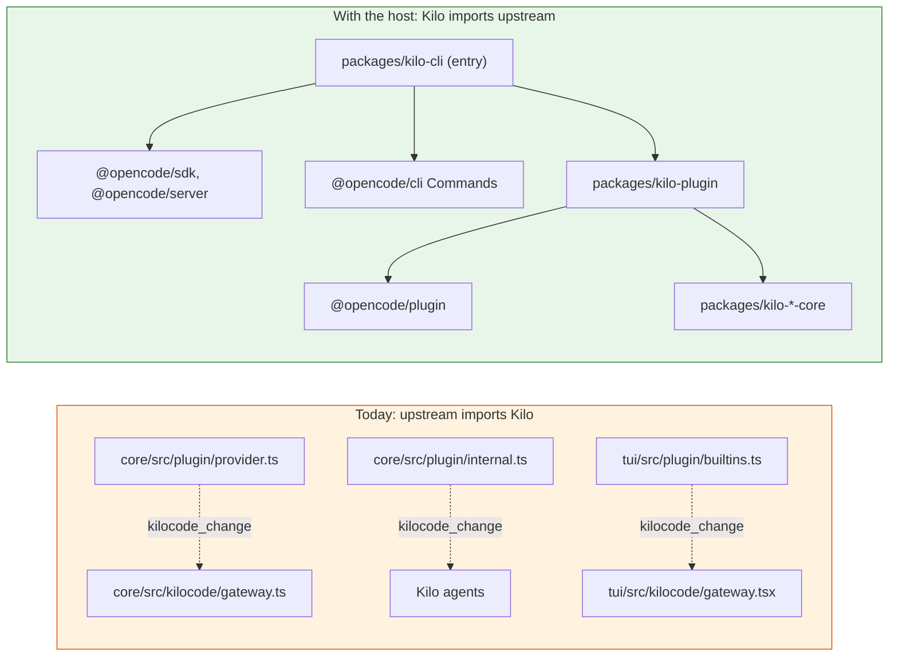
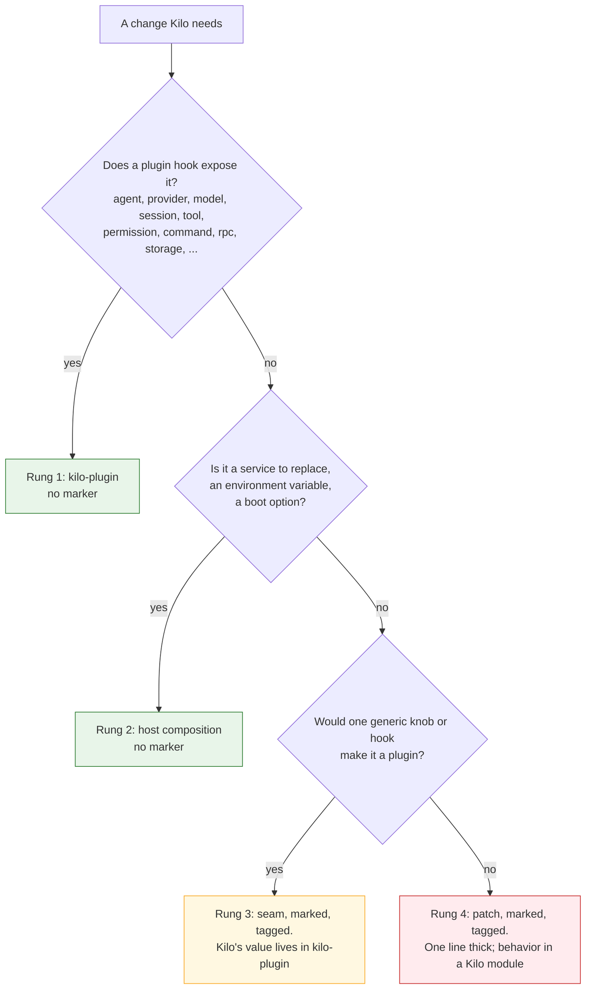

# Kilo host strategy and feature placement

Status: living, 2026-10-20. This document is the reusable record of the host strategy and the source of truth for how a change reaches `v2` (the placement rules, section 5): why Kilo code moves out of upstream files, how a change is placed on v2 (section 5), what the strategy guarantees when upstream changes again, and in which order the work happens. The plan (`kilo-v2-migration-plan.md`) holds the units and their status; the fork conventions (`../technical-notes/v2-fork-conventions.md`) hold the rules; the skill `.kilo/skills/v2-feature-placement/SKILL.md` is the procedure an agent follows for one change.

Related: epic #15171 (foundation), U-E0-01 host (#15172), U-E0-02 plugin scaffolding (#15173), Q-HOST-01 (answered: a Kilo host entry package), progress map `../progress/README.md`.

## 1. What the previous merges taught us

All numbers were measured on the repository, not estimated. B1 is the upstream v1 commit `main` was synced to (`8100c68b507b`), B2 the upstream v2 release at the time of the measurement (`4d9678a79d6`), and the v1 target is `main` at `fb7e96eda540`.

| Measurement | Value |
|---|---|
| Kilo edits inside shared upstream files on v1 | 7142 `kilocode_change` markers in 941 files |
| Imports from `packages/opencode/src/kilocode` into upstream modules | 828 imports into 215 distinct modules |
| Fate of the 941 patched files in upstream v2 | 61% deleted or rewritten, 33% modified, 2.4% unchanged |
| Patched files that merge textually into v2 (`git merge-file`) | 103 of 941 (11%), nearly all `packages/ui` |
| Kilo imports with no same-named v2 module | 532 of 697 (76%) |
| Archived port after 1462 upstream commits | 24 shared seam files: 5 still apply, 16 conflict, 3 targets deleted |
| v2.0.30 sync, Gateway adapter dependencies (`core/src/kilocode/gateway.ts` and `gateway-rpc.ts`) | 3 of 12 distinct imported upstream modules changed, 0 conflicts, found by reading the diff by hand |

What follows from the numbers:

1. **The cost of a migration scales with the number of places Kilo code meets upstream code, not with the number of Kilo lines.** 149 Kilo hunks in one upstream file (`session/prompt.ts`) belonged to 12 features and had no destination after the rewrite.
2. **Copying has a ceiling set by upstream.** Where upstream rewrote a file, there is nothing to copy into. No tooling changes the 61%.
3. **Kilo-owned does not mean decoupled.** The 542 Kilo-owned files under `src/kilocode` were carried easily; their 828 imports into upstream internals were not. The metric to watch is the number of distinct upstream internal modules Kilo code imports.
4. **A merge conflict is a weak change detector.** It fires only when upstream edits the same lines. It is silent when upstream changes a function Kilo calls from another file, a default, a timeout, or a load order. 80 of 310 both-modified files merged clean textually and were semantically suspect.
5. **Attribution has to be written at the time of the change.** Git history did not recover it (98 of 280 blamed commits in a sample were "resolve merge conflicts"). A tag in the source travels with the code; a content hash breaks on every release.
6. **A metric that cannot be regenerated goes stale in weeks.** The marker-audit documents were correct when written and useless a month later. Everything that describes the delta is generated from the repository (the progress map).

## 2. Approaches that were measured and rejected

- **Bulk carry of unchanged files.** 11% of the patched files carry textually, almost all presentation code. Carry such files only inside the unit that needs them, never as a bulk step.
- **Dual-input strangler (keep `packages/opencode` as a legacy host, #12887).** v1 and v2 share no stable interface at the runtime, wire or persistence layer. There is no seam for a runtime-level strangler. The one viable strangler seam is the wire protocol (section 10, facade).
- **Typecheck-and-iterate as a port method for clients.** 964 workspace imports of `kilo-vscode` resolve to nothing on v2 and the wire format changed. The type errors enumerate the protocol delta precisely, so this stays an inventory tool, not a port method.
- **A seam in upstream's entry instead of the host mirror (2026-10-20).** Proposed: export a `run(options)` from `cli/src/index.ts` (about five marked lines) so that `packages/kilo-cli/src/index.ts` (162 lines) can go. Rejected: it moves code from a Kilo-owned file back into an upstream file, which is the wrong direction (section 5, "Direction"). The mirror stays and gets a drift check (section 7).
- **Kilo values hard-coded into upstream discovery (#15018, 2026-10-19).** `core/src/config/discovery.ts` and `config.ts` imported a Kilo module and replaced upstream's file names and order. The result read `.kilo` for everyone, so upstream's own tests failed and six upstream test files had to be forked; `config.test.ts` alone has 34 upstream commits in 60 days. Rejected shape, replaced by a generic layout seam with upstream defaults, Kilo's values supplied by the host (U-E1-07). The rule it produced: a patch adds, it never changes an upstream default.

## 3. Target shape

Every Kilo feature consists of up to four kinds of code. They have different fates when upstream changes, and the strategy treats them differently.

| Layer | Example (Gateway) | Depends on | Fate when upstream changes |
|---|---|---|---|
| Logic | `packages/kilo-gateway-core` | nothing from `@opencode/*` | carried |
| Adapter | `packages/core/src/kilocode/gateway.ts` | public plugin, schema and client API; a short allowlist of core internals | rewritten only when the API moves; the compiler says where |
| Wiring | plugin registration, app directory, environment | upstream seams: `SdkPlugins.register`, `LayerNode` replacements, `createRoutes(overrides)` | moves from marked lines in upstream files into the host |
| Host entry | `packages/kilo-cli` | a mirror of upstream `cli/src/index.ts` | kept in step by a drift check |

The dependency direction is the whole point. Today upstream files import Kilo files through marked lines; the host reverses every arrow.

### Vocabulary

Three words that were used interchangeably and must not be.

| Word | Meaning | Markers | Example |
|---|---|---|---|
| **Patch** | A Kilo edit inside an upstream file. The progress map's cell kind for this is being renamed from `hook` to `patch` | yes, `kilocode_change(<feature>)` | `core/src/plugin/provider.ts:14` |
| **Plugin hook** | An extension point upstream exposes through `@opencode/plugin`; a Kilo plugin attaches from a Kilo-owned file | no | `tool.hook("execute.before")`, `session.compaction`, `editor.update("grep", ...)` |
| **Seam** | A new generic extension point Kilo adds to an upstream file so that a plugin hook becomes possible. One to three marked lines that carry no Kilo value | yes, tagged `seam` | `overrides` pass-through in `server/src/process.ts` |

Mapped onto the rung table in the fork conventions: plugin hook is rung 1, host composition is rung 2, seam is rung 3, patch is rung 4, branding is rung 5.

## 4. Step one: the Kilo host (U-E0-01, #15172)

The host is Kilo's own `main()`. It does what `packages/cli/src/index.ts` does (compose layers, run `Commands`), with Kilo's plugins and Kilo's service overrides passed through the two seams upstream already offers to embedders: `SdkPlugins.register` (`packages/core/src/plugin/sdk.ts`) and `LayerNode` replacements (`Global.node.replace(Global.layerWith(...))`, used by upstream itself in `cli/src/index.ts`). Q-HOST-01 is answered: a Kilo host entry package, not a thin wrapper, because upstream's CLI exports no wrap surface.

Why it is first: every feature merged before it registers through a marked line in an upstream builtin list (the Gateway in `provider.ts:14` and the TUI `/teams` command in `builtins.ts` on `v2`; the Kilo agents PR #14999 added the same shape to `internal.ts`; #15238 superseded it and registers the agents through the host). Three existing shared patches (`.gitignore`, root `package.json`, `README.md`) already state in `shared-patches.json` that they go away when the host owns the root and dev entry. Rungs 1 and 2 of the ladder are closed until the host exists, so every unit lands on rung 3 by necessity.

### Pieces, measured against the tree at `v2.0.30`

| Piece | Size | Rung |
|---|---:|---|
| `packages/kilo-cli/src/index.ts`: Kilo mirror of `cli/src/index.ts` (151 lines upstream): handler map spread, `Global.layerWith` for the Kilo directory, `KILO_*` environment translation, Kilo app name and version | ~150 lines | Kilo-owned, mirrored |
| `packages/kilo-cli/src/serve.ts`: upstream's 17-line serve handler plus `overrides` | ~25 lines | Kilo-owned |
| `packages/kilo-plugin`: stops being a placeholder; exports the Gateway and agents plugins | ~20 lines | Kilo-owned |
| `packages/cli/package.json`: `"./*": "./src/*.ts"` export, as `core`, `server` and `util` already have | 1 line | 3 |
| `packages/server/src/process.ts`: `start(...)` accepts `overrides` and passes them to `createRoutes`, which already takes them (`routes.ts:81-84`). Same concept as `ServerFetch.BootOptions.overrides` | 2 lines | 3 |
| `packages/cli/src/server-process.ts`: `Options.overrides` pass-through | 2 lines | 3 |
| `SdkPlugins.register` typing: today `Plugin<Scope.Scope>`; the Gateway is `Plugin<Bus.Service \| Scope.Scope>`. Widen to `Plugin<Requirements \| Scope.Scope>` (the loader provides those to every plugin), or drop the direct `Bus` import in the adapter | 1 line, or Kilo-side | 3 or 1 |

Net effect on the shared-patch baseline: three feature-specific marked lines become three or four generic pass-through lines that do not grow with features, and the three root patches are retired.

Known wrinkles: `packages/client/src/effect/service.ts:61` spawns `["opencode", "serve", "--service"]` by default, so the host sets the command or the binary name (decision D-4, which the host enables). The TUI's builtin plugin list is a separate in-process list; `/kilo-account` needs either a one-line generic seam there or the TUI plugin loading path (`tui/src/plugin/context.tsx` already loads external plugins from config and can disable builtins).

### What landed (U-E0-01)

- `packages/kilo-cli/src/index.ts` mirrors `cli/src/index.ts`; `serve.ts` mirrors the upstream serve handler and passes `KiloHost.overrides`. `bun dev` (`script/dev-isolated.ts`) starts this entry. Every server the CLI starts (background service, standalone, stdio) is a `serve` child of the same entry, because the CLI builds the command from `selfCommand()`.
- `host.ts` replaces `SdkPlugins.node` with a node that registers `KiloPlugins` (`packages/kilo-plugin`) and replaces `App.node` with Kilo's app name. The `SdkPlugins.register` typing seam was not needed: the loader gives a registered plugin only its Scope, so the host provides the global services a Kilo plugin requires (the Gateway's `Bus`) from the replacement node's dependencies. A Kilo plugin that needs a Location service (for example `SessionCompaction.Service`, as `core/src/config/plugin/compaction.ts` reads it) cannot get it this way; that is one rung-3 seam in `plugin/supervisor.ts` when the first feature needs it.
- `env.ts` translates the v1 `KILO_*` names whose `OPENCODE_*` name v2 reads (17 names, derived mechanically). A prefix rule is unsafe: v2 reads `OPENCODE_API_KEY` as the OpenCode Zen key.
- Seams: `cli/package.json` `./*` export, `ServerProcess.start` `overrides`, `Options.overrides` in `cli/src/server-process.ts`. The Gateway registration left `provider.ts`; upstream's `KiloPlugin` is back in the list and runs before the host's plugins, and the Gateway overwrites its OpenCode referer and title.
- Root patches: the v2 `bun dev` profile moved into the host package, so its `.gitignore` lines went. The root `dev` script stays (it is the only `bun dev` entry), the README patch stays (a package does not own the front page), and the other `.gitignore` patterns are not host entries.
- Wrinkles: the CLI and TUI never use the client's default service command (they pass `selfCommand()`); the default stays for other clients until D-4. The TUI list keeps its marked line in `builtins.ts`: a generic seam needs an `@opencode/tui` export plus an extension point, not fewer lines, and the config path loads only packages or files that a compiled binary does not have.

Acceptance is in the plan row U-E0-01 and in #15172: `bun dev` starts the host, the host runs the upstream CLI and server, Kilo plugins register through `SdkPlugins.register`, `service-smoke` passes with isolated HOME and XDG, the Gateway registration leaves `provider.ts`. In-flight PRs merge with their marked registration and move to the host in a follow-up.

What the host does not do: it does not port features, it does not remove the need for a seam where upstream has no extension point, and it does not solve the clients (section 10).

## 5. Placement rules

This section is the source of truth for adding a file to `v2` or moving a change onto it. `AGENTS.md`, the `v2-feature-placement` skill and the fork conventions point here; when they disagree with this section, this section wins.

### Direction

Kilo is the host, OpenCode is a library. Three rules follow, and they are not trade-offs:

1. **Code moves one way.** From upstream files into Kilo-owned files (`packages/kilo-*`, `src/kilocode/`, `test/kilocode/`), never the reverse. A proposal that adds or widens a `kilocode_change` line in an upstream file in order to remove or shrink a Kilo-owned file is rejected, whatever the line count says. The host entry mirror (162 Kilo-owned lines) is preferred over a five-line seam in `cli/src/index.ts` for this reason.
2. **A mirror is rung 2.** A Kilo-owned file that re-implements an upstream file (the host entry `packages/kilo-cli/src/index.ts` and `serve.ts`, a replaced builtin tool) is host composition. It is listed as a mirror (`mirroredFiles` in the sync tooling once U-L3-01 lands it; until then, named in the PR) and kept in step by the drift check (section 7), not turned into a seam.
3. **A patch adds, it never changes an upstream default.** The default graph (upstream code run without the host) must behave exactly like upstream, and upstream's own test files must pass against it unchanged. When a Kilo change makes upstream tests fail, the Kilo value is in the wrong place: the upstream file gets a generic knob with upstream's default, and the host supplies Kilo's value. Forked upstream test files are the symptom and are not allowed.

### The four rungs

Rung 2 includes mirrors (Direction, rule 2). Rung 3 and rung 4 are told apart mechanically: a marked line that references a `kilocode/` path, a `Kilo*` identifier or a Kilo string literal is a patch, rung 4, however small. A registration line that imports a Kilo plugin into an upstream list (`tui/src/plugin/builtins.ts`) is therefore a rung-4 call-out, not a seam.

Check the hook before assuming it is missing. On v2, compaction configuration is itself an upstream plugin (`core/src/config/plugin/compaction.ts` calls `SessionCompaction.Service.transform`), the `session.compaction` hook can replace a compaction result, and every builtin tool is a plugin registered through the same `ToolEditor` a Kilo plugin receives (`core/src/tool/plugin/grep.ts`, id `opencode.tool.grep`). Of the 241 v1 tool-area patches, all but about two have a rung-1 home.

### Three worked examples

**Rung 1, block destructive shell commands.** One new file `packages/kilo-plugin/src/sandbox-guard.ts` with `ctx.tool.hook("execute.before", ...)` that fails with `Tool.Error` when the Kilo sandbox blocks the command. Zero upstream files. At a sync: no conflict possible; an API change fails `bun typecheck` in `kilo-plugin`; a behavior change in `tool/plugin/shell.ts` appears in the dependency impact report. On v1 the same feature was 16 patches in 16 shared files.

**Rung 3, longer tool output in the compaction transcript.** `core/src/session/compaction.ts` cuts each tool result at `TOOL_OUTPUT_MAX_CHARS = 1_250` and `SessionCompaction.configure` knows only `auto`, `buffer` and `keep`. The seam adds an optional `toolOutput` setting and a parameter to `truncateToolOutput` (three marked lines tagged `kilocode_change(compaction-policy) seam`); the Kilo plugin calls `editor.configure({ toolOutput: 4000 })`. The marked lines carry no Kilo value. At a sync: a conflict only on those lines, and the Kilo side never moves.

**Rung 4, survive Bun 1.4 stream cancellation.** The v1 line `void reader.cancel(err).catch(() => undefined) // kilocode_change` in the SSE read loop. No hook sits inside the loop and a knob makes no sense. One marked, tagged line; `shared-patches.json` entry with rung 4 and the reason. At a sync: a conflict when upstream touches the line, or a "patched file touched" row in the sync report when they change the file around it.

| | Rung 1 | Rung 3 | Rung 4 |
|---|---|---|---|
| Upstream files touched | 0 | 1, generic lines | 1, specific line |
| Where Kilo's value lives | Kilo file | Kilo file | the line, or a call-out to a Kilo file |
| Conflict possible | no | on the seam lines | on the patch line |
| What finds upstream drift | typecheck, impact report | conflict, then typecheck of the plugin | conflict, or "patched file touched" |

### Shape rules

- A seam is generic: it widens a setting, exports a value or adds a dispatch point any plugin could use. It never contains a Kilo constant, a Kilo condition or a Kilo import.
- A patch is one line thick. When it is more than a defect fix, the line is a call into a Kilo-owned module (`if (yield* KiloPolicy.x(...)) ...`) and the policy lives there. v1 `session/prompt.ts` with 149 inline hunks is the shape to avoid.
- Every marked line carries its feature: `kilocode_change(<feature>)`, or `kilocode_change(<feature>:<id>)` when it replaces a v1 patch cell from the progress map. Seams add the word `seam`. A block names its feature after `start -`: `kilocode_change start - <feature>: <reason>` ... `kilocode_change end`. The counters recognize a block only when `start` or `end` follows `kilocode_change` directly (`script/upstream/utils/shared.ts`, `utils/markers.ts`), so `kilocode_change(<feature>) start` breaks the count (#15259). A done-proof inside a block goes on one of its lines as `kilocode_change(<feature>:<id>)`.
- A patch never changes an upstream default (Direction, rule 3). Upstream test files are not edited; the Kilo behavior is tested from Kilo-owned tests that compose the host's values explicitly.
- Builtin tools: wrap with `editor.update(id, ...)` when Kilo adds parameters, output or policy (grep, read, edit, write, prompt text); replace with `editor.remove(id)` plus `editor.add(...)` when Kilo changed the algorithm or the tool is a different product (task, websearch, parts of shell). A replaced tool is registered as a mirror of the upstream file it replaces.
- A server plugin registers in `KiloPlugins`; the host registers it. The TUI built-in list is the one remaining registration line in an upstream file, a rung-4 call-out (section 10).

## 6. Guarantees when upstream changes again

The test for the strategy: under every upstream future, Kilo must be no worse off than with the migration it is doing now.

| Future | Markers only | With the host | Result |
|---|---|---|---|
| Upstream stays on v2.x, ~5 releases a week | Sync cost grows with every feature | About ten generic seams, constant. Adapters fail typecheck when an API moves | host cheaper |
| Upstream removes a seam Kilo uses | unaffected | The one wiring line that used it becomes a marked line in a builtin list: today's state | equal to today |
| Upstream rewrites the runtime again | A repeat of v1 to v2: 61% of patched files gone, 76% of imports dead | Logic carried, adapters rewritten (the irreducible cost in both columns), host entry rewritten (~200 lines), seam list re-mapped | host much cheaper |
| Kilo stops syncing | fine | fine; seams can be inlined | equal |

Three rules make the second and third rows true. They are enforced, not advisory.

1. **Every host dependency on upstream is one of three things:** the public plugin API; a listed seam with a named rung-3 fallback in `shared-patches.json`; or a mirrored file registered in the sync tooling with a drift check. Nothing else.
2. **Logic packages import zero `@opencode/*`.** Adapters import the public surfaces (`@opencode/plugin`, `@opencode/schema`, `@opencode/client`, `@opencode/util`) freely and core internals only through an allowlist with a reason. The count of distinct core-internal modules imported by Kilo packages is a ratcheted number next to the shared-patch count. Today the Gateway adapter files (`core/src/kilocode/gateway.ts` and `gateway-rpc.ts`) import 12 distinct upstream modules: 10 from the public surfaces (`gateway.ts` 9, plus `@opencode/schema/rpc` in `gateway-rpc.ts`) and 2 core internals (`Bus`, `Variant`); `kilo-gateway-core` imports none. Since U-E0-01 the host adds `App`, `Bus` and `plugin/sdk` (its composition seams). The agents plugin (#15238) adds `permission`, `shell`, `tool-output` and `util/wildcard`, and the config discovery module (#15018) adds `location`, so the distinct count across Kilo packages was 9 on 2026-10-19 (`4c51aab`). `bun script/upstream/placement.ts --imports` prints the live count and fails on a logic-package import; the progress map summary carries it as a ratchet.
3. **A marked line is never the home of behavior.** It registers, widens or calls out. Behavior lives in a Kilo-owned module.

## 7. Detecting upstream change without conflicts

Three detectors replace the conflict as the signal, and together they cover more than the conflict did.

| Upstream change | Conflict (markers only) | Typecheck of Kilo packages | Dependency impact report | Mirror drift check |
|---|---|---|---|---|
| Same lines Kilo edited | yes | n/a | n/a | n/a |
| Signature or export of a module Kilo imports | no (other file) | **yes, exact file and line** | yes | |
| Behavior of a module Kilo imports, same types (`chunkTimeout` 5 to 15 minutes in v2.0.30) | no | no | **yes, with the diff** | |
| A seam the host uses | no | sometimes | **yes**, seams are a listed set | |
| A file the host mirrors | no, it is a copy | no | | **yes** |
| Internals Kilo does not import | no | no | no, correctly | |

**Dependency impact report** (`script/upstream/impact.ts`, a sync step): for each Kilo package and adapter, resolve its `@opencode/*` and relative imports to files (the progress map generator already does this), then `git diff --stat <previous pin> <new pin> -- <those files>` plus the seam list from `shared-patches.json` and the `mirroredFiles` list. Output: one table per feature in the sync PR body ("gateway: 3 of 12 dependencies changed, diff attached; agents: 0 of 7, nothing to retest"). The v2.0.30 sync PR wrote this section by hand under "Gateway impact".

**Mirror drift check:** the host entry and every replaced builtin tool are listed as `mirroredFiles` with the upstream path and the pinned hash. The sync PR prints the upstream diff of each mirrored file since the last pin so it is reviewed like a conflict.

**Retest scope:** automated tests of every Kilo package always; the per-feature manual self-test only for features with a non-empty row in the impact report.

## 8. Measurement: what changes in the progress map

The progress map (`../progress/README.md`, `bun script/upstream/progress.ts`) is the generated inventory of the v1 delta: one cell per Kilo-owned module, `/kilocode/*` API operation, patch in a shared file and test, grouped by feature, with `native`, `facade` and `dropped` dispositions. It was built before the host strategy and has one gap that the strategy creates, plus a few additions it needs.

**The gap.** Today a v1 patch cell closes when a v2 `kilocode_change(<feature>:<id>)` marker carries its ID. Markers are allowed only in shared upstream files (rungs 3 and 4). Under the host strategy most v1 patches are re-expressed as plugin hooks in Kilo-owned files (rung 1), where markers are forbidden, so those cells could never close. The map needs a second done-proof: an annotation for Kilo-owned files, for example `// kilo_port(<feature>:<id>)` on the Kilo code that replaces the v1 patch. The generator scans Kilo-owned paths for it exactly as it scans shared files for tagged markers. The skill tells agents which one to write: `kilocode_change(<feature>:<id>)` in a shared file, `kilo_port(<feature>:<id>)` in a Kilo-owned file.

**Changes, in order of value:**

1. Rename the cell kind `hook` to `patch` (`Kind` in `progress.ts`, README terms, skill text), so that "hook" means a plugin hook only.
2. Add the `kilo_port` done-proof for Kilo-owned files, with the same ID validation as markers (unknown IDs fail the run).
3. Record **where each done cell landed**: rung 1 or 2 when the proof is in a Kilo-owned path, rung 3 or 4 when it is a marker in a shared file (the rung comes from `shared-patches.json`). Show it per feature (`landed: 31 plugin, 2 seam, 1 patch`) and as a view. This is the shared-patch ratchet as a view, and it shows which features fought the ladder.
4. Add two ratcheted numbers to the summary and the PR comment: distinct core-internal upstream modules imported by Kilo packages (adapters; logic packages must be zero), and mirrored files with their drift state. Shared patches by rung already exist in `check-shared-patches.ts` and join the same summary.
5. The PR comment adds one placement line derived from the diff: new marked lines in shared files by rung, new `kilo_port` annotations, new core-internal imports. A PR that adds a rung-4 line without a `shared-patches.json` entry fails the check that already exists.
6. Client views: filter cells by the API operations and SDK symbols each client imports (VS Code first). A client can move to the v2 binary when every cell in its view is done, native, facade or dropped. That replaces hand-written escalation lists and is the input for the facade decision.

What does not change: the pins, the cell IDs, the dispositions file, the determinism rule (no model in the generator), and the `--check` job.

## 9. Order of work

| # | Step | Unit or issue | Exit |
|---|---|---|---|
| 1 | Kilo host | U-E0-01, #15172, done (#15232) | host runs CLI and server; Gateway registration leaves `provider.ts`; `service-smoke` isolated. The root `dev` script and README patches stay (the host is a package, not the repository root; reasons in `shared-patches.json`) |
| 2 | Feature placement skill and automation | new issue, same worktree as step 1 | `.kilo/skills/v2-feature-placement/SKILL.md` with verified commands; `script/upstream/placement.ts` answers "is there a hook, a service node, an existing seam" for a path or module |
| 2b | Progress map adopts the strategy (section 8, items 1 to 5) | new issue, own worktree, parallel to steps 1 and 2 | `patch` kind, `kilo_port` done-proof, landed-by-rung view, the two ratchets, placement line in the PR comment |
| 3 | Plugin scaffolding; Gateway RPC moves into `kilo-plugin` | U-E0-02, #15173 | one Kilo RPC round-trips from the plugin; `bun run generate` clean |
| 4 | Re-home in-flight registrations (agents, config) | agents done (#15238); config in progress as a generic layout seam with host-supplied values (U-E1-07) | baseline unchanged after they land; the six forked upstream config test files return to upstream |
| 5 | Identity: `kilo2` app directory through the host | U-E1-01, D-4 part 1 | isolated from the v1 IDE |
| 6 | Dispositions pass: mark what v2 already does `native` | map data PR | each cell has a v2 pointer and reviewer |
| 7 | Sync detectors: impact report, `mirroredFiles` drift check | U-L3-01 follow-ups | sync PR body carries the per-feature table |
| 8 | Tag backlog on `main`: `kilocode_change(<feature>)` per upstream area | v1 PRs, cheap agents draft, area owners merge | unattributed count falls across re-pins |
| 9 | Facade decision | section 10 | recorded, with a unit for the chosen path |
| 10 | G1 feature units by cost: branding by script, native adoption, self-contained modules, seam-heavy features | plan Part B | cell delta per PR |

## 10. Open decisions

- **Facade (proposed D-5).** Kilo owns both the server contract and every client; all clients speak the v1 protocol through `@kilocode/sdk`. A Kilo-owned facade that serves the v1 wire protocol on v2 core lets a client move to the v2 binary before it moves to the native client. Donor mechanism: the archived port's `packages/kilo-vscode/src/backend` (29 files). The decision is binary and must be explicit: a bridge with a removal date, or clients rebuilt natively first. Both consume the same donor code. It sits after the host and before any G2 work, and it needs the VS Code client view of the map as input.
- **Owners (D-3).** U-E0-01, U-L1-01 and U-L3-01 have no owner.
- **Binary and service command.** The client's default `["opencode", "serve", "--service"]` must become Kilo's for clients that do not pass a command (D-4). The CLI and TUI pass `selfCommand()`, so the host already spawns itself (U-E0-01).
- **TUI plugin registration.** Decided in U-E0-01: the marked line in `tui/src/plugin/builtins.ts` stays (section 4, "What landed"). It imports a Kilo module into an upstream list, so it is a rung-4 call-out, not a seam; `shared-patches.json` relabels it with the checker that enforces the rung 3 and 4 distinction (U-L3-01).
