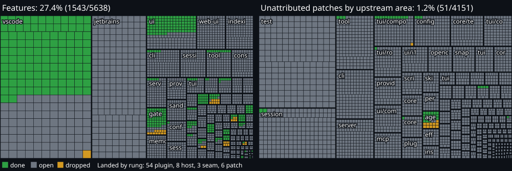
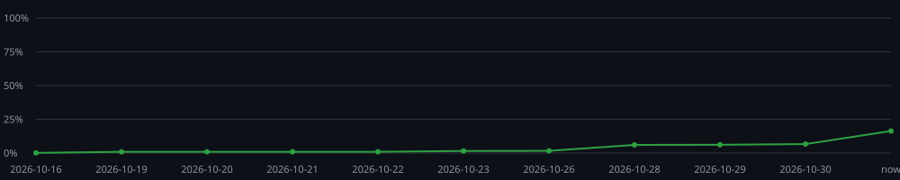

# Kilo v2 migration progress

Generated by `bun script/upstream/progress.ts`. Do not edit; edit `features.json` or `dispositions.json` and regenerate. CI updates it in a bot PR on pushes to v2; other PRs do not commit it.

Measures Kilo's v1 delta: Kilo `main` pinned at `fb7e96eda540` (the v1 target) compared with the upstream commit it was synced to, `8100c68b507b` (pins in `features.json`). Every Kilo change becomes a cell; a cell is done when the tracked v2 working tree has it.

## Summary

**1881 / 9765 cells done (19.3%)**, 89 dropped. `███░░░░░░░░░░░░░`

| Kind | Done | Total | % |
|---|---:|---:|---:|
| module | 1387 | 3518 | 39.4% |
| api | 11 | 36 | 30.6% |
| patch | 110 | 3440 | 3.2% |
| test | 373 | 2771 | 13.5% |

Not counted: 1428 branding-only hunks (rename script territory), 561 marker-only hunks (block boundaries), generated files. Patch attribution: 0 by tag, 261 by import, 97 by identifier, 4163 unattributed (see below).

Landed by rung, for patch cells closed by a done-proof: 73 plugin, 15 host, 3 seam, 6 patch.

Ratchets: 51 core-internal upstream modules imported by Kilo packages and adapters (`@opencode/core/agent`, `@opencode/core/app`, `@opencode/core/bus`, `@opencode/core/config`, `@opencode/core/config/discovery`, `@opencode/core/config/normalize`, `@opencode/core/config/plugin/skill-file`, `@opencode/core/credential`, `@opencode/core/database/database`, `@opencode/core/database/path`, `@opencode/core/effect/app-node-platform`, `@opencode/core/environment`, `@opencode/core/file-access`, `@opencode/core/form`, `@opencode/core/generate`, `@opencode/core/instance/service`, `@opencode/core/job`, `@opencode/core/location`, `@opencode/core/location-service-map`, `@opencode/core/model`, `@opencode/core/model-resolver`, `@opencode/core/permission`, `@opencode/core/plugin/provider/openai`, `@opencode/core/plugin/sdk`, `@opencode/core/plugin/system-prompt/anthropic.txt`, `@opencode/core/plugin/system-prompt/gpt-astra.txt`, `@opencode/core/plugin/system-prompt/gpt.txt`, `@opencode/core/plugin/system-prompt/kimi.txt`, `@opencode/core/plugin/system-prompt/trinity.txt`, `@opencode/core/provider`, `@opencode/core/rpc`, `@opencode/core/schedule`, `@opencode/core/schema`, `@opencode/core/session`, `@opencode/core/session/event`, `@opencode/core/session/projector`, `@opencode/core/session/runner/model`, `@opencode/core/session/runner/prompt/system.txt`, `@opencode/core/session/store`, `@opencode/core/session/system-prompt`, `@opencode/core/shell`, `@opencode/core/shell/parse`, `@opencode/core/skill`, `@opencode/core/tool`, `@opencode/core/tool-output`, `@opencode/core/tool/plugin/file-diff`, `@opencode/core/tool/plugin/question`, `@opencode/core/tool/plugin/todo`, `@opencode/core/tool/read-filesystem`, `@opencode/core/util/wildcard`, `@opencode/core/variant`); 101 shared patches by rung: 61 seam, 40 patch (`script/upstream/shared-patches.json`).

## History

One point per day from the committed `progress.json` on v2's first-parent history, plus the current state.

| Date | Done | Total | % |
|---|---:|---:|---:|
| 2026-10-16 | 12 | 9854 | 0.1% |
| 2026-10-19 | 87 | 9829 | 0.9% |
| 2026-10-20 | 87 | 9829 | 0.9% |
| 2026-10-21 | 90 | 9829 | 0.9% |
| 2026-10-22 | 93 | 9829 | 0.9% |
| 2026-10-23 | 150 | 9828 | 1.5% |
| 2026-10-26 | 157 | 9828 | 1.6% |
| 2026-10-28 | 594 | 9819 | 6% |
| 2026-10-29 | 597 | 9819 | 6.1% |
| 2026-10-30 | 646 | 9817 | 6.6% |
| 2026-11-05 | 1609 | 9786 | 16.4% |
| 2026-11-06 | 1874 | 9765 | 19.2% |
| now | 1881 | 9765 | 19.3% |

## Features

Cells per kind as done/total. A cell is done when it exists on v2 by the rules below, or has a disposition. Landed: the rungs of the done-proofs.

| Feature | Modules | API | Patches | Tests | Done | % | | Landed |
|---|---:|---:|---:|---:|---:|---:|---|---|
| acp | 0/1 |  | 0/1 | 0/2 | 0/4 | 0% | `░░░░░░░░░░░░░░░░` |  |
| agent | 1/3 | 0/1 | 1/1 | 4/8 | 6/13 | 46.2% | `███████░░░░░░░░░` | 1 plugin |
| agent-manager | 4/4 | 3/3 | 1/1 | 4/4 | 12/12 | 100% | `████████████████` | 1 plugin |
| anaconda-desktop | 0/7 | 0/3 |  | 0/7 | 0/17 | 0% | `░░░░░░░░░░░░░░░░` |  |
| archive-security |  |  |  | 0/1 | 0/1 | 0% | `░░░░░░░░░░░░░░░░` |  |
| auth | 0/2 |  | 0/4 | 0/4 | 0/10 | 0% | `░░░░░░░░░░░░░░░░` |  |
| background-jobs |  | 0/3 |  |  | 0/3 | 0% | `░░░░░░░░░░░░░░░░` |  |
| background-process | 0/3 |  | 0/1 | 0/4 | 0/8 | 0% | `░░░░░░░░░░░░░░░░` |  |
| board | 0/6 |  |  | 0/8 | 0/14 | 0% | `░░░░░░░░░░░░░░░░` |  |
| branch-name | 1/1 |  |  | 1/1 | 2/2 | 100% | `████████████████` |  |
| caffeination | 1/1 |  |  |  | 1/1 | 100% | `████████████████` |  |
| cleanup |  |  |  | 0/1 | 0/1 | 0% | `░░░░░░░░░░░░░░░░` |  |
| cli | 4/72 |  | 2/25 | 2/51 | 8/148 | 5.4% | `█░░░░░░░░░░░░░░░` | 1 plugin, 1 patch |
| cloud | 0/16 |  | 0/2 | 0/9 | 0/27 | 0% | `░░░░░░░░░░░░░░░░` |  |
| command | 0/3 | 0/2 |  | 0/3 | 0/8 | 0% | `░░░░░░░░░░░░░░░░` |  |
| commit-message | 4/4 |  |  | 3/3 | 7/7 | 100% | `████████████████` |  |
| compaction-policy | 0/5 | 0/3 | 0/1 | 0/8 | 0/17 | 0% | `░░░░░░░░░░░░░░░░` |  |
| components | 9/16 |  | 1/2 | 4/4 | 14/22 | 63.6% | `██████████░░░░░░` | 1 patch |
| config | 3/25 |  | 0/10 | 2/28 | 5/63 | 7.9% | `█░░░░░░░░░░░░░░░` |  |
| console | 0/87 |  | 0/1 | 0/9 | 0/97 | 0% | `░░░░░░░░░░░░░░░░` |  |
| core-watcher |  |  |  | 0/1 | 0/1 | 0% | `░░░░░░░░░░░░░░░░` |  |
| daemon | 0/2 |  |  | 0/1 | 0/3 | 0% | `░░░░░░░░░░░░░░░░` |  |
| database | 0/3 |  | 0/4 | 0/5 | 0/12 | 0% | `░░░░░░░░░░░░░░░░` |  |
| db-preflight | 0/1 |  | 0/1 | 0/1 | 0/3 | 0% | `░░░░░░░░░░░░░░░░` |  |
| effect | 0/4 |  | 0/2 | 0/3 | 0/9 | 0% | `░░░░░░░░░░░░░░░░` |  |
| enhance-prompt | 0/1 |  |  | 1/1 | 1/2 | 50% | `████████░░░░░░░░` |  |
| event-service | 0/1 |  |  | 0/1 | 0/2 | 0% | `░░░░░░░░░░░░░░░░` |  |
| event-storage | 0/5 |  | 0/8 | 0/3 | 0/16 | 0% | `░░░░░░░░░░░░░░░░` |  |
| exit-code | 0/1 |  | 0/3 | 0/1 | 0/5 | 0% | `░░░░░░░░░░░░░░░░` |  |
| fff | 0/1 |  | 0/4 | 0/1 | 0/6 | 0% | `░░░░░░░░░░░░░░░░` |  |
| filesystem-containment |  |  |  | 0/1 | 0/1 | 0% | `░░░░░░░░░░░░░░░░` |  |
| fixture |  |  |  | 0/10 | 0/10 | 0% | `░░░░░░░░░░░░░░░░` |  |
| gateway | 31/35 |  | 13/18 | 18/22 | 62/75 | 82.7% | `█████████████░░░` | 12 plugin |
| global | 2/2 |  | 4/4 | 1/1 | 7/7 | 100% | `████████████████` | 4 host |
| goals | 0/9 |  | 0/6 | 0/6 | 0/21 | 0% | `░░░░░░░░░░░░░░░░` |  |
| i18n | 20/20 |  |  |  | 20/20 | 100% | `████████████████` |  |
| image-size | 0/1 |  | 0/2 | 0/1 | 0/4 | 0% | `░░░░░░░░░░░░░░░░` |  |
| indexing | 95/95 |  | 6/6 | 41/41 | 142/142 | 100% | `████████████████` | 6 plugin, 1 host |
| installation | 0/2 |  | 0/2 | 0/1 | 0/5 | 0% | `░░░░░░░░░░░░░░░░` |  |
| instance | 0/3 |  | 0/8 | 0/8 | 0/19 | 0% | `░░░░░░░░░░░░░░░░` |  |
| jetbrains | 0/800 |  |  | 0/432 | 0/1232 | 0% | `░░░░░░░░░░░░░░░░` |  |
| markdown | 0/2 |  |  | 0/2 | 0/4 | 0% | `░░░░░░░░░░░░░░░░` |  |
| marketplace | 4/6 | 3/3 |  | 2/2 | 9/11 | 81.8% | `█████████████░░░` |  |
| mcp | 0/7 |  | 0/7 | 0/9 | 0/23 | 0% | `░░░░░░░░░░░░░░░░` |  |
| memory | 0/59 |  | 0/2 | 0/14 | 0/75 | 0% | `░░░░░░░░░░░░░░░░` |  |
| mermaid | 0/7 |  | 0/1 | 0/2 | 0/10 | 0% | `░░░░░░░░░░░░░░░░` |  |
| migration |  |  | 0/4 |  | 0/4 | 0% | `░░░░░░░░░░░░░░░░` |  |
| model-routing | 0/1 |  | 0/1 | 0/1 | 0/3 | 0% | `░░░░░░░░░░░░░░░░` |  |
| notebook | 2/2 |  | 1/1 | 2/2 | 5/5 | 100% | `████████████████` | 1 plugin |
| npm-publish |  |  | 0/2 | 0/1 | 0/3 | 0% | `░░░░░░░░░░░░░░░░` |  |
| oauth | 1/1 |  | 4/6 | 0/1 | 5/8 | 62.5% | `██████████░░░░░░` | 1 host, 3 seam |
| permission | 1/12 |  | 0/6 | 1/16 | 2/34 | 5.9% | `█░░░░░░░░░░░░░░░` |  |
| pii | 1/1 |  |  |  | 1/1 | 100% | `████████████████` |  |
| plan | 0/2 |  |  | 0/4 | 0/6 | 0% | `░░░░░░░░░░░░░░░░` |  |
| plugin | 8/26 |  | 0/2 | 1/6 | 9/34 | 26.5% | `████░░░░░░░░░░░░` |  |
| presence |  |  |  |  | 0/0 | 0% | `░░░░░░░░░░░░░░░░` |  |
| process | 0/4 | 0/1 | 0/9 | 0/1 | 0/15 | 0% | `░░░░░░░░░░░░░░░░` |  |
| project | 0/4 |  | 0/2 | 0/5 | 0/11 | 0% | `░░░░░░░░░░░░░░░░` |  |
| provider | 0/16 |  | 0/14 | 0/38 | 0/68 | 0% | `░░░░░░░░░░░░░░░░` |  |
| provider-usage | 6/6 | 2/2 | 2/2 |  | 10/10 | 100% | `████████████████` | 2 plugin |
| pty | 0/6 |  | 0/14 | 0/7 | 0/27 | 0% | `░░░░░░░░░░░░░░░░` |  |
| question | 0/1 |  | 0/2 | 1/4 | 1/7 | 14.3% | `██░░░░░░░░░░░░░░` |  |
| reference | 0/3 |  | 0/3 | 0/2 | 0/8 | 0% | `░░░░░░░░░░░░░░░░` |  |
| release-publish-scope |  |  |  | 0/1 | 0/1 | 0% | `░░░░░░░░░░░░░░░░` |  |
| review | 2/4 |  | 1/3 | 1/2 | 4/9 | 44.4% | `███████░░░░░░░░░` | 1 plugin |
| ripgrep-grep | 0/1 |  | 0/7 | 0/2 | 0/10 | 0% | `░░░░░░░░░░░░░░░░` |  |
| sandbox | 28/29 |  | 11/12 | 25/25 | 64/66 | 97% | `████████████████` | 8 plugin, 6 host |
| sbom |  |  | 0/3 | 0/1 | 0/4 | 0% | `░░░░░░░░░░░░░░░░` |  |
| search-target | 0/1 |  | 0/17 | 0/1 | 0/19 | 0% | `░░░░░░░░░░░░░░░░` |  |
| security | 0/1 |  | 0/1 | 0/1 | 0/3 | 0% | `░░░░░░░░░░░░░░░░` |  |
| server | 4/51 |  | 1/10 | 2/35 | 7/96 | 7.3% | `█░░░░░░░░░░░░░░░` | 1 plugin |
| session | 1/23 | 0/4 | 0/17 | 1/69 | 2/113 | 1.8% | `░░░░░░░░░░░░░░░░` |  |
| session-export | 0/27 |  | 0/1 | 0/25 | 0/53 | 0% | `░░░░░░░░░░░░░░░░` |  |
| session-fork | 0/2 |  |  | 0/1 | 0/3 | 0% | `░░░░░░░░░░░░░░░░` |  |
| session-import | 0/2 | 0/6 |  | 0/1 | 0/9 | 0% | `░░░░░░░░░░░░░░░░` |  |
| session-message | 0/1 |  | 0/11 | 0/3 | 0/15 | 0% | `░░░░░░░░░░░░░░░░` |  |
| session-portability | 0/2 |  | 0/1 | 0/1 | 0/4 | 0% | `░░░░░░░░░░░░░░░░` |  |
| session-resume | 0/3 |  | 0/2 | 0/2 | 0/7 | 0% | `░░░░░░░░░░░░░░░░` |  |
| session-revert | 0/1 |  | 0/1 | 0/2 | 0/4 | 0% | `░░░░░░░░░░░░░░░░` |  |
| session-title | 0/1 |  | 0/1 | 0/2 | 0/4 | 0% | `░░░░░░░░░░░░░░░░` |  |
| shell | 0/1 |  |  | 0/1 | 0/2 | 0% | `░░░░░░░░░░░░░░░░` |  |
| skill | 1/8 | 1/1 | 0/4 | 1/9 | 3/22 | 13.6% | `██░░░░░░░░░░░░░░` |  |
| snapshot | 1/8 | 1/2 | 2/2 | 1/11 | 5/23 | 21.7% | `███░░░░░░░░░░░░░` | 2 plugin |
| stdio-tap | 0/1 |  | 0/3 |  | 0/4 | 0% | `░░░░░░░░░░░░░░░░` |  |
| steering | 0/5 |  | 0/1 | 0/4 | 0/10 | 0% | `░░░░░░░░░░░░░░░░` |  |
| storage |  |  |  | 1/1 | 1/1 | 100% | `████████████████` |  |
| suggestion | 0/7 |  | 0/3 | 0/3 | 0/13 | 0% | `░░░░░░░░░░░░░░░░` |  |
| telemetry | 0/5 |  | 0/2 | 0/7 | 0/14 | 0% | `░░░░░░░░░░░░░░░░` |  |
| tool | 10/61 |  | 0/7 | 7/41 | 17/109 | 15.6% | `██░░░░░░░░░░░░░░` |  |
| ts-check | 0/2 |  | 0/2 | 0/3 | 0/7 | 0% | `░░░░░░░░░░░░░░░░` |  |
| tui | 2/15 |  | 1/6 | 2/24 | 5/45 | 11.1% | `██░░░░░░░░░░░░░░` | 1 plugin |
| tui-sync | 0/1 |  | 0/1 | 0/2 | 0/4 | 0% | `░░░░░░░░░░░░░░░░` |  |
| ui | 145/248 |  | 0/1 | 1/18 | 146/267 | 54.7% | `█████████░░░░░░░` |  |
| usage-cost | 0/4 |  |  | 0/5 | 0/9 | 0% | `░░░░░░░░░░░░░░░░` |  |
| util | 0/8 |  | 0/4 | 0/8 | 0/20 | 0% | `░░░░░░░░░░░░░░░░` |  |
| vscode | 991/1424 |  |  | 237/607 | 1228/2031 | 60.5% | `██████████░░░░░░` |  |
| wakeup | 0/5 | 0/1 | 0/1 | 0/4 | 0/11 | 0% | `░░░░░░░░░░░░░░░░` |  |
| web-ui | 0/154 |  |  |  | 0/154 | 0% | `░░░░░░░░░░░░░░░░` |  |
| worktree | 4/4 | 1/1 | 1/1 | 6/6 | 12/12 | 100% | `████████████████` | 1 plugin |

## Unattributed patches

Hunks in shared upstream files with no `kilocode_change(<feature>)` tag, no Kilo import and no Kilo identifier, grouped by upstream area. They count in the total. Tag them on `main` to move them into a feature box, or give them a disposition.

| Area | Patches | Tests | Done | % |
|---|---:|---:|---:|---:|
| test |  | 0/821 | 0/821 | 0% |
| session | 4/449 |  | 4/449 | 0.9% |
| tool | 3/237 |  | 3/237 | 1.3% |
| cli | 0/216 |  | 0/216 | 0% |
| server | 0/173 |  | 0/173 | 0% |
| tui/component | 13/141 |  | 13/141 | 9.2% |
| config | 3/130 |  | 3/130 | 2.3% |
| core/test |  | 0/118 | 0/118 | 0% |
| tui/context | 0/101 |  | 0/101 | 0% |
| tui/routes | 1/97 |  | 1/97 | 1% |
| provider | 0/88 |  | 0/88 | 0% |
| ui/components | 0/88 |  | 0/88 | 0% |
| mcp | 0/82 |  | 0/82 | 0% |
| ui/i18n | 0/78 |  | 0/78 | 0% |
| opencode/pkg | 0/72 |  | 0/72 | 0% |
| snapshot | 0/67 |  | 0/67 | 0% |
| tui/test |  | 0/55 | 0/55 | 0% |
| core/tool | 0/54 |  | 0/54 | 0% |
| script | 0/54 |  | 0/54 | 0% |
| core/session | 0/51 |  | 0/51 | 0% |
| plugin | 0/51 |  | 0/51 | 0% |
| core/v1 | 7/50 |  | 7/50 | 14% |
| skill | 0/39 |  | 0/39 | 0% |
| permission | 0/36 |  | 0/36 | 0% |
| effect | 0/33 |  | 0/33 | 0% |
| installation | 0/25 |  | 0/25 | 0% |
| tui/app | 0/24 |  | 0/24 | 0% |
| agent | 21/23 |  | 21/23 | 91.3% |
| core/pty | 0/22 |  | 0/22 | 0% |
| project | 0/22 |  | 0/22 | 0% |
| sdk/pkg | 0/21 |  | 0/21 | 0% |
| core/pkg | 0/20 |  | 0/20 | 0% |
| core/plugin | 0/20 |  | 0/20 | 0% |
| core/ripgrep | 0/20 |  | 0/20 | 0% |
| acp | 0/19 |  | 0/19 | 0% |
| tui/ui | 4/19 |  | 4/19 | 21.1% |
| core/filesystem | 0/18 |  | 0/18 | 0% |
| session-ui/v2 | 0/17 | 0/1 | 0/18 | 0% |
| llm/protocols | 0/16 |  | 0/16 | 0% |
| tui/feature-plugins | 0/16 |  | 0/16 | 0% |
| ui/pkg | 0/16 |  | 0/16 | 0% |
| util | 0/15 |  | 0/15 | 0% |
| core/credential | 0/14 |  | 0/14 | 0% |
| command | 0/13 |  | 0/13 | 0% |
| llm/test |  | 0/13 | 0/13 | 0% |
| storage | 0/13 |  | 0/13 | 0% |
| core/models-dev | 0/12 |  | 0/12 | 0% |
| lsp | 0/12 |  | 0/12 | 0% |
| core/flag | 0/11 |  | 0/11 | 0% |
| schema/v1 | 1/11 |  | 1/11 | 9.1% |
| tui/config | 0/11 |  | 0/11 | 0% |
| ui/context | 0/11 |  | 0/11 | 0% |
| core/config | 0/10 |  | 0/10 | 0% |
| protocol/groups | 0/10 |  | 0/10 | 0% |
| containers/pkg | 0/9 |  | 0/9 | 0% |
| core/integration | 0/9 |  | 0/9 | 0% |
| event-v2-bridge | 0/9 |  | 0/9 | 0% |
| http-recorder/pkg | 0/9 |  | 0/9 | 0% |
| core/cross-spawn-spawner | 0/8 |  | 0/8 | 0% |
| question | 0/8 |  | 0/8 | 0% |
| sdk-next/test |  | 0/8 | 0/8 | 0% |
| http-recorder/websocket | 0/7 |  | 0/7 | 0% |
| server/handlers | 0/7 |  | 0/7 | 0% |
| ui/styles | 0/7 |  | 0/7 | 0% |
| worktree | 0/7 |  | 0/7 | 0% |
| httpapi-codegen/test |  | 0/6 | 0/6 | 0% |
| index | 0/6 |  | 0/6 | 0% |
| plugin/pkg | 0/6 |  | 0/6 | 0% |
| session-ui/pkg | 0/6 |  | 0/6 | 0% |
| share | 0/6 |  | 0/6 | 0% |
| core/database | 1/5 |  | 1/5 | 20% |
| core/fs-util | 0/5 |  | 0/5 | 0% |
| core/script | 0/5 |  | 0/5 | 0% |
| llm/schema | 0/5 |  | 0/5 | 0% |
| script/index | 0/5 |  | 0/5 | 0% |
| server/location | 0/5 |  | 0/5 | 0% |
| client/test |  | 0/4 | 0/4 | 0% |
| codemode/pkg | 0/4 |  | 0/4 | 0% |
| effect-drizzle-sqlite/pkg | 0/4 |  | 0/4 | 0% |
| image | 0/4 |  | 0/4 | 0% |
| llm/pkg | 0/4 |  | 0/4 | 0% |
| plugin/tui | 0/4 |  | 0/4 | 0% |
| server/pkg | 0/4 |  | 0/4 | 0% |
| session-ui/components | 0/4 |  | 0/4 | 0% |
| tui/pkg | 0/4 |  | 0/4 | 0% |
| tui/plugin | 0/4 |  | 0/4 | 0% |
| tui/theme | 0/4 |  | 0/4 | 0% |
| auth | 0/3 |  | 0/3 | 0% |
| client/pkg | 0/3 |  | 0/3 | 0% |
| core/event | 0/3 |  | 0/3 | 0% |
| core/image | 0/3 |  | 0/3 | 0% |
| core/location-services | 0/3 |  | 0/3 | 0% |
| effect-sqlite-node/pkg | 0/3 |  | 0/3 | 0% |
| http-recorder/test |  | 0/3 | 0/3 | 0% |
| httpapi-codegen/pkg | 0/3 |  | 0/3 | 0% |
| schema/durable-event-manifest | 0/3 |  | 0/3 | 0% |
| schema/pty | 0/3 |  | 0/3 | 0% |
| sdk-next/pkg | 0/3 |  | 0/3 | 0% |
| server/routes | 0/3 |  | 0/3 | 0% |
| tui/util | 0/3 |  | 0/3 | 0% |
| client/generated-effect | 0/2 |  | 0/2 | 0% |
| containers/script | 0/2 |  | 0/2 | 0% |
| core/installation | 0/2 |  | 0/2 | 0% |
| core/reference | 0/2 |  | 0/2 | 0% |
| core/repository-cache | 0/2 |  | 0/2 | 0% |
| core/state | 0/2 |  | 0/2 | 0% |
| llm/provider-error | 0/2 |  | 0/2 | 0% |
| plugin/index | 0/2 |  | 0/2 | 0% |
| protocol/pkg | 0/2 |  | 0/2 | 0% |
| schema/llm | 0/2 |  | 0/2 | 0% |
| schema/pkg | 0/2 |  | 0/2 | 0% |
| schema/server-event | 0/2 |  | 0/2 | 0% |
| schema/session-status-event | 0/2 |  | 0/2 | 0% |
| storybook/pkg | 0/2 |  | 0/2 | 0% |
| bus | 0/1 |  | 0/1 | 0% |
| client/index | 0/1 |  | 0/1 | 0% |
| control-plane | 0/1 |  | 0/1 | 0% |
| core/aisdk | 0/1 |  | 0/1 | 0% |
| core/background-job | 0/1 |  | 0/1 | 0% |
| core/control-plane | 0/1 |  | 0/1 | 0% |
| core/effect | 0/1 |  | 0/1 | 0% |
| core/global | 0/1 |  | 0/1 | 0% |
| core/provider | 0/1 |  | 0/1 | 0% |
| core/schema | 0/1 |  | 0/1 | 0% |
| core/util | 0/1 |  | 0/1 | 0% |
| effect-drizzle-sqlite/sqlite-core | 0/1 |  | 0/1 | 0% |
| effect-drizzle-sqlite/test |  | 0/1 | 0/1 | 0% |
| format | 0/1 |  | 0/1 | 0% |
| httpapi-codegen/index | 0/1 |  | 0/1 | 0% |
| id | 0/1 |  | 0/1 | 0% |
| ide | 0/1 |  | 0/1 | 0% |
| llm/providers | 0/1 |  | 0/1 | 0% |
| llm/script | 0/1 |  | 0/1 | 0% |
| plugin/script | 0/1 |  | 0/1 | 0% |
| protocol/api | 0/1 |  | 0/1 | 0% |
| schema/command | 0/1 |  | 0/1 | 0% |
| schema/event-manifest | 0/1 |  | 0/1 | 0% |
| schema/file-diff | 0/1 |  | 0/1 | 0% |
| schema/mcp-event | 0/1 |  | 0/1 | 0% |
| schema/revert | 0/1 |  | 0/1 | 0% |
| schema/session-event | 0/1 |  | 0/1 | 0% |
| schema/worktree-event | 0/1 |  | 0/1 | 0% |
| script/pkg | 0/1 |  | 0/1 | 0% |
| server/cors | 0/1 |  | 0/1 | 0% |
| tui/prompt | 0/1 |  | 0/1 | 0% |
| tui/runtime | 0/1 |  | 0/1 | 0% |
| ui/assets | 0/1 |  | 0/1 | 0% |
| ui/theme | 0/1 |  | 0/1 | 0% |
| ui/v2 | 0/1 |  | 0/1 | 0% |

## Excluded

- docs (977 cells): Documentation site (packages/kilo-docs). Not part of the runtime port.

## Dropped

- `api:GET /kilocode/notebook`: v1 listed server-initiated notebook requests for the extension to answer; v2 has no server notebook API because the extension owns the workspace over a loopback broker, so there is no pending request to list. (notebook-tools)
- `api:POST /kilocode/notebook/{requestID}/reject`: v1 rejected a server-initiated notebook request through this route; on v2 the server calls the extension broker and the response is the reply, so no reject route exists. (notebook-tools)
- `api:POST /kilocode/notebook/{requestID}/reply`: v1 replied to a server-initiated notebook request through this route; on v2 the server calls the extension broker and receives the result in the same HTTP response. (notebook-tools)
- `module:packages/core/src/kilocode/session/recall-message-index.ts`: The v1 message FTS index and its triggers existed to make SQL recall search fast. v2 recall ranks in memory over SessionStore.messagesWithRefs in packages/kilo-plugin/src/recall/search.ts and creates no store objects, so the index has no v2 counterpart. (transcript-recall)
- `module:packages/core/src/kilocode/session/recall-part-index.ts`: The v1 part FTS index and its triggers existed only for SQL recall search. The v2 recall plugin reads decoded session messages through SessionStore and ranks them in memory, so no part index is built or maintained. (transcript-recall)
- `module:packages/kilo-gateway/src/auth/device-auth.ts`: v1 marked it as a legacy console flow that is not used (spinner, team prompt). The live device flow, auth/device.ts, is ported to packages/kilo-gateway-core/src/device.ts. (gateway-finish)
- `module:packages/kilo-gateway/src/auth/legacy-migration.ts`: Import of the pre-v1 Kilo CLI login (~/.kilocode/cli/config.json) at CLI start. v1 ran it at each start; v2 signs in with the device method and imports v1 data through U-E3-01. (gateway-finish)
- `module:packages/kilo-gateway/src/loader.ts`: kiloCustomLoader had no caller on v1 (packages/opencode used its own kiloCustomLoaders). Activation and the anonymous key are in packages/core/src/kilocode/gateway.ts. (gateway-finish)
- `module:packages/kilo-gateway/src/provider-debug.ts`: createKiloDebug had no caller on v1. It logged the v1 AI SDK provider for debugging. (gateway-finish)
- `module:packages/kilo-gateway/src/server/edit.ts`: Hono route of v1 createKiloRoutes, which had no caller on v1. The live v1 edit route is packages/opencode/src/kilocode/server/httpapi/handlers/kilo-gateway.ts (server box); v2 resolves the target through the kilocode.gateway RPC. (gateway-finish)
- `module:packages/kilo-gateway/src/server/fim.ts`: Hono route of v1 createKiloRoutes, which had no caller on v1. The live v1 FIM route is packages/opencode/src/kilocode/server/httpapi/handlers/kilo-gateway.ts (server box); v2 resolves the target through the kilocode.gateway RPC. (gateway-finish)
- `module:packages/kilo-gateway/src/server/routes.ts`: v1 createKiloRoutes (Hono) had no caller on v1. The live v1 routes are packages/opencode/src/kilocode/server/httpapi/handlers/kilo-gateway.ts (server box); v2 serves the Gateway contract through the kilocode.gateway RPC. (gateway-finish)
- `module:packages/kilo-gateway/src/types/jsx.d.ts`: JSX type shim that let the v1 package compile TUI code outside the TUI package. The v2 TUI code is in packages/tui. (gateway-finish)
- `module:packages/kilo-gateway/src/types/tui.d.ts`: Type shim for TUI runtime modules that let the v1 package compile TUI code outside the TUI package. The v2 TUI code is in packages/tui. (gateway-finish)
- `module:packages/kilo-gateway/test/provider.test.ts`: It tested v1 buildRequestHeaders, where request headers replace the defaults. v2 merges the Kilo headers last on purpose, so that they replace the OpenCode referer and title of the upstream KiloPlugin; packages/core/test/kilocode/gateway.test.ts checks the result. (gateway-finish)
- `module:packages/kilo-indexing/src/detect.ts`: Plugin-name detection for the v1 config plugin list (callers: plugin/loader.ts and indexing-feature.ts). v2 registers KiloIndexingPlugin in KiloPlugins (packages/kilo-plugin/src/index.ts) for every location; indexing.enabled decides whether it indexes, so there is no plugin entry to detect. (codebase-indexing-2)
- `module:packages/kilo-indexing/src/plugin.ts`: The no-op @kilocode/plugin entry that put the engine in the v1 plugin list. v2 registers KiloIndexingPlugin directly in KiloPlugins (packages/kilo-plugin/src/index.ts). (codebase-indexing-2)
- `module:packages/kilo-indexing/src/server/routes.ts`: Hono routes exported as @kilocode/kilo-indexing/server with no importer on v1 (git grep 'kilo-indexing/server' finds only the package.json export). The live v1 API was server/httpapi/groups/indexing.ts, ported as the kilocode.indexing RPC. (codebase-indexing-2)
- `module:packages/kilo-indexing/test/kilocode/indexing/detect.test.ts`: Tests src/detect.ts, which is dropped: v2 has no indexing plugin entry in the config plugin list. (codebase-indexing-2)
- `module:packages/kilo-vscode/docs/error-handling/autocomplete-settings-link.md`: Work note for v1 issue #6284 (status bar settings link), not runtime code. The v2 status bar tooltip links to kilo-code.v2.settings with the autocomplete tab (packages/kilo-vscode/src/services/autocomplete/AutocompleteStatusBar.ts). (autocomplete-inline)
- `module:packages/kilo-vscode/docs/features/remember-last-model.md`: Stale v1 design note: it describes an in-memory model and a globalState lastModel key that never shipped. The shipped behavior (persisted recents, config precedence) is ported in v2/model-default.ts and src/model-preferences.ts. (model-picker-parity)
- `module:packages/kilo-vscode/docs/non-agent-features/codebase-indexing-semantic-search.md`: Planning note that lists the remaining work to port indexing from kilocode-legacy, not runtime code or user documentation. The work it lists is done by this port (packages/kilo-indexing, packages/kilo-plugin/src/indexing); v2 kilo-vscode has no docs folder. (codebase-indexing-2)
- `module:packages/kilo-vscode/src/agent-manager/SessionTerminalManager.ts`: v2 intentionally removes the Agent Manager VS Code terminal destination so the embedded panel terminal is the only terminal. This module managed VS Code integrated terminals and has no v2 replacement. (boiled-message)
- `module:packages/kilo-vscode/src/agent-manager/am-visible-presence.test.ts`: The test covered the dropped attached-session presence module. Visible presence uses session.view and is covered by the agent manager session tests; there is no v2 presence module to test. (am-progress-map)
- `module:packages/kilo-vscode/src/agent-manager/am-visible-presence.ts`: Attached-session presence is an excluded epic (.kilo/plans/agent-manager-v2-conventions.md). The v2 panel shows visible presence from session.view; there is no presence module, registration call or /presence route. (am-progress-map)
- `module:packages/kilo-vscode/src/agent-manager/run/destination.ts`: The v2 run path always uses the embedded script terminal, so the destination selector between the panel and a VS Code task is removed. (boiled-message)
- `module:packages/kilo-vscode/src/agent-manager/run/task.ts`: The v2 run path always uses the embedded script terminal; the VS Code ProcessExecution task adapter is removed. (boiled-message)
- `module:packages/kilo-vscode/src/agent-manager/sandbox-bootstrap.ts`: Sandbox metadata and the inheritance token are excluded (#15309): the v2 orchestration request carries no sandbox token and the Agent Manager has no sandbox bootstrap. .kilo/plans/agent-manager-v2-conventions.md lists the feature as excluded. (am-progress-map)
- `module:packages/kilo-vscode/src/agent-manager/task-runner.ts`: Worktree setup now always runs in the embedded script terminal; the VS Code task runner is removed with the destination setting. (boiled-message)
- `module:packages/kilo-vscode/src/agent-manager/terminal-destination.ts`: The terminal destination setting, its watcher and its persistence are removed. A stored value is cleared at activation by clearLegacyTerminalDestination. (boiled-message)
- `module:packages/kilo-vscode/src/kilo-provider/config-bindings.ts`: ConfigBindings guarded v1 config.overlayUpdate with a connection generation, project generation and target revision, and expired a binding after reconnect, trust revocation, removal or save. v2 writes the config files in the extension host (src/settings-host.ts configWrite with the serialize chain) and the webview has no revision-bound target, so the class has no v2 caller. src/settings-host.ts owns the file target and the write order instead. (open-config-picker)
- `module:packages/kilo-vscode/src/services/autocomplete/migrate-default.ts`: One-time migration of stored kilo-code.new.autocomplete provider/model values to the unset default. The v2 extension reads new keys (kilo-code.v2.autocomplete.*), which have no stored v1 values to migrate; unset already resolves to the default model (packages/kilo-vscode/src/services/autocomplete/settings.ts readAutocompleteSettings). (autocomplete-inline)
- `module:packages/kilo-vscode/tests/unit/agent-manager-memory-commands.test.ts`: The Memory and Feedback providers are excluded (.kilo/plans/agent-manager-v2-conventions.md). v2 has no memory command, provider or resource, so the command test has no carrier. (am-progress-map)
- `module:packages/kilo-vscode/tests/unit/agent-manager-telemetry.test.ts`: The test covered the dropped Agent Manager telemetry module. Telemetry is excluded and no v2 telemetry module or event exists. (am-progress-map)
- `module:packages/kilo-vscode/tests/unit/agent-manager-terminal-destination.test.ts`: Tested the removed destination setting and its panel-local override rules; both are gone. The single terminal path is covered by test/agent-manager-terminal-side.test.ts and test/terminal-destination-cleanup.test.ts. (boiled-message)
- `module:packages/kilo-vscode/tests/unit/autocomplete-migrate-default.test.ts`: Tests the dropped migrate-default.ts migration of kilo-code.new.autocomplete values; v2 reads kilo-code.v2.autocomplete.* keys with no v1 values to migrate. (autocomplete-inline)
- `module:packages/kilo-vscode/tests/unit/config-bindings.test.ts`: Tests the removed v1 ConfigBindings class (immutable read target, expiry on reconnect, trust, removal and save, and publication after a concurrent refresh). v2 host writes through src/settings-host.ts with the serialize chain and has no bindings. (open-config-picker)
- `module:packages/kilo-vscode/tests/unit/mcp-auth-service.test.ts`: Tests the v1 host McpAuthService, which v2 removes: the server owns MCP OAuth state (integration.oauth.*) and the webview calls it directly in webview-ui/src/v2/mcp.ts. (settings-mcp)
- `module:packages/kilo-vscode/tests/unit/mcp-auth-status.test.ts`: Tests needsAuthNames from the removed v1 host service; v2 reads McpServer.status from the server. (settings-mcp)
- `module:packages/kilo-vscode/tests/unit/open-config-message.test.ts`: Tests configMessage, the v1 webview helper that built the openConfigFile message and its localized labels. v2 has no such message: the webview posts openFile and the host builds the quick pick, so the label assertions are not carried. (open-config-picker)
- `module:packages/kilo-vscode/tests/unit/run-terminal-destination.test.ts`: Tested the removed run destination selector. The embedded run start is covered by test/run-controller.test.ts and test/run-message.test.ts. (boiled-message)
- `module:packages/kilo-vscode/tests/unit/session-terminal-manager.test.ts`: Tested the removed VS Code integrated terminal manager. The embedded terminal panel is covered by test/agent-manager-terminal-state.test.ts and test/agent-manager-terminal-side.test.ts. (boiled-message)
- `module:packages/kilo-vscode/webview-ui/agent-manager/telemetry.ts`: Telemetry is excluded (.kilo/plans/agent-manager-v2-conventions.md): the ported Agent Manager has no telemetry module or event, and the wrapped user-visible behavior is unchanged. (am-progress-map)
- `module:packages/kilo-vscode/webview-ui/agent-manager/terminal/TerminalDestinationButton.tsx`: The split button and its destination dropdown are removed. TabBar renders one terminal toggle for the embedded panel, covered by test/agent-manager-terminal-side.test.ts. (boiled-message)
- `module:packages/kilo-vscode/webview-ui/src/utils/open-config.ts`: The v1 helper built the localized openConfigFile message: scope, loaded status, create entry and all source labels. v2 has no such message: the webview posts openFile with the host-resolved target and the host quick pick uses fixed English labels like the other host-side confirmations, so configMessage is not carried. The picker behavior is the separate kilo-provider/open-config.ts cell ported to packages/kilo-vscode/src/open-config.ts. (fix-progress-map)
- `module:packages/opencode/src/kilocode/agent/scout.txt`: Scout prompt. Scout (experimental, default off) is not ported. U-E11-05 records the decision. (agents-plugin)
- `module:packages/opencode/src/kilocode/indexing-feature.ts`: indexingEnabled and ensureIndexingPlugin read and injected @kilocode/kilo-indexing in the config plugin list. v2 always registers KiloIndexingPlugin (packages/kilo-plugin/src/index.ts); the TUI command and sidebar are always present, as with the v1 default built-in plugin. (codebase-indexing-2)
- `module:packages/opencode/src/kilocode/marketplace/detection.ts`: Runtime detection of installed marketplace items (skill/MCP/agent/plugin scans) is intentionally replaced: v2 lists only marketplace-managed records from the server database (the `kv` table) and reports their status by comparing content fingerprints with the files on disk (packages/kilo-plugin/src/marketplace/index.ts installed/restore, installer.ts inspect). Native/manual items are not adopted, and agent/plugin detection re-lands with their content units. Decision recorded under U-E2-23 in the former plan (`e39551c9b0:migration-tracking/plans/kilo-v2-migration-plan.md`); marketplace epic #15307. (kilo-new-marketplace)
- `module:packages/opencode/src/kilocode/marketplace/plugin-config.ts`: Plugin config patching (patchPlugin) is not carried on v2: plugin/bundle marketplace content is out of scope for the default skills/MCP unit and re-lands with the plugin content unit. Decision recorded under U-E2-23 in the former plan (`e39551c9b0:migration-tracking/plans/kilo-v2-migration-plan.md`); marketplace epic #15307. (kilo-new-marketplace)
- `module:packages/opencode/src/kilocode/marketplace/plugin-spec.ts`: Plugin identity resolution (pluginIdentity) is not carried on v2: plugin/bundle marketplace content is out of scope for the default skills/MCP unit and re-lands with the plugin content unit. Decision recorded under U-E2-23 in the former plan (`e39551c9b0:migration-tracking/plans/kilo-v2-migration-plan.md`); marketplace epic #15307. (kilo-new-marketplace)
- `module:packages/opencode/src/kilocode/marketplace/relevance.ts`: Workspace suggest_for.filename relevance scanning (ripgrep budget/skip rules) is not carried on v2: browse/search filter the catalog client-side by text match; relevance ranking re-lands with its own unit if wanted. Decision recorded under U-E2-23 in the former plan (`e39551c9b0:migration-tracking/plans/kilo-v2-migration-plan.md`); marketplace epic #15307. (kilo-new-marketplace)
- `module:packages/opencode/src/kilocode/presence/context.ts`: The presence context and route prefixes. Attached-session presence is an excluded epic: .kilo/plans/agent-manager-v2-conventions.md lists it as excluded, and PR #15737 has no presence module, /presence route or import. Visible presence uses session.view, which is tracked by its own agent-manager work. (am-progress-map)
- `module:packages/opencode/src/kilocode/presence/policy.ts`: The presence policy. Attached-session presence is an excluded epic: .kilo/plans/agent-manager-v2-conventions.md lists it as excluded, and PR #15737 has no presence module, /presence route or import. Visible presence uses session.view, which is tracked by its own agent-manager work. (am-progress-map)
- `module:packages/opencode/src/kilocode/presence/service.ts`: The presence service and its event-service connection. Attached-session presence is an excluded epic: .kilo/plans/agent-manager-v2-conventions.md lists it as excluded, and PR #15737 has no presence module, /presence route or import. Visible presence uses session.view, which is tracked by its own agent-manager work. (am-progress-map)
- `module:packages/opencode/src/kilocode/storage/json-migration.ts`: v1 lazily migrated the JSON file store (storage/**/*.json) into SQLite on first access. v2 replaced the JSON store with an event-sourced SQLite store, so there is no JSON tree to migrate. Legacy import is handled natively at the SQLite level by packages/core/src/database/v1-migration.bun.ts, and D-4 isolation (packages/kilo-cli/src/env.ts keeps CONFIG/CONFIG_DIR/DB out of the translated OPENCODE_* names) keeps v2 out of v1's store. The JSON migrator is obsolete. (store-paths)
- `module:packages/opencode/test/kilocode/config/indexing-default-plugin.test.ts`: Tests the injection of @kilocode/kilo-indexing into the config plugin list. v2 has no such injection: KiloIndexingPlugin is registered in KiloPlugins. (codebase-indexing-2)
- `module:packages/opencode/test/kilocode/indexing-feature.test.ts`: Tests indexing-feature.ts, which is dropped (no plugin entry in the v2 config plugin list). (codebase-indexing-2)
- `module:packages/opencode/test/kilocode/marketplace-api.test.ts`: The carried assertions (YAML response parsing, item normalization, per-kind fetch failure aggregation, cached fallback with warning) are covered by packages/kilo-plugin/test/marketplace.test.ts and packages/kilo-plugin/test/marketplace-plugin.test.ts. Dropped on purpose: kebab display-name synthesis (the Kilo catalog ships display names) and JSON-only endpoints (the Kilo catalog serves YAML). (kilo-new-marketplace)
- `module:packages/opencode/test/kilocode/marketplace-plugin-http.test.ts`: v1 tested the plugin HTTP install endpoints (refresh-cached config, partial removal, malformed config kept). Plugin marketplace content and the HTTP surface are not carried on v2; the skills/MCP API is covered by the kilocode.marketplace RPC round trips in packages/kilo-cli/test/marketplace.test.ts and the OAuth flow in packages/kilo-cli/test/marketplace-oauth.test.ts. Decision recorded under U-E2-23 in the former plan (`e39551c9b0:migration-tracking/plans/kilo-v2-migration-plan.md`); marketplace epic #15307. (kilo-new-marketplace)
- `module:packages/opencode/test/kilocode/marketplace-plugin.test.ts`: v1 tested plugin identity parsing and nested/global plugin source removal helpers. Plugin marketplace content is not carried on v2 (re-lands with the plugin content unit). The same-named v2 file hosts the replacement RPC-plugin lifecycle coverage, not a port of these assertions. (kilo-new-marketplace)
- `module:packages/opencode/test/kilocode/marketplace-relevance.test.ts`: v1 tested the relevance ranking and exclusion rules; relevance scanning is not carried on v2 (see the relevance module disposition). The client-side text filter is exercised by the TUI browser tests in packages/tui/test/kilocode/marketplace.test.ts. (kilo-new-marketplace)
- `module:packages/opencode/test/kilocode/presence/policy.test.ts`: The presence policy test. Attached-session presence is an excluded epic: .kilo/plans/agent-manager-v2-conventions.md lists it as excluded, and PR #15737 has no presence module, /presence route or import. Visible presence uses session.view, which is tracked by its own agent-manager work. (am-progress-map)
- `module:packages/opencode/test/kilocode/presence/service-presence.test.ts`: The presence service event test. Attached-session presence is an excluded epic: .kilo/plans/agent-manager-v2-conventions.md lists it as excluded, and PR #15737 has no presence module, /presence route or import. Visible presence uses session.view, which is tracked by its own agent-manager work. (am-progress-map)
- `module:packages/opencode/test/kilocode/presence/service.test.ts`: The presence service test. Attached-session presence is an excluded epic: .kilo/plans/agent-manager-v2-conventions.md lists it as excluded, and PR #15737 has no presence module, /presence route or import. Visible presence uses session.view, which is tracked by its own agent-manager work. (am-progress-map)
- `module:packages/opencode/test/kilocode/storage/db.test.ts`: Tested the v1 opencode-<channel>.db -> kilo-<channel>.db fallback that let a renamed binary reuse the old channel database. v2 keeps upstream's opencode*.db filenames inside the distinct kilo2 directory and fail-closes v1 KILO_DB (packages/kilo-cli/src/env.ts:34), so there is no cross-store fallback; channel-path selection is native at packages/cli/src/database-path.ts. The fallback is obsoleted by the D-4 distinct-dir design. (store-paths)
- `module:packages/opencode/test/kilocode/storage/json-migration.test.ts`: Tested the dropped JSON->SQLite migrator (module:packages/opencode/src/kilocode/storage/json-migration.ts). The event-sourced store's legacy-import correctness is covered natively by packages/core/test/v1-migration.test.ts. (store-paths)
- `module:packages/opencode/test/kilocode/tool-registry-indexing-import-failure.test.ts`: v1 imported the indexing module lazily in the tool registry and guarded the import. v2 adds the tool from KiloIndexingPlugin, whose static imports are plain TypeScript; the native parts (LanceDB, tree-sitter, @parcel/watcher) load only in the worker, where a failure becomes an Error status. (codebase-indexing-2)
- `module:packages/opencode/test/kilocode/tool-registry-semantic-import-failure.test.ts`: Same reason as tool-registry-indexing-import-failure: no lazy tool import in v2, the tool module is a static import of the plugin. (codebase-indexing-2)
- `patch:agent:063e034b577a`: Scout prompt import. Scout (experimental, default off) is not ported. U-E11-05 records the decision. (agents-plugin)
- `patch:gateway:0468bd6d3d9e`: v1 config schema fields prompt, isFree and ai_sdk_provider for models are not native v2 config fields. The Gateway catalog owns dialect, free status, and backend prompt directives; models.ts parses the prompt enum and kilo-plugin/src/gateway/prompt.ts applies it through session context hooks. Native v2 model package/settings/variant overlays remain configurable. This disposition does not claim that legacy config model.prompt is implemented. (gateway-model-parity)
- `patch:gateway:d783ce7945b8`: Import for the v1 config schema fields prompt and ai_sdk_provider (see patch:gateway:0468bd6d3d9e). (gateway-finish)
- `patch:indexing:12755e954b69`: v1 v2-compat config test expected @kilocode/kilo-indexing in config.plugin because Kilo injected built-in plugins during load. v2 injects nothing into config.plugin; the plugin is registered by the host. (codebase-indexing-2)
- `patch:marketplace:5fc326e8ea39`: The v1 kilocode_change in packages/opencode/src/plugin/install.ts (import of marketplace pluginIdentity for upstream plugin patching) serves plugin installs, which v2 does not carry for the default skills/MCP unit. The TUI registration patch is tracked by the updated shared-patches entry; plugin content re-lands with its unit. (kilo-new-marketplace)
- `patch:notebook:752d64cdd86b`: The v1 HTTP API exercise registered and exercised the three notebook routes. v2 has no notebook routes; the equivalent tool behavior is covered by packages/kilo-plugin/test/notebook.test.ts. (notebook-tools)
- `patch:notebook:c524c93fe185`: v1 registered Notebook.node in the server app runtime. v2 needs no server-side notebook service: the extension broker holds the request state and the plugin only makes loopback calls. (notebook-tools)
- `patch:presence:391f36cf44c5`: The server route hook for the attached-session presence service. Attached-session presence is an excluded epic: .kilo/plans/agent-manager-v2-conventions.md lists it as excluded, and PR #15737 has no presence module, /presence route or import. Visible presence uses session.view, which is tracked by its own agent-manager work. (am-progress-map)
- `patch:unattributed:agent:09375914c157`: Rule for the `suggest` tool, which v2 does not have yet. The suggest unit (U-E2-16) adds the rule with the tool (#14999, differences table). (agents-plugin)
- `patch:unattributed:agent:0faa6c731275`: Kilo `whenToUse` guidance in the LLM agent generation prompt (`kilo agent create`). v2 has no agent generation and no `generate.txt`. (agents-plugin)
- `patch:unattributed:agent:1b8fe669272e`: Telemetry options for the LLM agent generation call (`kilo agent create`). v2 has no agent generation, so no call exists to configure. (agents-plugin)
- `patch:unattributed:agent:2e2369fd59e1`: Orchestrator `deprecated` badge field. The v2 agent schema has no field for it (#14999, differences table). (agents-plugin)
- `patch:unattributed:agent:461dc96586d3`: Per-agent hardening after config, a bundled hunk whose parts land in different units. Explore shell limits are now ported: KiloAgentPlugin applies the read-only shell table (gh and find denied) to the native Explore agent in Plugin and reapplies it after global config in Ceiling (packages/kilo-plugin/src/agent/index.ts). Still deferred: metadata lifting (no v2 schema fields), the Plan edit guard after per-agent rules (U-E2-13) and Scout reference agents (U-E11-05). Each part is a row of the differences table in #14999. (explore-readonly-bash)
- `patch:unattributed:agent:51a770bdc581`: RuntimeFlags in the agent service fed Scout and the shared agent board rules. The v2 agents plugin reads no runtime flags: Scout is not ported (U-E11-05), and the board unit adds its own rules. (agents-plugin)
- `patch:unattributed:agent:6cdbea643f7d`: Default denies for the Scout repository tools (`repo_clone`, `repo_overview`). Scout (experimental, default off) is not ported. U-E11-05 records the decision. (agents-plugin)
- `patch:unattributed:agent:7c1daa44f22c`: Kilo `whenToUse` guidance in the LLM agent generation prompt (`kilo agent create`). v2 has no agent generation and no `generate.txt`. (agents-plugin)
- `patch:unattributed:agent:8c603298aa6d`: RuntimeFlags in the agent service fed Scout and the shared agent board rules. The v2 agents plugin reads no runtime flags: Scout is not ported (U-E11-05), and the board unit adds its own rules. (agents-plugin)
- `patch:unattributed:agent:92890c7740e7`: Scout agent. Scout (experimental, default off) is not ported. U-E11-05 records the decision. (agents-plugin)
- `patch:unattributed:agent:d88711e4e0f0`: Rule for the `suggest` tool, which v2 does not have yet. The suggest unit (U-E2-16) adds the rule with the tool (#14999, differences table). (agents-plugin)
- `patch:unattributed:core/v1:803d6139aabf`: The v1 experimental sandbox keys (`experimental.sandbox`, `experimental.sandbox_restrict_network`, `experimental.sandbox_writable_paths`) have no v1 runtime caller (git grep over packages/*/src finds only the schema and the generated SDK types). The live v1 key is the top-level `sandbox` struct, read by packages/opencode/src/kilocode/sandbox/config.ts and folded by KiloConfigPolicy. The experimental aliases are dead fields. (v2-config-keys)
- `patch:unattributed:tui/component:902bf97fd9cb`: v1 hunk ranked the upstream 'Popular providers' rows of the model picker with rankProviderOptions while searching. Upstream v2 removed those rows from component/dialog-model.tsx (signed-out users reach integrations through the 'View all integrations' action, which opens DialogIntegration), so there is no provider row left to rank. Model search ranking is ported in packages/tui/src/kilocode/model-picker.ts. (kilo-model-picker)

## Counting rules

- Feature boxes come from the v1 target: directories under `src/kilocode/`, `packages/kilo-*`, and the split table in `features.json`.
- module: a Kilo-owned v1 file. Done when a tracked Kilo-owned v2 file has the same feature and relative path, or the same feature and basename.
- api: a `/kilocode/*` operation in the v1 OpenAPI document. Done when the path literal appears in `packages/protocol/src`, `packages/server/src` or a Kilo-owned v2 file.
- patch: one Kilo hunk in a shared upstream file (`git diff -U0` of the v1 target over its upstream base). Its ID hashes the added lines without whitespace and comments. Done when a tracked v2 file under `packages/` carries a done-proof with the ID: `kilocode_change(<feature>:<id>)` in a shared upstream file, `kilo_port(<feature>:<id>)` in a Kilo-owned file. For an unattributed patch, the feature is its box, `unattributed:<area>`. A proof with an unknown ID, or in the wrong kind of file, fails the run.
- test: a module or patch in a test file, same rules.
- landed: the rung of the done-proof. `kilo_port` is rung 2 (host) in `packages/kilo-cli` and rung 1 (plugin) in other Kilo-owned files; a marker has the rung of its file in `script/upstream/shared-patches.json` (3 seam, 4 patch). A cell with more than one proof counts once, at the highest rung.
- Ratchets: core-internal imports count the distinct modules in `packages/core/src` outside `kilocode/` that non-test files in `packages/kilo-*` and `packages/*/src/kilocode` import, as `@opencode/core/*` or by relative path. A non-test file of a logic package (`packages/kilo-*-core`) that imports anything from `@opencode/*` fails the run. Shared patches by rung count the entries in `shared-patches.json`.
- A disposition in `dispositions.json` overrides: `ported`, `native` and `facade` count as done, `dropped` leaves the denominator and is listed above. Every disposition needs a note and an author. A module ported under another name needs `ported` with the v2 path.
- A proof or a disposition says that v2 has the behavior. Close a cell only after you compare the v1 code with v2; a cell with a known gap stays open. `dropped` is for behavior that is not carried (a shim, dead v1 code, or a decision the plan records), not for behavior that a later unit ports. Rules: `.kilo/skills/v2-migration/SKILL.md`, section "Progress map".
- Hunks whose only change is a brand rename, and hunks that contain only markers, are not cells.

## Terms

- cell: one unit of Kilo's v1 delta (a file, an API operation or a hunk). open: not done and no disposition.
- feature box: the cells of one feature. The feature comes from the v1 path or from `features.json`; a tag is always a feature name.
- area: for unattributed patches, the upstream directory of the shared file (`session`, `tui/component`); `<pkg>/pkg` means a file outside `src`, `test` and `script`, such as `package.json` or a Dockerfile.
- re-pin: moving `pins.v1Target` in `features.json` to a newer `main` commit, normally in an upstream sync PR. Cells and patch IDs follow the new target.
- rung: where Kilo code meets upstream (fork conventions): 1 plugin hook, 2 host composition, 3 seam, 4 patch.

## Working with the map

- `bun script/upstream/progress.ts --list <feature>` prints the open cells of a feature with their IDs and v1 source lines.
- To mark a patch ported, put its ID on the v2 code that replaces it: `kilocode_change(<feature>:<id>)` on a marked line in a shared upstream file, `kilo_port(<feature>:<id>)` in a Kilo-owned file. To record a decision instead, add the cell ID to `dispositions.json`.
- To move an unattributed patch into a feature, tag its marker on `main` as `kilocode_change(<feature>)`; the next v1 re-pin picks it up.
