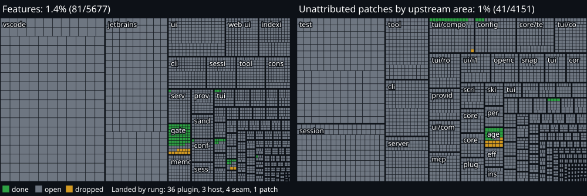
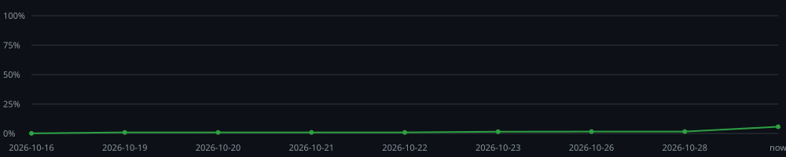

# Kilo v2 migration progress

Generated by `bun script/upstream/progress.ts`. Do not edit; edit `features.json` or `dispositions.json` and regenerate. CI fails when this file is stale.

Measures Kilo's v1 delta: Kilo `main` pinned at `fb7e96eda540` (the v1 target) compared with the upstream commit it was synced to, `8100c68b507b` (pins in `features.json`). Every Kilo change becomes a cell; a cell is done when the tracked v2 working tree has it.

## Summary

**93 / 9829 cells done (0.9%)**, 25 dropped. `░░░░░░░░░░░░░░░░`

| Kind | Done | Total | % |
|---|---:|---:|---:|
| module | 32 | 3547 | 0.9% |
| api | 0 | 39 | 0% |
| patch | 39 | 3445 | 1.1% |
| test | 22 | 2798 | 0.8% |

Not counted: 1428 branding-only hunks (rename script territory), 561 marker-only hunks (block boundaries), generated files. Patch attribution: 0 by tag, 261 by import, 97 by identifier, 4163 unattributed (see below).

Landed by rung, for patch cells closed by a done-proof: 21 plugin, 3 host, 0 seam, 0 patch.

Ratchets: 23 core-internal upstream modules imported by Kilo packages and adapters (`@opencode/core/app`, `@opencode/core/bus`, `@opencode/core/config`, `@opencode/core/config/discovery`, `@opencode/core/effect/app-node-platform`, `@opencode/core/model`, `@opencode/core/model-resolver`, `@opencode/core/permission`, `@opencode/core/plugin/sdk`, `@opencode/core/plugin/system-prompt/anthropic.txt`, `@opencode/core/plugin/system-prompt/gpt-astra.txt`, `@opencode/core/plugin/system-prompt/gpt.txt`, `@opencode/core/plugin/system-prompt/kimi.txt`, `@opencode/core/plugin/system-prompt/trinity.txt`, `@opencode/core/provider`, `@opencode/core/rpc`, `@opencode/core/session/runner/model`, `@opencode/core/session/runner/prompt/system.txt`, `@opencode/core/session/system-prompt`, `@opencode/core/shell`, `@opencode/core/tool-output`, `@opencode/core/util/wildcard`, `@opencode/core/variant`); 42 shared patches by rung: 25 seam, 17 patch (`script/upstream/shared-patches.json`).

## History

One point per day from the committed `progress.json` on v2's first-parent history, plus the current state.

| Date | Done | Total | % |
|---|---:|---:|---:|
| 2026-10-16 | 12 | 9854 | 0.1% |
| 2026-10-19 | 87 | 9829 | 0.9% |
| 2026-10-20 | 87 | 9829 | 0.9% |
| 2026-10-21 | 90 | 9829 | 0.9% |
| 2026-10-22 | 93 | 9829 | 0.9% |
| now | 93 | 9829 | 0.9% |

## Features

Cells per kind as done/total. A cell is done when it exists on v2 by the rules below, or has a disposition. Landed: the rungs of the done-proofs.

| Feature | Modules | API | Patches | Tests | Done | % | | Landed |
|---|---:|---:|---:|---:|---:|---:|---|---|
| acp | 0/1 |  | 0/1 | 0/2 | 0/4 | 0% | `░░░░░░░░░░░░░░░░` |  |
| agent | 1/3 | 0/1 | 1/1 | 4/8 | 6/13 | 46.2% | `███████░░░░░░░░░` | 1 plugin |
| agent-manager | 0/4 | 0/3 | 0/1 | 0/4 | 0/12 | 0% | `░░░░░░░░░░░░░░░░` |  |
| anaconda-desktop | 0/7 | 0/3 |  | 0/7 | 0/17 | 0% | `░░░░░░░░░░░░░░░░` |  |
| archive-security |  |  |  | 0/1 | 0/1 | 0% | `░░░░░░░░░░░░░░░░` |  |
| auth | 0/2 |  | 0/4 | 0/4 | 0/10 | 0% | `░░░░░░░░░░░░░░░░` |  |
| background-jobs |  | 0/3 |  |  | 0/3 | 0% | `░░░░░░░░░░░░░░░░` |  |
| background-process | 0/3 |  | 0/1 | 0/4 | 0/8 | 0% | `░░░░░░░░░░░░░░░░` |  |
| board | 0/6 |  |  | 0/8 | 0/14 | 0% | `░░░░░░░░░░░░░░░░` |  |
| branch-name | 0/1 |  |  | 0/1 | 0/2 | 0% | `░░░░░░░░░░░░░░░░` |  |
| caffeination | 0/1 |  |  |  | 0/1 | 0% | `░░░░░░░░░░░░░░░░` |  |
| cleanup |  |  |  | 0/1 | 0/1 | 0% | `░░░░░░░░░░░░░░░░` |  |
| cli | 0/72 |  | 0/25 | 0/51 | 0/148 | 0% | `░░░░░░░░░░░░░░░░` |  |
| cloud | 0/16 |  | 0/2 | 0/9 | 0/27 | 0% | `░░░░░░░░░░░░░░░░` |  |
| command | 0/3 | 0/2 |  | 0/3 | 0/8 | 0% | `░░░░░░░░░░░░░░░░` |  |
| commit-message | 0/4 |  |  | 0/3 | 0/7 | 0% | `░░░░░░░░░░░░░░░░` |  |
| compaction-policy | 0/5 | 0/3 | 0/1 | 0/8 | 0/17 | 0% | `░░░░░░░░░░░░░░░░` |  |
| components | 0/16 |  | 0/2 | 0/4 | 0/22 | 0% | `░░░░░░░░░░░░░░░░` |  |
| config | 0/25 |  | 0/10 | 0/29 | 0/64 | 0% | `░░░░░░░░░░░░░░░░` |  |
| console | 0/87 |  | 0/1 | 0/9 | 0/97 | 0% | `░░░░░░░░░░░░░░░░` |  |
| core-watcher |  |  |  | 0/1 | 0/1 | 0% | `░░░░░░░░░░░░░░░░` |  |
| daemon | 0/2 |  |  | 0/1 | 0/3 | 0% | `░░░░░░░░░░░░░░░░` |  |
| database | 0/3 |  | 0/4 | 0/5 | 0/12 | 0% | `░░░░░░░░░░░░░░░░` |  |
| db-preflight | 0/1 |  | 0/1 | 0/1 | 0/3 | 0% | `░░░░░░░░░░░░░░░░` |  |
| effect | 0/4 |  | 0/2 | 0/3 | 0/9 | 0% | `░░░░░░░░░░░░░░░░` |  |
| enhance-prompt | 0/1 |  |  | 0/1 | 0/2 | 0% | `░░░░░░░░░░░░░░░░` |  |
| event-service | 0/1 |  |  | 0/1 | 0/2 | 0% | `░░░░░░░░░░░░░░░░` |  |
| event-storage | 0/5 |  | 0/8 | 0/3 | 0/16 | 0% | `░░░░░░░░░░░░░░░░` |  |
| exit-code | 0/1 |  | 0/3 | 0/1 | 0/5 | 0% | `░░░░░░░░░░░░░░░░` |  |
| fff | 0/1 |  | 0/4 | 0/1 | 0/6 | 0% | `░░░░░░░░░░░░░░░░` |  |
| filesystem-containment |  |  |  | 0/1 | 0/1 | 0% | `░░░░░░░░░░░░░░░░` |  |
| fixture |  |  |  | 0/10 | 0/10 | 0% | `░░░░░░░░░░░░░░░░` |  |
| gateway | 31/35 |  | 13/18 | 18/22 | 62/75 | 82.7% | `█████████████░░░` | 12 plugin |
| global | 0/2 |  | 1/4 | 0/1 | 1/7 | 14.3% | `██░░░░░░░░░░░░░░` | 1 host |
| goals | 0/9 |  | 0/6 | 0/6 | 0/21 | 0% | `░░░░░░░░░░░░░░░░` |  |
| i18n | 0/20 |  |  |  | 0/20 | 0% | `░░░░░░░░░░░░░░░░` |  |
| image-size | 0/1 |  | 0/2 | 0/1 | 0/4 | 0% | `░░░░░░░░░░░░░░░░` |  |
| indexing | 0/99 |  | 0/6 | 0/44 | 0/149 | 0% | `░░░░░░░░░░░░░░░░` |  |
| installation | 0/2 |  | 0/2 | 0/1 | 0/5 | 0% | `░░░░░░░░░░░░░░░░` |  |
| instance | 0/3 |  | 0/8 | 0/8 | 0/19 | 0% | `░░░░░░░░░░░░░░░░` |  |
| jetbrains | 0/800 |  |  | 0/432 | 0/1232 | 0% | `░░░░░░░░░░░░░░░░` |  |
| markdown | 0/2 |  |  | 0/2 | 0/4 | 0% | `░░░░░░░░░░░░░░░░` |  |
| marketplace | 0/10 | 0/3 | 0/1 | 0/6 | 0/20 | 0% | `░░░░░░░░░░░░░░░░` |  |
| mcp | 0/7 |  | 0/7 | 0/9 | 0/23 | 0% | `░░░░░░░░░░░░░░░░` |  |
| memory | 0/59 |  | 0/2 | 0/14 | 0/75 | 0% | `░░░░░░░░░░░░░░░░` |  |
| mermaid | 0/7 |  | 0/1 | 0/2 | 0/10 | 0% | `░░░░░░░░░░░░░░░░` |  |
| migration |  |  | 0/4 |  | 0/4 | 0% | `░░░░░░░░░░░░░░░░` |  |
| model-routing | 0/1 |  | 0/1 | 0/1 | 0/3 | 0% | `░░░░░░░░░░░░░░░░` |  |
| notebook | 0/2 | 0/3 | 0/2 | 0/3 | 0/10 | 0% | `░░░░░░░░░░░░░░░░` |  |
| npm-publish |  |  | 0/2 | 0/1 | 0/3 | 0% | `░░░░░░░░░░░░░░░░` |  |
| oauth | 0/1 |  | 0/6 | 0/1 | 0/8 | 0% | `░░░░░░░░░░░░░░░░` |  |
| permission | 0/12 |  | 0/6 | 0/16 | 0/34 | 0% | `░░░░░░░░░░░░░░░░` |  |
| pii | 0/1 |  |  |  | 0/1 | 0% | `░░░░░░░░░░░░░░░░` |  |
| plan | 0/2 |  |  | 0/4 | 0/6 | 0% | `░░░░░░░░░░░░░░░░` |  |
| plugin | 0/26 |  | 0/2 | 0/6 | 0/34 | 0% | `░░░░░░░░░░░░░░░░` |  |
| presence | 0/3 |  | 0/1 | 0/3 | 0/7 | 0% | `░░░░░░░░░░░░░░░░` |  |
| process | 0/4 | 0/1 | 0/9 | 0/1 | 0/15 | 0% | `░░░░░░░░░░░░░░░░` |  |
| project | 0/4 |  | 0/2 | 0/5 | 0/11 | 0% | `░░░░░░░░░░░░░░░░` |  |
| provider | 0/16 |  | 0/14 | 0/38 | 0/68 | 0% | `░░░░░░░░░░░░░░░░` |  |
| provider-usage | 0/6 | 0/2 | 0/2 |  | 0/10 | 0% | `░░░░░░░░░░░░░░░░` |  |
| pty | 0/6 |  | 0/14 | 0/7 | 0/27 | 0% | `░░░░░░░░░░░░░░░░` |  |
| question | 0/1 |  | 0/2 | 0/4 | 0/7 | 0% | `░░░░░░░░░░░░░░░░` |  |
| reference | 0/3 |  | 0/3 | 0/2 | 0/8 | 0% | `░░░░░░░░░░░░░░░░` |  |
| release-publish-scope |  |  |  | 0/1 | 0/1 | 0% | `░░░░░░░░░░░░░░░░` |  |
| review | 0/4 |  | 0/3 | 0/2 | 0/9 | 0% | `░░░░░░░░░░░░░░░░` |  |
| ripgrep-grep | 0/1 |  | 0/7 | 0/2 | 0/10 | 0% | `░░░░░░░░░░░░░░░░` |  |
| sandbox | 0/29 |  | 0/12 | 0/25 | 0/66 | 0% | `░░░░░░░░░░░░░░░░` |  |
| sbom |  |  | 0/3 | 0/1 | 0/4 | 0% | `░░░░░░░░░░░░░░░░` |  |
| search-target | 0/1 |  | 0/17 | 0/1 | 0/19 | 0% | `░░░░░░░░░░░░░░░░` |  |
| security | 0/1 |  | 0/1 | 0/1 | 0/3 | 0% | `░░░░░░░░░░░░░░░░` |  |
| server | 0/51 |  | 1/10 | 0/35 | 1/96 | 1% | `░░░░░░░░░░░░░░░░` | 1 plugin |
| session | 0/25 | 0/4 | 0/17 | 0/69 | 0/115 | 0% | `░░░░░░░░░░░░░░░░` |  |
| session-export | 0/27 |  | 0/1 | 0/25 | 0/53 | 0% | `░░░░░░░░░░░░░░░░` |  |
| session-fork | 0/2 |  |  | 0/1 | 0/3 | 0% | `░░░░░░░░░░░░░░░░` |  |
| session-import | 0/2 | 0/6 |  | 0/1 | 0/9 | 0% | `░░░░░░░░░░░░░░░░` |  |
| session-message | 0/1 |  | 0/11 | 0/3 | 0/15 | 0% | `░░░░░░░░░░░░░░░░` |  |
| session-portability | 0/2 |  | 0/1 | 0/1 | 0/4 | 0% | `░░░░░░░░░░░░░░░░` |  |
| session-resume | 0/3 |  | 0/2 | 0/2 | 0/7 | 0% | `░░░░░░░░░░░░░░░░` |  |
| session-revert | 0/1 |  | 0/1 | 0/2 | 0/4 | 0% | `░░░░░░░░░░░░░░░░` |  |
| session-title | 0/1 |  | 0/1 | 0/2 | 0/4 | 0% | `░░░░░░░░░░░░░░░░` |  |
| shell | 0/1 |  |  | 0/1 | 0/2 | 0% | `░░░░░░░░░░░░░░░░` |  |
| skill | 0/8 | 0/1 | 0/4 | 0/9 | 0/22 | 0% | `░░░░░░░░░░░░░░░░` |  |
| snapshot | 0/8 | 0/2 | 0/2 | 0/11 | 0/23 | 0% | `░░░░░░░░░░░░░░░░` |  |
| stdio-tap | 0/1 |  | 0/3 |  | 0/4 | 0% | `░░░░░░░░░░░░░░░░` |  |
| steering | 0/5 |  | 0/1 | 0/4 | 0/10 | 0% | `░░░░░░░░░░░░░░░░` |  |
| storage | 0/1 |  |  | 0/3 | 0/4 | 0% | `░░░░░░░░░░░░░░░░` |  |
| suggestion | 0/7 |  | 0/3 | 0/3 | 0/13 | 0% | `░░░░░░░░░░░░░░░░` |  |
| telemetry | 0/5 |  | 0/2 | 0/7 | 0/14 | 0% | `░░░░░░░░░░░░░░░░` |  |
| tool | 0/61 |  | 0/7 | 0/43 | 0/111 | 0% | `░░░░░░░░░░░░░░░░` |  |
| ts-check | 0/2 |  | 0/2 | 0/3 | 0/7 | 0% | `░░░░░░░░░░░░░░░░` |  |
| tui | 0/15 |  | 0/6 | 0/24 | 0/45 | 0% | `░░░░░░░░░░░░░░░░` |  |
| tui-sync | 0/1 |  | 0/1 | 0/2 | 0/4 | 0% | `░░░░░░░░░░░░░░░░` |  |
| ui | 0/248 |  | 0/1 | 0/18 | 0/267 | 0% | `░░░░░░░░░░░░░░░░` |  |
| usage-cost | 0/4 |  |  | 0/5 | 0/9 | 0% | `░░░░░░░░░░░░░░░░` |  |
| util | 0/8 |  | 0/4 | 0/8 | 0/20 | 0% | `░░░░░░░░░░░░░░░░` |  |
| vscode | 0/1439 |  |  | 0/618 | 0/2057 | 0% | `░░░░░░░░░░░░░░░░` |  |
| wakeup | 0/5 | 0/1 | 0/1 | 0/4 | 0/11 | 0% | `░░░░░░░░░░░░░░░░` |  |
| web-ui | 0/154 |  |  |  | 0/154 | 0% | `░░░░░░░░░░░░░░░░` |  |
| worktree | 0/4 | 0/1 | 0/1 | 0/6 | 0/12 | 0% | `░░░░░░░░░░░░░░░░` |  |

## Unattributed patches

Hunks in shared upstream files with no `kilocode_change(<feature>)` tag, no Kilo import and no Kilo identifier, grouped by upstream area. They count in the total. Tag them on `main` to move them into a feature box, or give them a disposition.

| Area | Patches | Tests | Done | % |
|---|---:|---:|---:|---:|
| test |  | 0/821 | 0/821 | 0% |
| session | 0/449 |  | 0/449 | 0% |
| tool | 0/237 |  | 0/237 | 0% |
| cli | 0/216 |  | 0/216 | 0% |
| server | 0/173 |  | 0/173 | 0% |
| tui/component | 0/142 |  | 0/142 | 0% |
| config | 2/130 |  | 2/130 | 1.5% |
| core/test |  | 0/118 | 0/118 | 0% |
| tui/context | 0/101 |  | 0/101 | 0% |
| tui/routes | 0/97 |  | 0/97 | 0% |
| provider | 0/88 |  | 0/88 | 0% |
| ui/components | 0/88 |  | 0/88 | 0% |
| mcp | 0/82 |  | 0/82 | 0% |
| ui/i18n | 0/78 |  | 0/78 | 0% |
| opencode/pkg | 0/72 |  | 0/72 | 0% |
| snapshot | 0/67 |  | 0/67 | 0% |
| tui/test |  | 0/55 | 0/55 | 0% |
| core/tool | 0/54 |  | 0/54 | 0% |
| script | 0/54 |  | 0/54 | 0% |
| core/session | 0/51 |  | 0/51 | 0% |
| core/v1 | 0/51 |  | 0/51 | 0% |
| plugin | 0/51 |  | 0/51 | 0% |
| skill | 0/39 |  | 0/39 | 0% |
| permission | 0/36 |  | 0/36 | 0% |
| effect | 0/33 |  | 0/33 | 0% |
| installation | 0/25 |  | 0/25 | 0% |
| tui/app | 0/24 |  | 0/24 | 0% |
| agent | 21/23 |  | 21/23 | 91.3% |
| core/pty | 0/22 |  | 0/22 | 0% |
| project | 0/22 |  | 0/22 | 0% |
| sdk/pkg | 0/21 |  | 0/21 | 0% |
| core/pkg | 0/20 |  | 0/20 | 0% |
| core/plugin | 0/20 |  | 0/20 | 0% |
| core/ripgrep | 0/20 |  | 0/20 | 0% |
| acp | 0/19 |  | 0/19 | 0% |
| tui/ui | 0/19 |  | 0/19 | 0% |
| core/filesystem | 0/18 |  | 0/18 | 0% |
| session-ui/v2 | 0/17 | 0/1 | 0/18 | 0% |
| llm/protocols | 0/16 |  | 0/16 | 0% |
| tui/feature-plugins | 0/16 |  | 0/16 | 0% |
| ui/pkg | 0/16 |  | 0/16 | 0% |
| util | 0/15 |  | 0/15 | 0% |
| core/credential | 0/14 |  | 0/14 | 0% |
| command | 0/13 |  | 0/13 | 0% |
| llm/test |  | 0/13 | 0/13 | 0% |
| storage | 0/13 |  | 0/13 | 0% |
| core/models-dev | 0/12 |  | 0/12 | 0% |
| lsp | 0/12 |  | 0/12 | 0% |
| core/flag | 0/11 |  | 0/11 | 0% |
| schema/v1 | 0/11 |  | 0/11 | 0% |
| tui/config | 0/11 |  | 0/11 | 0% |
| ui/context | 0/11 |  | 0/11 | 0% |
| core/config | 0/10 |  | 0/10 | 0% |
| protocol/groups | 0/10 |  | 0/10 | 0% |
| containers/pkg | 0/9 |  | 0/9 | 0% |
| core/integration | 0/9 |  | 0/9 | 0% |
| event-v2-bridge | 0/9 |  | 0/9 | 0% |
| http-recorder/pkg | 0/9 |  | 0/9 | 0% |
| core/cross-spawn-spawner | 0/8 |  | 0/8 | 0% |
| question | 0/8 |  | 0/8 | 0% |
| sdk-next/test |  | 0/8 | 0/8 | 0% |
| http-recorder/websocket | 0/7 |  | 0/7 | 0% |
| server/handlers | 0/7 |  | 0/7 | 0% |
| ui/styles | 0/7 |  | 0/7 | 0% |
| worktree | 0/7 |  | 0/7 | 0% |
| httpapi-codegen/test |  | 0/6 | 0/6 | 0% |
| index | 0/6 |  | 0/6 | 0% |
| plugin/pkg | 0/6 |  | 0/6 | 0% |
| session-ui/pkg | 0/6 |  | 0/6 | 0% |
| share | 0/6 |  | 0/6 | 0% |
| core/database | 0/5 |  | 0/5 | 0% |
| core/fs-util | 0/5 |  | 0/5 | 0% |
| core/script | 0/5 |  | 0/5 | 0% |
| llm/schema | 0/5 |  | 0/5 | 0% |
| script/index | 0/5 |  | 0/5 | 0% |
| server/location | 0/5 |  | 0/5 | 0% |
| client/test |  | 0/4 | 0/4 | 0% |
| codemode/pkg | 0/4 |  | 0/4 | 0% |
| effect-drizzle-sqlite/pkg | 0/4 |  | 0/4 | 0% |
| image | 0/4 |  | 0/4 | 0% |
| llm/pkg | 0/4 |  | 0/4 | 0% |
| plugin/tui | 0/4 |  | 0/4 | 0% |
| server/pkg | 0/4 |  | 0/4 | 0% |
| session-ui/components | 0/4 |  | 0/4 | 0% |
| tui/pkg | 0/4 |  | 0/4 | 0% |
| tui/plugin | 0/4 |  | 0/4 | 0% |
| tui/theme | 0/4 |  | 0/4 | 0% |
| auth | 0/3 |  | 0/3 | 0% |
| client/pkg | 0/3 |  | 0/3 | 0% |
| core/event | 0/3 |  | 0/3 | 0% |
| core/image | 0/3 |  | 0/3 | 0% |
| core/location-services | 0/3 |  | 0/3 | 0% |
| effect-sqlite-node/pkg | 0/3 |  | 0/3 | 0% |
| http-recorder/test |  | 0/3 | 0/3 | 0% |
| httpapi-codegen/pkg | 0/3 |  | 0/3 | 0% |
| schema/durable-event-manifest | 0/3 |  | 0/3 | 0% |
| schema/pty | 0/3 |  | 0/3 | 0% |
| sdk-next/pkg | 0/3 |  | 0/3 | 0% |
| server/routes | 0/3 |  | 0/3 | 0% |
| tui/util | 0/3 |  | 0/3 | 0% |
| client/generated-effect | 0/2 |  | 0/2 | 0% |
| containers/script | 0/2 |  | 0/2 | 0% |
| core/installation | 0/2 |  | 0/2 | 0% |
| core/reference | 0/2 |  | 0/2 | 0% |
| core/repository-cache | 0/2 |  | 0/2 | 0% |
| core/state | 0/2 |  | 0/2 | 0% |
| llm/provider-error | 0/2 |  | 0/2 | 0% |
| plugin/index | 0/2 |  | 0/2 | 0% |
| protocol/pkg | 0/2 |  | 0/2 | 0% |
| schema/llm | 0/2 |  | 0/2 | 0% |
| schema/pkg | 0/2 |  | 0/2 | 0% |
| schema/server-event | 0/2 |  | 0/2 | 0% |
| schema/session-status-event | 0/2 |  | 0/2 | 0% |
| storybook/pkg | 0/2 |  | 0/2 | 0% |
| bus | 0/1 |  | 0/1 | 0% |
| client/index | 0/1 |  | 0/1 | 0% |
| control-plane | 0/1 |  | 0/1 | 0% |
| core/aisdk | 0/1 |  | 0/1 | 0% |
| core/background-job | 0/1 |  | 0/1 | 0% |
| core/control-plane | 0/1 |  | 0/1 | 0% |
| core/effect | 0/1 |  | 0/1 | 0% |
| core/global | 0/1 |  | 0/1 | 0% |
| core/provider | 0/1 |  | 0/1 | 0% |
| core/schema | 0/1 |  | 0/1 | 0% |
| core/util | 0/1 |  | 0/1 | 0% |
| effect-drizzle-sqlite/sqlite-core | 0/1 |  | 0/1 | 0% |
| effect-drizzle-sqlite/test |  | 0/1 | 0/1 | 0% |
| format | 0/1 |  | 0/1 | 0% |
| httpapi-codegen/index | 0/1 |  | 0/1 | 0% |
| id | 0/1 |  | 0/1 | 0% |
| ide | 0/1 |  | 0/1 | 0% |
| llm/providers | 0/1 |  | 0/1 | 0% |
| llm/script | 0/1 |  | 0/1 | 0% |
| plugin/script | 0/1 |  | 0/1 | 0% |
| protocol/api | 0/1 |  | 0/1 | 0% |
| schema/command | 0/1 |  | 0/1 | 0% |
| schema/event-manifest | 0/1 |  | 0/1 | 0% |
| schema/file-diff | 0/1 |  | 0/1 | 0% |
| schema/mcp-event | 0/1 |  | 0/1 | 0% |
| schema/revert | 0/1 |  | 0/1 | 0% |
| schema/session-event | 0/1 |  | 0/1 | 0% |
| schema/worktree-event | 0/1 |  | 0/1 | 0% |
| script/pkg | 0/1 |  | 0/1 | 0% |
| server/cors | 0/1 |  | 0/1 | 0% |
| tui/prompt | 0/1 |  | 0/1 | 0% |
| tui/runtime | 0/1 |  | 0/1 | 0% |
| ui/assets | 0/1 |  | 0/1 | 0% |
| ui/theme | 0/1 |  | 0/1 | 0% |
| ui/v2 | 0/1 |  | 0/1 | 0% |

## Excluded

- docs (977 cells): Documentation site (packages/kilo-docs). Not part of the runtime port.

## Dropped

- `module:packages/kilo-gateway/src/auth/device-auth.ts`: v1 marked it as a legacy console flow that is not used (spinner, team prompt). The live device flow, auth/device.ts, is ported to packages/kilo-gateway-core/src/device.ts. (gateway-finish)
- `module:packages/kilo-gateway/src/auth/legacy-migration.ts`: Import of the pre-v1 Kilo CLI login (~/.kilocode/cli/config.json) at CLI start. v1 ran it at each start; v2 signs in with the device method and imports v1 data through U-E3-01. (gateway-finish)
- `module:packages/kilo-gateway/src/loader.ts`: kiloCustomLoader had no caller on v1 (packages/opencode used its own kiloCustomLoaders). Activation and the anonymous key are in packages/core/src/kilocode/gateway.ts. (gateway-finish)
- `module:packages/kilo-gateway/src/provider-debug.ts`: createKiloDebug had no caller on v1. It logged the v1 AI SDK provider for debugging. (gateway-finish)
- `module:packages/kilo-gateway/src/server/edit.ts`: Hono route of v1 createKiloRoutes, which had no caller on v1. The live v1 edit route is packages/opencode/src/kilocode/server/httpapi/handlers/kilo-gateway.ts (server box); v2 resolves the target through the kilocode.gateway RPC. (gateway-finish)
- `module:packages/kilo-gateway/src/server/fim.ts`: Hono route of v1 createKiloRoutes, which had no caller on v1. The live v1 FIM route is packages/opencode/src/kilocode/server/httpapi/handlers/kilo-gateway.ts (server box); v2 resolves the target through the kilocode.gateway RPC. (gateway-finish)
- `module:packages/kilo-gateway/src/server/routes.ts`: v1 createKiloRoutes (Hono) had no caller on v1. The live v1 routes are packages/opencode/src/kilocode/server/httpapi/handlers/kilo-gateway.ts (server box); v2 serves the Gateway contract through the kilocode.gateway RPC. (gateway-finish)
- `module:packages/kilo-gateway/src/types/jsx.d.ts`: JSX type shim that let the v1 package compile TUI code outside the TUI package. The v2 TUI code is in packages/tui. (gateway-finish)
- `module:packages/kilo-gateway/src/types/tui.d.ts`: Type shim for TUI runtime modules that let the v1 package compile TUI code outside the TUI package. The v2 TUI code is in packages/tui. (gateway-finish)
- `module:packages/kilo-gateway/test/provider.test.ts`: It tested v1 buildRequestHeaders, where request headers replace the defaults. v2 merges the Kilo headers last on purpose, so that they replace the OpenCode referer and title of the upstream KiloPlugin; packages/core/test/kilocode/gateway.test.ts checks the result. (gateway-finish)
- `module:packages/opencode/src/kilocode/agent/scout.txt`: Scout prompt. Scout (experimental, default off) is not ported. U-E11-05 records the decision. (agents-plugin)
- `patch:agent:063e034b577a`: Scout prompt import. Scout (experimental, default off) is not ported. U-E11-05 records the decision. (agents-plugin)
- `patch:gateway:0468bd6d3d9e`: v1 config schema fields prompt, isFree and ai_sdk_provider for models are not native v2 config fields. The Gateway catalog owns dialect, free status, and backend prompt directives; models.ts parses the prompt enum and kilo-plugin/src/gateway/prompt.ts applies it through session context hooks. Native v2 model package/settings/variant overlays remain configurable. This disposition does not claim that legacy config model.prompt is implemented. (gateway-model-parity)
- `patch:gateway:d783ce7945b8`: Import for the v1 config schema fields prompt and ai_sdk_provider (see patch:gateway:0468bd6d3d9e). (gateway-finish)
- `patch:unattributed:agent:09375914c157`: Rule for the `suggest` tool, which v2 does not have yet. The suggest unit (U-E2-16) adds the rule with the tool (#14999, differences table). (agents-plugin)
- `patch:unattributed:agent:0faa6c731275`: Kilo `whenToUse` guidance in the LLM agent generation prompt (`kilo agent create`). v2 has no agent generation and no `generate.txt`. (agents-plugin)
- `patch:unattributed:agent:1b8fe669272e`: Telemetry options for the LLM agent generation call (`kilo agent create`). v2 has no agent generation, so no call exists to configure. (agents-plugin)
- `patch:unattributed:agent:2e2369fd59e1`: Orchestrator `deprecated` badge field. The v2 agent schema has no field for it (#14999, differences table). (agents-plugin)
- `patch:unattributed:agent:461dc96586d3`: Per-agent hardening after config: metadata lifting (no v2 schema fields), Explore shell limits (native Explore, U-E2-17), the Plan edit guard after per-agent rules (U-E2-13) and Scout reference agents (U-E11-05). Each part is a row of the differences table in #14999. (agents-plugin)
- `patch:unattributed:agent:51a770bdc581`: RuntimeFlags in the agent service fed Scout and the shared agent board rules. The v2 agents plugin reads no runtime flags: Scout is not ported (U-E11-05), and the board unit adds its own rules. (agents-plugin)
- `patch:unattributed:agent:6cdbea643f7d`: Default denies for the Scout repository tools (`repo_clone`, `repo_overview`). Scout (experimental, default off) is not ported. U-E11-05 records the decision. (agents-plugin)
- `patch:unattributed:agent:7c1daa44f22c`: Kilo `whenToUse` guidance in the LLM agent generation prompt (`kilo agent create`). v2 has no agent generation and no `generate.txt`. (agents-plugin)
- `patch:unattributed:agent:8c603298aa6d`: RuntimeFlags in the agent service fed Scout and the shared agent board rules. The v2 agents plugin reads no runtime flags: Scout is not ported (U-E11-05), and the board unit adds its own rules. (agents-plugin)
- `patch:unattributed:agent:92890c7740e7`: Scout agent. Scout (experimental, default off) is not ported. U-E11-05 records the decision. (agents-plugin)
- `patch:unattributed:agent:d88711e4e0f0`: Rule for the `suggest` tool, which v2 does not have yet. The suggest unit (U-E2-16) adds the rule with the tool (#14999, differences table). (agents-plugin)

## Counting rules

- Feature boxes come from the v1 target: directories under `src/kilocode/`, `packages/kilo-*`, and the split table in `features.json`.
- module: a Kilo-owned v1 file. Done when a tracked Kilo-owned v2 file has the same feature and relative path, or the same feature and basename.
- api: a `/kilocode/*` operation in the v1 OpenAPI document. Done when the path literal appears in `packages/protocol/src`, `packages/server/src` or a Kilo-owned v2 file.
- patch: one Kilo hunk in a shared upstream file (`git diff -U0` of the v1 target over its upstream base). Its ID hashes the added lines without whitespace and comments. Done when a tracked v2 file under `packages/` carries a done-proof with the ID: `kilocode_change(<feature>:<id>)` in a shared upstream file, `kilo_port(<feature>:<id>)` in a Kilo-owned file. For an unattributed patch, the feature is its box, `unattributed:<area>`. A proof with an unknown ID, or in the wrong kind of file, fails the run.
- test: a module or patch in a test file, same rules.
- landed: the rung of the done-proof. `kilo_port` is rung 2 (host) in `packages/kilo-cli` and rung 1 (plugin) in other Kilo-owned files; a marker has the rung of its file in `script/upstream/shared-patches.json` (3 seam, 4 patch). A cell with more than one proof counts once, at the highest rung.
- Ratchets: core-internal imports count the distinct modules in `packages/core/src` outside `kilocode/` that non-test files in `packages/kilo-*` and `packages/*/src/kilocode` import, as `@opencode/core/*` or by relative path. A non-test file of a logic package (`packages/kilo-*-core`) that imports anything from `@opencode/*` fails the run. Shared patches by rung count the entries in `shared-patches.json`.
- A disposition in `dispositions.json` overrides: `ported`, `native` and `facade` count as done, `dropped` leaves the denominator and is listed above. Every disposition needs a note and an author. A module ported under another name needs `ported` with the v2 path.
- A proof or a disposition says that v2 has the behavior. Close a cell only after you compare the v1 code with v2; a cell with a known gap stays open. `dropped` is for behavior that is not carried (a shim, dead v1 code, or a decision the plan records), not for behavior that a later unit ports. Rules: `.kilo/skills/v2-migration/SKILL.md`, section "Progress map".
- Hunks whose only change is a brand rename, and hunks that contain only markers, are not cells.

## Terms

- cell: one unit of Kilo's v1 delta (a file, an API operation or a hunk). open: not done and no disposition.
- feature box: the cells of one feature. The feature comes from the v1 path or from `features.json`; a tag is always a feature name.
- area: for unattributed patches, the upstream directory of the shared file (`session`, `tui/component`); `<pkg>/pkg` means a file outside `src`, `test` and `script`, such as `package.json` or a Dockerfile.
- re-pin: moving `pins.v1Target` in `features.json` to a newer `main` commit, normally in an upstream sync PR. Cells and patch IDs follow the new target.
- rung: where Kilo code meets upstream (fork conventions): 1 plugin hook, 2 host composition, 3 seam, 4 patch.

## Working with the map

- `bun script/upstream/progress.ts --list <feature>` prints the open cells of a feature with their IDs and v1 source lines.
- To mark a patch ported, put its ID on the v2 code that replaces it: `kilocode_change(<feature>:<id>)` on a marked line in a shared upstream file, `kilo_port(<feature>:<id>)` in a Kilo-owned file. To record a decision instead, add the cell ID to `dispositions.json`.
- To move an unattributed patch into a feature, tag its marker on `main` as `kilocode_change(<feature>)`; the next v1 re-pin picks it up.
